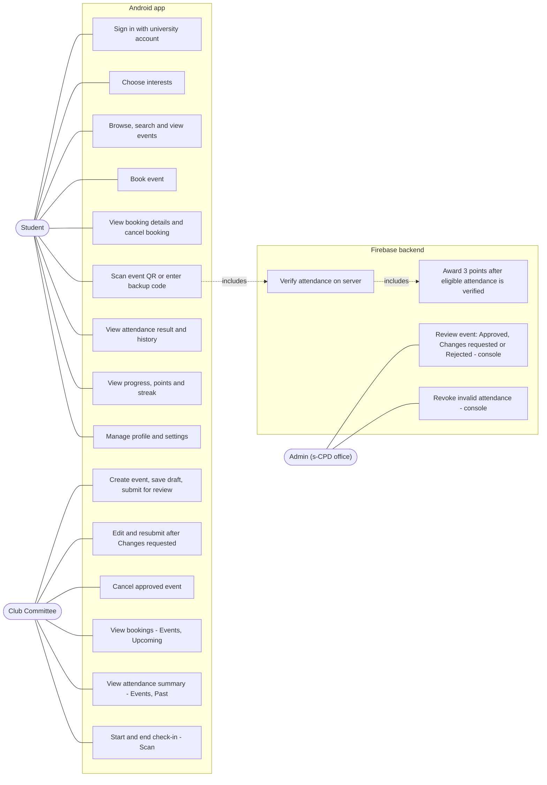
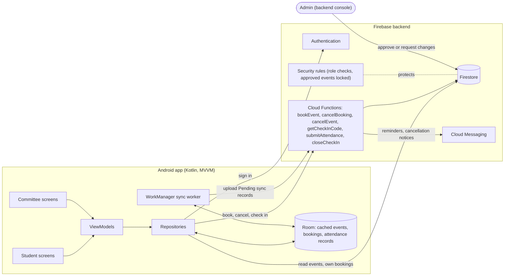
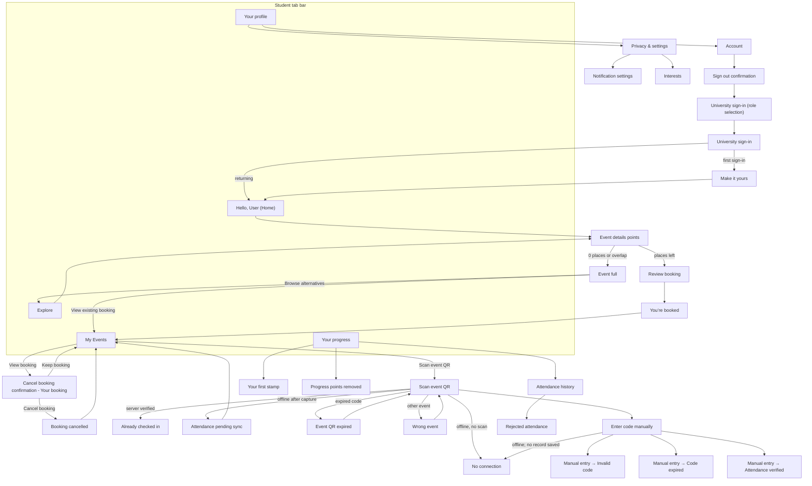
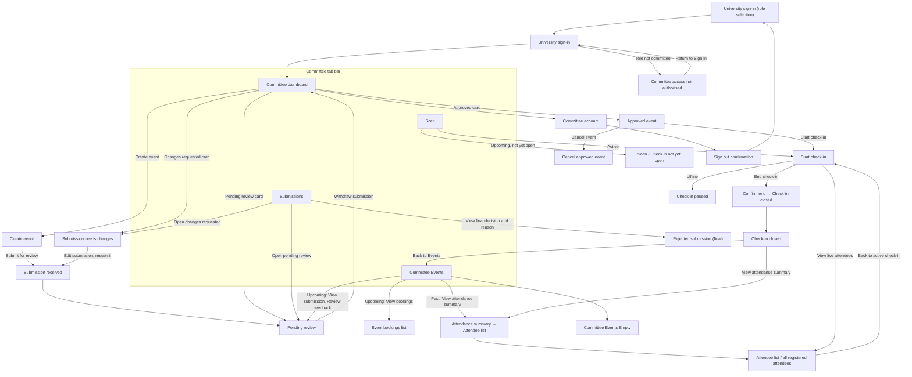
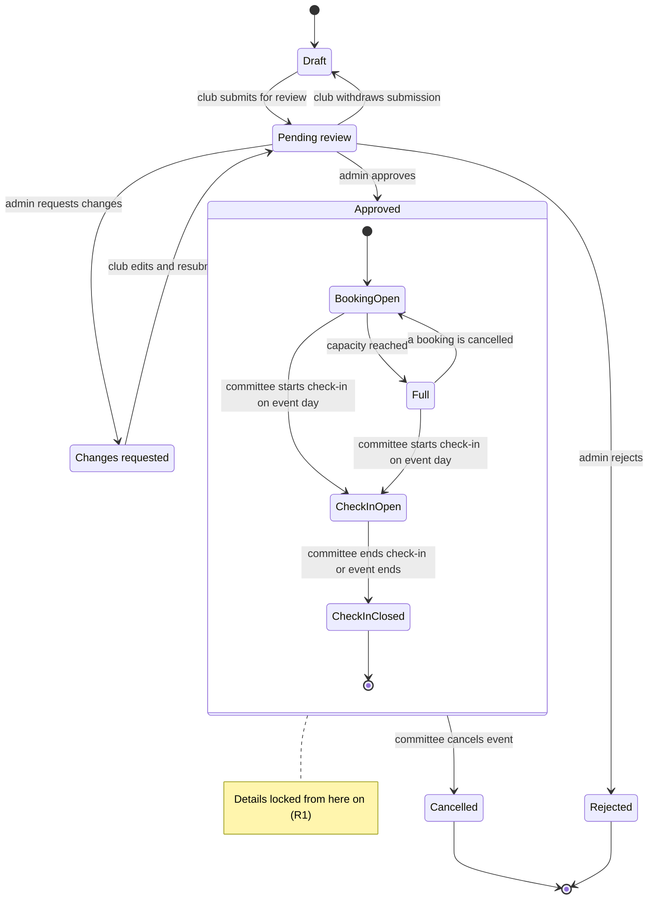
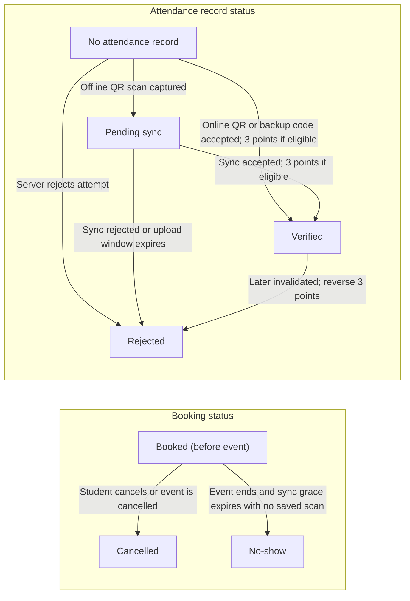
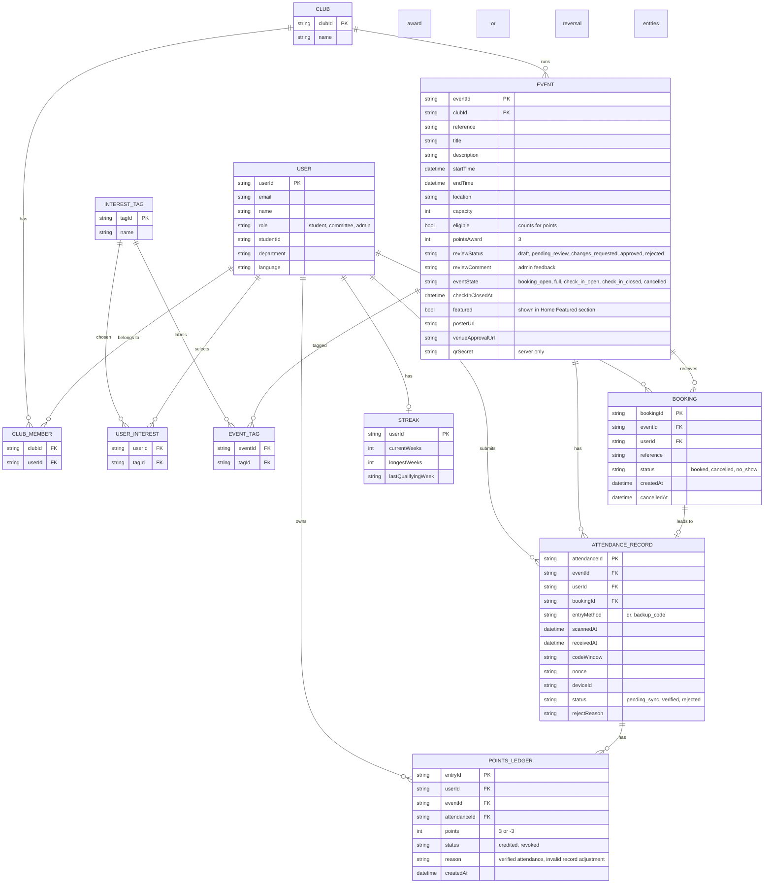
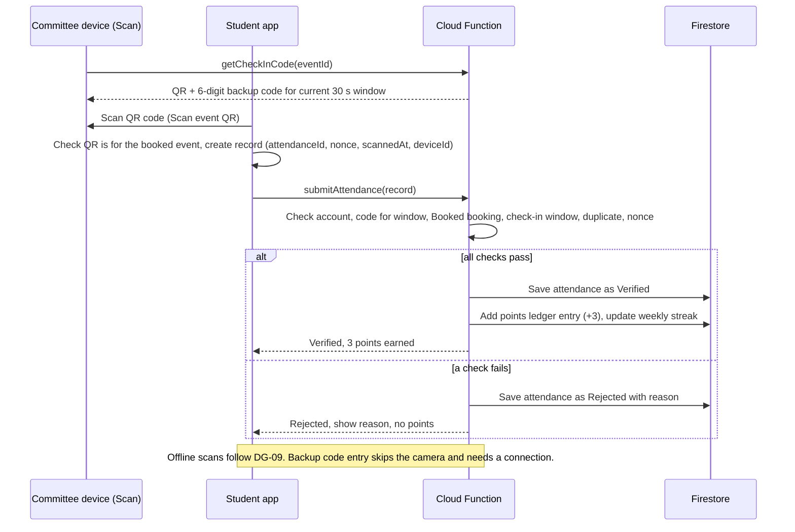
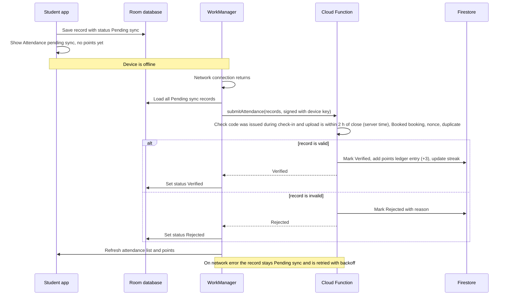

**COMP3040 Mobile Device Programming — CW1 Part 1: Requirements and Analysis**

| Group member | Student ID | Main responsibility |
|---|---|---|
| Moiz Israr Malik | 20705922 | Requirements and user stories: R1–R6 |
| Tham Wing Lok | 20611657 | Technical design and diagrams |
| Wong Cheuk Kei | 20602511 | UI/UX design and wireframes |

## 1. Project overview

s-CPD is a native Android app for University of Nottingham Malaysia students and club committees. Students discover and book events, check in using a rotating QR code, and track verified attendance. Committees submit events and manage bookings and check-in. The s-CPD office reviews submissions through the backend. The app adds personalised recommendations and weekly attendance streaks.

## 2. Requirements analysis

### Functional requirements

| Ref | Area | Expected behaviour |
|:---:|---|---|
| **R1** | Event review | Club Committee submits an event for **Pending review**. Admin can approve it, request changes, or reject it. **Changes requested** submissions can be edited and resubmitted; **Rejected** is final and cannot be booked. **Approved** event details are locked. |
| **R2** | Discovery and booking | Students browse approved events, reserve available places and manage bookings through **My Events**. |
| **R3** | Check-in | Committee displays a rotating QR and backup code. Student check-ins are validated against bookings and event times. |
| **R4** | Offline use | QR scans can be saved as **Pending sync** and verified later. Manual code entry requires internet. |
| **R5** | Points and progress | Eligible **Verified** attendance earns **3 points** once. Points can be reversed if a record is later invalidated. |
| **R6** | Access | Student and Club Committee use the Android app. Admin approvals and corrections are backend-only. |

### Non-functional requirements

| Area | Proposed test target |
|---|---|
| **Security** | All tested cross-role, cross-club and cross-student unauthorised requests are denied by the backend. |
| **Reliability** | Offline scans survive app restarts; resubmitting one scan never creates extra points. |
| **Booking integrity** | Of 20 simultaneous attempts for the final place, at most one booking succeeds. |
| **Responsiveness** | On the required emulator, a scan is saved offline and **Pending sync** appears within 2 seconds. |
| **Usability** | Booking and attendance failures show clear messages; main touch targets are at least 48 dp. |

### User stories and acceptance criteria

**Event review and booking**

| Story | Actor / priority | User story | Acceptance criteria | Screen in Section 5 |
|---|---|---|---|---|
| **US-01 · R1** | Club Committee · Must-have | As a club committee member, I want to create an event and submit it from **Dashboard**, so that the s-CPD office can approve it for points before students see it. | A valid submission becomes **Pending review** and is not shown to students. A field that breaks a rule (title 3–80 characters, description at least 20, capacity 1–500, 1–3 tags, start at least 2 days ahead, end after start) shows its error, and nothing is submitted. **Changes requested** shows the office's comment and allows editing and resubmission. **Approved** details are read-only. **Rejected** is final and can't be booked. | Dashboard / Submission |
| **US-02 · R1** | Admin · Must-have | As the s-CPD office, I want to approve, reject or request changes to event submissions in the backend, so that only events that deserve s-CPD points are published. | **Approved** makes the event visible in Explore and bookable, and locks its details. **Changes requested** returns it to the committee with a reason; they can edit and resubmit. **Rejected** is final; the event can never be booked. The committee sees each decision and its reason in Submissions. | Backend only |
| **US-03 · R1, R2** | Club Committee · Must-have | As a club committee member, I want to cancel an approved event, so that booked students aren't left waiting for an event that won't happen. | Cancelling needs a reason of at least 10 characters. Bookings then close, every booked or waitlisted place changes to **Event cancelled**, and those students see the reason in My Events. The approved details stay locked. | Submission approved |
| **US-04 · R2** | Student · Must-have | As a student, I want suitable events shown first, so that I can find one worth my time without scrolling through every event. | A **suitable** event is approved, not cancelled, still to come, not already booked by me, and doesn't overlap any of my bookings. **Home** ranks suitable events: +3 for each tag matching my interests, +1 for each tag from events I attended (up to +2), +1 if it starts within 7 days and −2 if it is full. Ties go to the earliest start. Each card shows its main reason, for example "Because you like Tech". **Explore** search matches the title, club, venue or tag, with an empty state when nothing matches and an offline banner when there is no connection. | Home / Explore |
| **US-05 · R2** | Student · Must-have | As a student, I want to book an available event, so that I'm guaranteed a place. | Confirming with places left and no clash opens **Booking confirmed**, and places left drop by 1. Two taps on Confirm create one booking. When two students try for the last place, exactly one is booked. If the event overlaps one of my bookings, booking is disabled and the message names the other event and its start time. If the event is full, the button changes to **Join waitlist** (US-23). | Event details / Review booking |
| **US-06 · R2** | Student · Must-have | As a student, I want to check or cancel my booking, so that my place goes to someone else if I can't attend. | **Your booking** shows the date, venue and the scans the event needs. Cancelling more than 2 hours before the start releases my place, or gives it to the first student on the waitlist, and opens **Booking cancelled**. Within 2 hours of the start there is no Cancel button, and the screen says cancellations have closed. Offline, the booking stays and an error is shown. | My Events / Your booking |
| **US-07 · R2, R5** | Club Committee · Must-have | As a club committee member, I want to review participation before, during and after my event, so that I can plan the room and check who attended. | Before the event, **Bookings** lists each booked student's name and ID, and the waitlist count. During check-in, **Attendee list** shows "x of y checked in", updated as each student is verified, with filters for Checked in, Not yet and Flagged. After the event, **Attendance summary** shows each student's final outcome. | Events / Bookings / Attendance summary |
| **US-23 · R2** | Student · Nice-to-have | As a student, I want to join a waitlist when an event is full, so that I still have a chance of going. | A full event offers **Join waitlist** and shows my position, for example "You're #1 on the waitlist". When a booked student cancels, the first student on the waitlist is booked automatically. | Event details / My Events |
| **US-24 · R2** | Admin · Must-have | As the s-CPD office, I want limits on bookings, so that one student can't hold places that others would use. | A student can hold at most 5 active bookings. Cancelling closes 2 hours before the start. After 3 no-shows in a semester, booking is paused, with a message saying why. | Event details |
| **US-25 · R1** | Club Committee · Must-have | As a club committee member, I want a clear way forward when an approved event has to change, so that students only ever see details the office approved. | An approved event opens read-only with "Approved events can't be changed. Cancel and resubmit instead." Any edit attempt leaves the event **Approved** and unchanged. | Submission approved |
| **US-26 · R1** | Club Committee · Must-have | As a club committee member, I want to request s-CPD points and explain why, so that the office can judge whether the event deserves them. | With **Request s-CPD points** on, the reason must be at least 20 characters or the form shows an error. With it off, no reason is needed and the event earns no points. | Create event |

**Check-in and offline attendance**

| Story | Actor / priority | User story | Acceptance criteria | Screen in Section 5 |
|---|---|---|---|---|
| **US-08 · R3** | Club Committee · Must-have | As a club committee member, I want to run check-in from **Scan**, so that students can prove they are in the room. | Starting check-in shows a QR code and a 6-digit backup code, and both change every 30 seconds. If the committee phone goes offline, no new code is shown and the screen says check-in is paused. Opening the checkpoint shows a separate checkpoint code. Ending check-in stops new codes; scans already saved offline are still accepted for 2 hours. | Scan / End check-in |
| **US-09 · R3** | Student · Must-have | As a student, I want to scan the event QR, so that my attendance is recorded in seconds, even in a crowded room. | A booked student who scans the live code and confirms with their fingerprint or screen lock gets **Verified** for that stage. A code more than one 30-second window old, a changed code, a code for another event or for the wrong stage is **Rejected** with the reason. Known limitation: a live code relayed to someone outside, or a shared login, can still pass (Section 3). | Scan |
| **US-10 · R3** | Student · Must-have | As a student, I want to enter a backup code when my camera fails, so that a broken camera doesn't cost me my attendance. | The current 6-digit code entered online gives **Verified** for that stage. A wrong or expired code shows an error. After 5 wrong codes in one session, code entry is disabled for that session. Offline, code entry is disabled with a message, and nothing is saved or queued. | Enter code manually |
| **US-11 · R4** | Student · Must-have | As a student at a venue with no signal, I want my QR scan saved on my phone, so that a bad connection doesn't cost me my attendance. | Scanning offline shows the stage as **Saved on phone** and the result as **Pending sync**. Until the server verifies it, the scan earns 0 points, adds no streak week, and Progress shows "1 check-in waiting to sync". The scan stays on the phone (in Room) if the app is closed or restarted, until the server answers. When the connection returns, it uploads automatically, with no tap needed. | Pending sync |
| **US-12 · R3, R4** | Student · Must-have | As a student, I want a clear result for each uploaded scan, so that I can contact the organiser while it can still be fixed. | Each upload becomes **Verified** or **Rejected** with a reason. The same scan uploaded twice counts once. The server judges time by its own clock only: the code must have been issued during that event's check-in, and the upload must arrive within 2 hours of check-in closing. The time the phone reports is kept for diagnosis only, so changing the phone's clock can't make a late scan count. The check-in screen shows when the phone last synced. | Attendance verification result |
| **US-13 · R3, R4** | Club Committee · Must-have | As a club committee member, I want an accurate attendee list, so that I can tell who really attended. | **Attendee list** and **Attendance summary** separate **Verified**, **Awaiting sync**, **Rejected** and **No-show**. A student whose scan may still be uploading shows as **Awaiting sync**, not as a no-show, until the 2-hour upload window ends. Claims flagged for review, such as one phone used by two accounts, are marked **Flagged**. | Attendee list / Attendance summary |
| **US-27 · R4** | Student · Must-have | As a student, I want a warning before I sign out with scans not yet synced, so that I don't lose attendance by accident. | With 1 or more scans saved on the phone, **Sign out** first shows how many would be lost, with **Stay signed in** as an option. With none saved, sign-out happens straight away. | Profile |

**Points and access**

| Story | Actor / priority | User story | Acceptance criteria | Screen in Section 5 |
|---|---|---|---|---|
| **US-14 · R5** | Student · Must-have | As a student, I want to track my points, so that I know how far I am from the s-CPD requirement. | Each eligible event adds exactly 3 points once, when all its required scans are **Verified**. **Pending sync**, **Incomplete attendance**, **Rejected** and **No-show** add 0. The **Progress** total equals the sum of the points history, and **Attendance history** shows each event's outcome. | Progress / Attendance history |
| **US-15 · R5** | Admin · Must-have | As the s-CPD office, I want to reverse points for attendance later found invalid, so that students can't keep points they shouldn't have. | A reversal adds one −3 entry with the office's reason to the student's points history, and the record shows **Rejected** with that reason. Reversing the same record again adds nothing. The streak and stamps are then worked out again without that event (see Feature 2). | Backend only |
| **US-16 · R6** | Student / Club Committee · Must-have | As a student or committee member, I want to sign in with my university account, so that I only get the features my role allows. | The role comes from the account, not from the role picked on **Welcome to s-CPD**. An account signing in under the wrong role sees an error and nothing opens. A wrong password shows "Email or password not recognised" and clears the password field. While signing in, the button is disabled, so the request can't be sent twice. | Student entry / Committee entry |
| **US-17 · R6** | Student · Must-have | As a student, I want my records kept private, so that other students can't see my bookings, attendance or points. | The backend denies any request for my bookings, attendance or points from an account other than mine or the s-CPD office. **Profile** lets me change my interests and notification settings, and sign out. | Profile / Privacy & settings |
| **US-18 · R6** | Club Committee · Must-have | As a club committee member, I want access limited to my own society, so that one club can't change another club's events. | The dashboard lists only my club's events. The backend denies edits to other clubs' events and any approval request. **Account** shows verified committee access and asks me to confirm before signing out. | Account |
| **US-28 · R5** | Admin · Nice-to-have | As the s-CPD office, I want committee members to earn no points for their own club's events, so that clubs can't award points to themselves. | A member of club A who checks in at club A's event has their attendance recorded, and 0 points are added. | Backend only |

### Role permissions

| Action | Student | Club Committee | Admin (backend only) |
|---|:---:|:---:|:---:|
| Browse events and manage own bookings | Yes | No | No |
| Scan QR and view own points | Yes | No | No |
| Create drafts; edit drafts or Changes requested submissions; cancel approved events | No | Own club | No |
| Run check-in, view club bookings/attendance | No | Own club | No |
| Approve, request changes to, or reject event submissions | No | No | Yes |
| Reverse invalid attendance and points | No | No | Yes |

### Original features

| Feature | Value and scope | Screen in Section 5 |
|---|---|---|
| **1. Personalised recommendations** | Interests in Leadership, Sports, Tech, Volunteering, Arts and Career improve discovery. **Recommended for you** uses saved interests and verified attendance history; similar-student data is optional. | Make it yours / Home / Explore |
| **2. Weekly attendance streak** | **Progress** counts consecutive Monday-to-Sunday weeks (Malaysia time) with at least one verified attendance. Weeks with no approved events, such as exam weeks, are skipped. If the office reverses an attendance, that week stops counting and the streak is worked out again: for example, verified weeks −1, −2 and −3 give a 3-week streak, and reversing week −2 leaves a 1-week streak. Interest stamps are visual rewards, not a third feature. | Progress |

| Story | Actor / priority | User story | Acceptance criteria | Screen in Section 5 |
|---|---|---|---|---|
| **US-19 · Feature 1** | Student · Must-have | As a student, I want to choose and edit my interests, so that recommendations match what I care about from my first sign-in. | A student with no saved interests sees **Make it yours** before Home. Saving interests changes the ranking on Home straight away. They can be changed later in **Interests**. | Make it yours / Interests |
| **US-20 · Feature 1** | Student · Must-have | As a student, I want to know why an event is recommended, so that I can decide quickly whether it suits me. | Each recommended card shows its main reason (scoring in US-04). A new student with no attendance history is ranked by interests and start date only. | Home / Explore |
| **US-21 · Feature 1** | Student · Nice-to-have | As a student, I want suggestions informed by similar students, so that I discover events I wouldn't have searched for. | Ranking may use patterns combined across many students, and never shows any individual's attendance. | Home / Explore |
| **US-22 · Feature 2** | Student · Must-have | As a student, I want to track my weekly streak and stamps, so that I'm encouraged to keep attending through the semester. | Only **Verified** attendance counts towards the streak and stamps. Each verified event gives one stamp per interest tag on it. A late verification or a reversal updates the week it belongs to (Feature 2). | Progress |

**Attendance limitation:** A live QR or backup code can be relayed to somebody outside the venue, and a shared login can't be told apart from the real student. A phone's clock can also be changed, so the server never uses it to decide a result. It accepts a code only within the 30-second window it was issued in. It accepts a saved offline scan only if the code was issued during check-in and the upload reaches the server within 2 hours of check-in closing, both measured by server time. Claims that still look suspicious, such as one phone used by two accounts, are flagged for the s-CPD office to review.

**Attempts to cheat**

| Story | Actor | Attempt | Expected system response |
|---|---|---|---|
| **AS-01 · R3, R4** | Student | Scans a photo of the QR that a friend sent, while offline, and uploads it hours later. | Rejected if it reaches the server more than 2 hours after check-in closed. |
| **AS-02 · R3** | Student | Signs out and in on one phone to check in friends. | A second account on the same phone at the same event is refused, and both accounts are flagged. |
| **AS-03 · R3** | Student | Hands an unlocked phone to a friend at the event. | The phone asks for the fingerprint or screen lock before sending a check-in. |
| **AS-04 · R3** | Club Committee | Posts the live QR in the club group chat. | Every claim is stored with its device, and unusual patterns are flagged for the office. |
| **AS-05 · R2** | Student | Books every event and doesn't turn up. | The limits in US-24 apply. |
| **AS-06 · R1, R5** | Club Committee | Creates events just to give members points. | Nothing is public until the office approves it (US-02), and members get no points for their own club's events (US-28). |
| **AS-07 · R3** | Student | Changes a QR code or calls the backend directly. | A code whose signature doesn't match is rejected. Only the signed-in account is trusted from the phone. |
| **AS-08 · R3** | Student | Guesses backup codes. | After 5 wrong codes in one session, code entry is disabled for that student. |
| **AS-09 · R4** | Student | Sets the phone's clock back so a late offline scan looks on time. | The server uses its own clock and the issue time signed into the code, so the scan is rejected. |

### Revisions after Part 1 feedback

- Every user story now states its benefit ("so that…"), and the story and its acceptance criteria are in separate columns.
- Acceptance criteria describe the system's behaviour with measurable values instead of repeating the story.
- US-04 defines a **suitable** event and how events are ranked.
- US-11 clarifies what a student sees and what counts while a scan is waiting to sync.
- Feature 2 explains, with an example, how a reversal changes the streak.
- The attendance limitation, Section 3 and the attendance security checks explain how a changed phone clock is handled: the server only uses its own time.
- New stories US-23 to US-28 and the attempts-to-cheat table cover waitlists, booking limits, changes after approval, points requests, sign-out with unsynced scans and own-club points.

## 3. Challenges, risks, and assumptions

### Challenges and risks

| Risk / challenge | Response | Remaining limitation |
|---|---|---|
| A student shares a live QR or backup code so someone else can check in. | Rotate both codes every 30 seconds; verify the signed-in account’s booking, check-in window and duplicate status on the server. | A code can still be relayed while it is valid, and shared accounts cannot prove who used the device. |
| Offline scans may be delayed or have altered timestamps. | Save QR scans as **Pending sync** with a unique ID; award no points until server verification. The server ignores the phone's clock: the code must have been issued during check-in, and the upload must arrive within 2 hours of check-in closing, both by server time. Manual code entry requires internet. | A code photographed during check-in and uploaded within the 2-hour window can still pass, so such patterns are flagged for review. |
| Simultaneous bookings could exceed event capacity. | Check capacity and timetable clashes in a server transaction; make retries idempotent. | A connection failure can leave the student unsure whether a booking succeeded, so the app should refresh its status. |
| Incorrect role or club access could expose data. | Check university identity, role and club membership in backend rules and functions. | A compromised university account may still be misused. |

### Assumptions

- Students and committee members have University of Nottingham accounts; the backend maintains their roles and club memberships.
- Event details, capacity and eligibility are confirmed during review. Approved event details are locked.
- A committee device needs internet to start or refresh check-in codes. A student can save a captured QR scan offline; manual code entry needs internet.
- One eligible, server-verified attendance earns 3 points. Streak weeks run Monday to Sunday in Malaysia time.

## 4. Technical design
 
### Architecture
 
The app is a native Kotlin Android app using MVVM with repositories. Screens only display state, ViewModels hold presentation logic, and repositories are the only layer that decides whether data comes from the device or the backend. A Room database stores cached events, bookings and every attendance record scanned on the device, so students can view saved bookings and capture a QR scan while offline. Firebase is the shared backend: Authentication for sign-in, Firestore for shared data, Cloud Functions for trusted operations (booking, cancelling, issuing check-in codes, attendance verification, points) and Cloud Messaging for reminders and cancellation notices. A WorkManager job uploads Pending sync records when a connection returns.
 
The app has two sets of screens: **Student** (Home, Explore, My Events, Progress, Profile) and **Committee** (Dashboard, Events, Scan, Submissions). **Admin is not an app user.** The s-CPD office reviews events in the backend console, so no Admin Android screen is required. Admin appears in the diagrams only as an actor or as a backend review step.
 
**Roles and authentication.** The University sign-in (role selection) screen offers Student or Club Committee. Choosing one only selects the sign-in screen and grants nothing. After university sign-in, the backend reads the role stored on the account (set by the backend, never by the app). Security rules and Cloud Functions check it on every request, so a student cannot call committee operations, and the UI shows only the screens for the verified role. If the role does not match, the Committee access not authorised screen offers Continue as Student or Return to Sign in.
 
**DG-01 Use-case overview (R1–R6)**
 

 
**DG-02 Architecture diagram (R4, R6)**
 

 
### Screen flows
 
Screen names below are the Figma frame names.
 
**DG-03 Student screen flow (R2–R6)**
 

 
**DG-04 Committee screen flow (R1, R3, R6)**
 

 
### Status terms
 
| Area | Terms | Notes |
|---|---|---|
| Event review | Draft, Pending review, Approved, Changes requested, Rejected | Draft is not a review status. Admin reviews submissions in the backend: **Approved** locks event details; **Changes requested** allows edits and resubmission; **Rejected** is final and cannot be booked. |
| Booking / participation | Booked, Cancelled, No-show | **Booked** applies before the event. **Cancelled** releases the place. Mark **No-show** only after the event and the sync grace period, when no attendance scan was saved. A **Pending sync** scan is not a no-show. |
| Attendance record | Pending sync, Verified, Rejected | **Pending sync** is a captured offline QR scan waiting for the server. The server decides whether it becomes **Verified** or **Rejected**. Rejected attendance is separate from a rejected event. |
| Points | +3 per eligible Verified attendance; 0 otherwise | Award points once, only after server verification. Bookings, **Pending sync**, **Rejected** and **No-show** earn no points. If verified attendance is later invalidated, reverse the 3 points and recalculate progress. |
 
### Data model
 
**DG-05 Event lifecycle (R1)**
 
A club creates an event as a Draft and submits it for Pending review. Admin can approve it, request changes, or reject it. The Committee can edit and resubmit events marked Changes requested; Rejected events are final and cannot be booked. Approved event details are locked by backend rules. After approval, the Committee can cancel the event, which closes bookings and notifies booked students.
 

 
**DG-06 Booking and attendance lifecycle (R2–R5)**
 

A booking remains **Booked** while its attendance record is **Pending sync**. It becomes **No-show** only after the event and sync grace period if no scan was saved.

**DG-07 Entity-relationship diagram (R1–R5)**
 
All entities use stable IDs (`userId`, `clubId`, `eventId`, `bookingId`, `attendanceId`). `attendanceId` is a UUID created on the device, so a retried upload cannot create a duplicate. The event's QR secret is a server-only field. Each eligible Verified attendance earns 3 points once, after server verification. Points are stored as a ledger (one row per award or reversal) so they can be revoked with an audit trail, and the weekly streak counts Monday-to-Sunday weeks containing at least one Verified attendance. The STREAK record stores a summary derived from verified attendance; recalculate it from the attendance and points records after a verification or reversal. Recommended for you is ranked from saved interests (USER_INTEREST, EVENT_TAG) and Verified attendance history, and any similar-student signal would use aggregated counts only. Interest stamps and the points milestone on the Your progress screen are calculated from the ledger and event tags, so they are not stored. Booking capacity and schedule-clash checks run in one Cloud Function transaction, so two students cannot take the last place or hold overlapping bookings.
 

 
### Attendance security
 
Check-in is started from Committee Scan. The committee device asks the server for the current code, which is `HMAC(eventSecret, eventId + 30-second window)` shown as a rotating QR code with a 6-digit backup code derived from the same value. The event secret never leaves the server, so neither the committee device nor the student device can validate a code itself. Code refresh pauses while the committee device is offline (Check-in paused). The student scans the QR with the app (or types the backup code while online), and the app saves a record (code, scan time, nonce, device ID). The app can reject a QR for a different event locally (Wrong event), but only the server decides whether a record is Verified. The server checks that:
 
1. the record belongs to the signed-in student,
2. the code was issued by the server during this check-in session: within one 30-second window of the server's receive time for an online scan, or before check-in closed for a saved offline scan,
3. the event is Approved and eligible, and the student has a Booked booking for it,
4. a saved offline scan reaches the server within 2 hours of check-in closing, measured by the server's clock (the scan time the phone reports is stored for diagnosis only and never decides the result),
5. no attendance exists for this student and event, and the nonce is unused.
Failed records are Rejected with a reason the student can see (for example, scanned after the QR expired). Only after all checks pass does the server award the 3 points and update the weekly streak. Students scan the committee's code, and there is no personal code to share. For emulator testing, the scan screen also accepts the 6-digit backup code typed in by hand, which goes through the same server checks and needs a connection.
 
| Cheating attempt | Defence | Remaining weakness |
|---|---|---|
| Checking in for a friend | Record tied to the signed-in account and its Booked booking, one per student per event, and the server flags a device used by several accounts | A friend who shares their login |
| Checking in from home | Code exists only on the committee screen and expires after 30 seconds | Live relay or a photo sent within seconds |
| Checking in after the event | Server accepts only codes issued during check-in, and offline uploads within 2 hours of it closing, judged by server time | A code photographed during check-in and uploaded inside the 2-hour window |
| Faked offline record | Server checks the code against when it issued it, ignores the phone's clock, and flags odd gaps and lone scans | Photographing a real code and uploading it within the window can pass. Flagged records can be revoked |
| Replay or duplicate | Idempotent `attendanceId`, unique student-event key, nonce | None significant |
| Rooted device | Records signed with a Keystore key bound to the account's device | Root can bypass this, accepted risk |
| Dishonest committee member | Admin can audit counts and revoke | Detected, not prevented |
 
**DG-08 Attendance verification sequence (R3, R5)**
 

 
### Offline sync
 
Without a connection a QR scan still works. The record is saved in Room as Pending sync and shown in the attendance list, with no points or streak credit yet. If no QR was captured while offline, no attendance record is saved or queued; show the **No connection** state. Manual code entry must be retried when online. WorkManager uploads Pending sync records when the network returns and sets each one to Verified or Rejected from the server's answer. Failed uploads stay Pending sync and retry with backoff, which is safe because uploads are idempotent. Points and streak credit come only from the server after verification. If a Verified record is later found invalid, it becomes Rejected, the ledger gets a reversing entry, totals and streak are recalculated, and the student sees it on Progress points removed.
 
**DG-09 Offline sync sequence (R4, R5)**
 

 
## 5. UI design and wireframes

These wireframes show the main Student and Club Committee journeys and their key states. Admin event review is handled in the backend, so Admin mobile screens are not included.

**Header behaviour:** The main dashboard and landing screens use an expanded header with the campus background, blue overlay and university branding. As the user scrolls, it collapses into a compact dark-blue app bar. Secondary screens use the compact header. These are states of one header design, not separate designs.

### Student entry and interests — R6

Student - entry and interests

Users choose Student or Club Committee before signing in. University sign-in verifies their actual permissions. Students can select interests to personalise event suggestions.

### Event discovery — R2, Feature 1

Student - explore events

Students browse featured and recommended events, search and filter the listings, and see helpful empty-result or offline states.

### Event details and booking — R2

Student - booking flow

**Navigation note:** Students can reach an event from either Home or Explore. On Home, they open a Featured or Recommended event; recommendation cards show why the event matches them. In Explore, they open an event from search results or filtered listings. Both routes lead to the same event details and booking flow. The repeated event screens show different entry points and recommendation context, not separate versions of the event.

Event details show availability and relevant information. The flow covers full events, timetable clashes, booking review and confirmation.

### My Events and cancellations — R2

Student - My Events

Students view upcoming and past bookings, open booking details, and cancel a booking. The confirmation and cancelled states show the outcome.

### Attendance and check-in — R3, R4

Student - attendance and check-in

Students scan the Committee’s rotating QR or enter its current backup code. Invalid and expired codes show an error. Offline scans show Pending sync; manual code entry requires an online server check. Attendance is Verified only after server confirmation.

### Points and progress — R5, Feature 2

Student - progress and attendance history

Students view verified points, attendance history, interest stamps and their weekly streak. Pending records do not earn points or streak credit; invalid attendance can have its points removed.

### Profile and settings — R6

Student - profile and account settings

Students view their profile, manage interests and notification preferences, adjust privacy settings and sign out.

### Committee entry and access — R6

Committee - entry and sign-in

Committee members choose their role and sign in with their university account. Selecting a role does not grant access; the app checks permissions after sign-in. The screens also show sign-in and unauthorised-access errors.

### Committee dashboard — R1, R3, R6

Committee - dashboard

The dashboard summarises event and submission statuses, links to event creation and check-in, and shows the next public event. The Account button provides access to the committee profile.

### Event submissions — R1

Committee event submissions

Committee members create drafts and submit events for review. In **Submissions**, they can see **Pending review**, **Changes requested**, or a final **Rejected** decision and its reason. They can edit and resubmit events marked **Changes requested**. Approved details are locked, but the event can be cancelled.

### Committee Events — R1, R2, R3

Committee - Events

The Upcoming tab shows events and links to their booking lists. The Past tab links to attendance summaries. An empty state lets the committee create an event.

### Check-in — R3, R4, R5

Committee - check-in

The committee displays a rotating event QR and its short-lived backup code. Check-in can be paused when offline; a stale code cannot be used. Ending check-in closes the session, while saved scans still need server verification.

### Bookings and attendance — R2, R3, R4, R5

Committee - bookings and attendance

**Navigation note:** Committee Events manages scheduled events: before an event starts, Upcoming opens its bookings; after it ends, Past opens its attendance summary. During an event, Scan is used to display the rotating QR and backup code and open the live attendee list. Ending check-in leads to the attendance summary.

The booking list and attendance summary show **Verified**, **Pending sync**, **Rejected** and **No-show** records. Only server-verified attendance earns 3 points; closing check-in does not verify pending scans.

### Committee account — R6

Committee - account and sign-out

Committee members can view their verified club access and sign out with a confirmation step.

