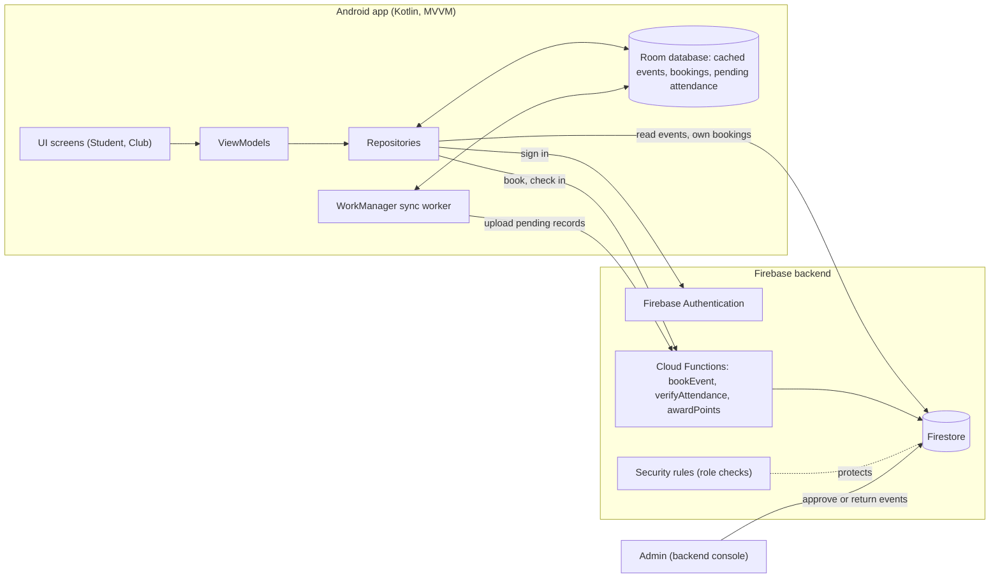
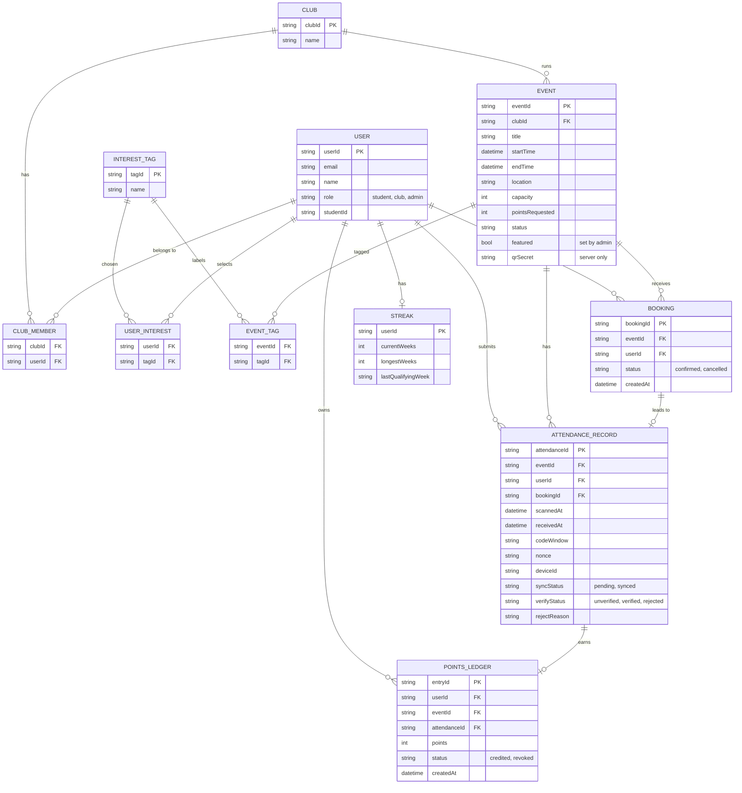
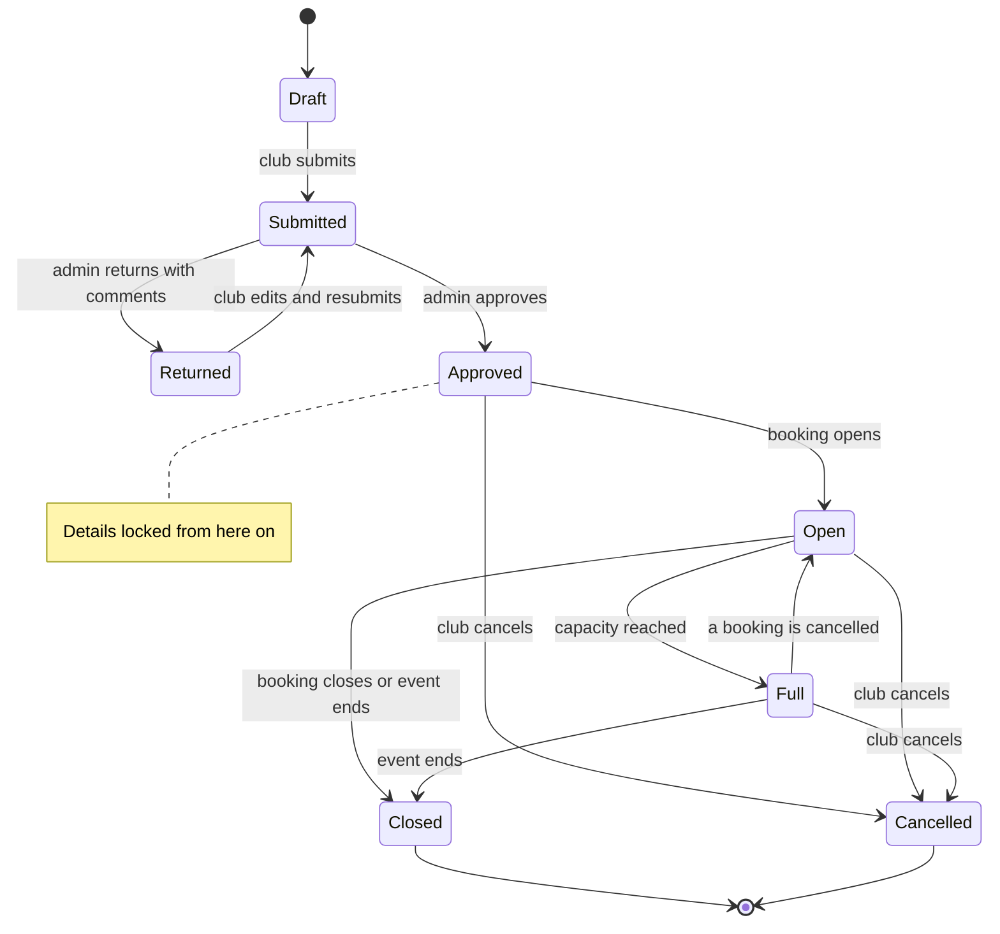
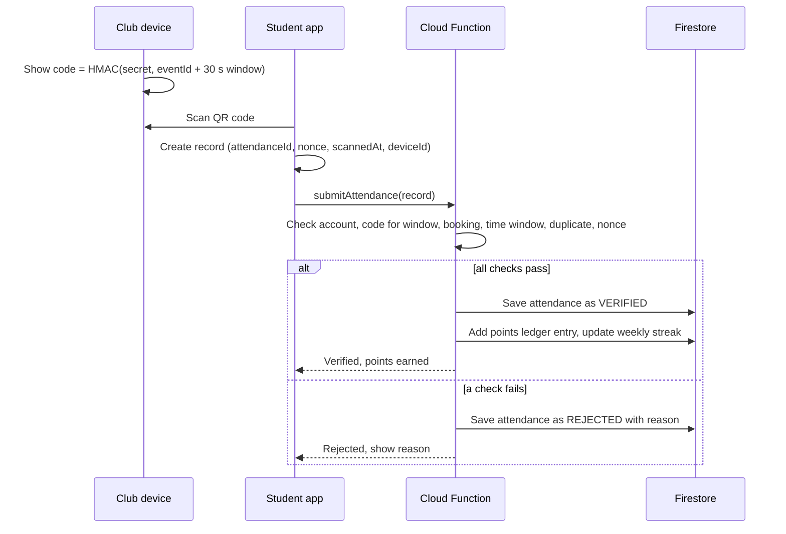
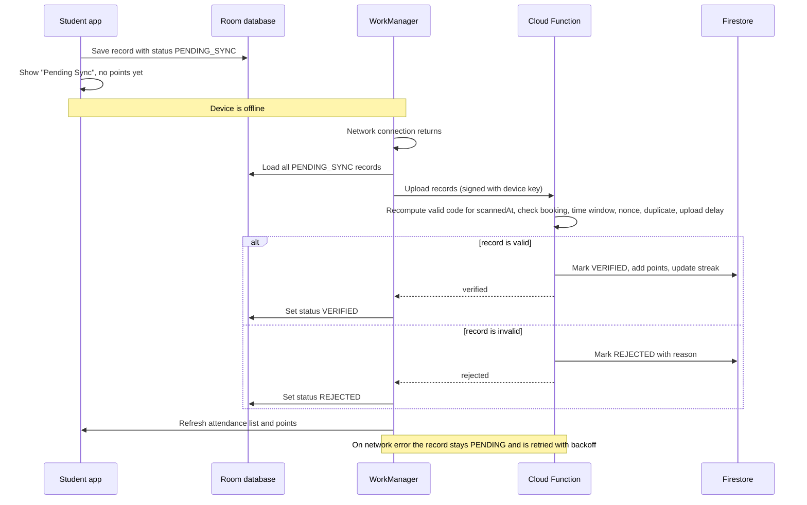

**COMP3040 Mobile Device Programming — CW1 Part 1: Requirements and Analysis**

| Group member | Student ID | Main responsibility |
|---|---|---|
| Moiz Israr Malik | 20705922 | Requirements and user stories: R1–R6 |
| [Name] | xxxxxxxx | Technical design and diagrams |
| Wong Cheuk Kei | 20602511 | UI/UX design and wireframes |

> **Target:** approximately 1,500 words, excluding UI components and diagrams.

## 1. Project overview

Campus events can be difficult for students to discover, while clubs need a clear way to manage event submissions, bookings and attendance. The proposed s-CPD app is a native Android app for University of Nottingham Malaysia students and club committees. Students can find events through search and personalised recommendations, book places, check in with an event’s rotating QR code or short-lived backup code, and track verified attendance. Club committees can submit events, manage bookings and run check-in. The s-CPD office reviews submissions through the backend; approved event details are locked. QR scans made offline remain pending until the server verifies them. Only eligible verified attendance earns 3 points and contributes to the weekly streak. The two added features are personalised recommendations and attendance streaks.

### Actors

- **Student:** [Main actions]
- **Club representative:** [Main actions]
- **Admin / s-CPD office:** [Main actions and whether handled in the backend]

## 2. Requirements analysis

### Functional requirements

| Ref | Area | Expected behaviour |
|:---:|---|---|
| **R1** | Event review | Club Committee submits events; Admin approves them or requests changes. **Approved** details are locked. |
| **R2** | Discovery and booking | Students browse approved events, reserve available places and manage bookings through **My Events**. |
| **R3** | Check-in | Committee displays a rotating QR and backup code. Student check-ins are validated against bookings and event times. |
| **R4** | Offline use | QR scans can be saved as **Pending sync** and verified later. Manual code entry requires internet. |
| **R5** | Points and progress | **Verified** attendance earns **3 points**. Invalid awards can be reversed. |
| **R6** | Access | Student and Club Committee use the Android app. Admin approvals and corrections are backend-only. |

### Non-functional requirements

| Area | Proposed test target |
|---|---|
| **Security** | All tested cross-role, cross-club and cross-student unauthorised requests are denied by the backend. |
| **Reliability** | Offline scans survive app restarts; resubmitting one scan never creates extra points. |
| **Booking integrity** | Of 20 simultaneous attempts for the final place, at most one booking succeeds. |
| **Responsiveness** | On the required emulator, a scan is saved offline and **Pending sync** appears within 2 seconds. |
| **Usability** | Booking and attendance failures show clear messages; main touch targets are at least 48 dp. |

### User stories and acceptance criteria

**Event review and booking**

| Story | Actor / priority | User need and acceptance criteria | Screen in Section 5 |
|---|---|---|---|
| **US-01 · R1** | Club Committee · Must-have | I want to create and submit events from **Dashboard**. Required details are checked; submitting produces **Pending review**. **Changes requested** shows feedback and allows editing and resubmission; **Approved** details cannot be edited. | Dashboard / Submission |
| **US-02 · R1** | Admin · Must-have | I want to approve, reject or request changes to event submissions. Only authorised admins can make these decisions in the backend. Only **Approved** events can be booked. | Backend only |
| **US-03 · R1, R2** | Club Committee · Must-have | I want to cancel an approved event. Cancellation closes bookings and informs booked students without unlocking approved details. | Submission approved |
| **US-04 · R2** | Student · Must-have | I want to find suitable activities. **Home** and **Explore** show approved events, search, filters, recommendations and useful empty/offline states. | Home / Explore |
| **US-05 · R2** | Student · Must-have | I want to book an available event. **Event details** explains full capacity and clashes; **Review booking** rechecks them on the server. Concurrent requests cannot overbook, and only success opens **Booking confirmed**. | Event details / Review booking |
| **US-06 · R2** | Student · Must-have | I want to check or cancel my booking. **My Events** opens **Your booking**; cancelling releases the place and opens **Booking cancelled**. **Booked** applies only before the event. | My Events / Your booking |
| **US-07 · R2, R5** | Club Committee · Must-have | I want to review participation. **Events > Upcoming > Bookings** shows reservations; **Events > Past > Attendance summary** shows attendance outcomes. | Events / Attendance summary |

**Check-in and offline attendance**

| Story | Actor / priority | User need and acceptance criteria | Screen in Section 5 |
|---|---|---|---|
| **US-08 · R3** | Club Committee · Must-have | I want to manage check-in using **Scan**. The QR and six-digit backup code refresh every 30 seconds during an active session. Lost connectivity pauses new code display; ending check-in closes the session, not pending claims. | Scan / End check-in |
| **US-09 · R3** | Student · Must-have | I want to scan the displayed event QR. The server checks my account, booking, event window and duplicate attendance; altered, replayed or expired online codes are rejected. | Scan |
| **US-10 · R3** | Student · Must-have | I want a fallback when the camera fails. **Enter code manually** checks the current backup code online; an incorrect or expired code is rejected. | Enter code manually |
| **US-11 · R4** | Student · Must-have | I want to keep an offline scan. It survives app restarts as **Pending sync**, without awarding points or a streak. | Pending sync |
| **US-12 · R3, R4** | Student · Must-have | I want a reliable verification result. Upload retries after reconnection; valid records become **Verified**, while invalid or duplicate claims become **Rejected** with a reason. Suspicious offline timestamps are flagged for review. | Attendance verification result |
| **US-13 · R3, R4** | Club Committee · Must-have | I want an accurate attendee list. **Attendee list** and **Attendance summary** distinguish **Verified**, **Pending sync**, **Rejected** and **No-show**. A pending scan is not treated as a no-show. | Attendee list / Attendance summary |

**Points and access**

| Story | Actor / priority | User need and acceptance criteria | Screen in Section 5 |
|---|---|---|---|
| **US-14 · R5** | Student · Must-have | I want to track my points. **Progress** and **Attendance history** award **3 points** once per **Verified** event. **Pending sync**, **Rejected** and **No-show** earn zero. | Progress / Attendance history |
| **US-15 · R5** | Admin · Must-have | I want to correct incorrect attendance. An authorised backend reversal removes 3 points, records the correction and updates the streak and stamps. | Backend only |
| **US-16 · R6** | Student / Club Committee · Must-have | I want to sign in securely. **Welcome to s-CPD** offers the two app roles; **Sign in to s-CPD** checks university credentials and actual permissions. Invalid sign-in or unauthorised committee access displays an error. | Student entry / Committee entry |
| **US-17 · R6** | Student · Must-have | I want my records kept private. Backend checks prevent access to another student's bookings, points and attendance; **Profile** supports interests, notifications and sign-out. | Profile / Privacy & settings |
| **US-18 · R6** | Club Committee · Must-have | I want access limited to my own society. Backend checks prevent editing other clubs' events or approving submissions. **Account** shows verified access and confirms sign-out. | Account |

### Role permissions

| Action | Student | Club Committee | Admin (backend only) |
|---|:---:|:---:|:---:|
| Browse events and manage own bookings | Yes | No | No |
| Scan QR and view own points | Yes | No | No |
| Create, revise or cancel club events | No | Own club | No |
| Run check-in, view club bookings/attendance | No | Own club | No |
| Approve events or request changes | No | No | Yes |
| Reverse invalid attendance and points | No | No | Yes |

### Original features

| Feature | Value and scope | Screen in Section 5 |
|---|---|---|
| **1. Personalised recommendations** | Interests in Leadership, Sports, Tech, Volunteering, Arts and Career improve discovery. **Recommended for you** uses saved interests and verified attendance history; similar-student data is optional. | Make it yours / Home / Explore |
| **2. Weekly attendance streak** | **Progress** counts consecutive Monday-to-Sunday weeks with verified attendance. Corrections recalculate the streak. Interest stamps are visual rewards, not a third feature. | Progress |

| Story | Actor / priority | User need and acceptance criteria | Screen in Section 5 |
|---|---|---|---|
| **US-19 · Feature 1** | Student · Must-have | I want to choose and edit interests. **Make it yours** saves selected categories; **Interests** changes them later and updates recommendations. | Make it yours / Interests |
| **US-20 · Feature 1** | Student · Must-have | I want relevant recommendations. **Home** explains why suggested approved events match my interests; new students receive interest-based results. | Home / Explore |
| **US-21 · Feature 1** | Student · Nice-to-have | I want suggestions informed by similar students. Aggregated patterns may improve ranking without exposing individual attendance histories. | Home / Explore |
| **US-22 · Feature 2** | Student · Must-have | I want to track my weekly streak and stamps. Only **Verified** attendance counts. Late verification or reversal updates the relevant week and visual rewards. | Progress |

**Attendance limitation:** A live QR or backup code can be relayed to somebody outside the venue. Offline phone timestamps can be changed, so an offline scan alone cannot prove physical presence or scan time. Such claims remain **Pending sync** until server validation, with suspicious claims flagged for review.

## 3. Challenges, risks, and assumptions

### Challenges and risks

| Risk / challenge | Response | Remaining limitation |
|---|---|---|
| [Example: checking in for a friend] | [Defence] | [Weakness] |
| [Example: poor connection at an event] | [Offline handling] | [Limitation] |
| [Example: incorrect role access] | [Permission checks] | [Limitation] |

### Assumptions

- [Assumption about accounts, roles, or Club membership]
- [Assumption about devices, connectivity, or event information]

## 4. Technical design

### Architecture

The app is a native Kotlin Android app using MVVM with repositories. Screens only display state, ViewModels hold presentation logic, and repositories are the only layer that decides whether data comes from the device or the backend. A Room database stores cached events, bookings and every attendance record scanned on the device, so students can keep working offline. Firebase is the shared backend: Authentication for sign-in, Firestore for shared data, and Cloud Functions for trusted operations (booking, attendance verification, points). A WorkManager job uploads pending records when a connection returns.

**Roles and authentication.** Choosing Student, Club or Admin on launch only selects the sign-in screen and grants nothing. After university sign-in, the backend reads the role stored on the account (set by the backend, never by the app). Security rules and Cloud Functions check it on every request, so a student cannot call club operations, and the UI shows only the screens for the verified role. Admin approval is done in the backend console.

### Data model

All entities use stable IDs (`userId`, `clubId`, `eventId`, `bookingId`, `attendanceId`). `attendanceId` is a UUID created on the device, so a retried upload cannot create a duplicate. The event's QR secret is a server-only field. Points are stored as a ledger (one row per award or reversal) so they can be revoked with an audit trail, and the weekly streak counts calendar weeks containing at least one verified attendance. Booking capacity and clash checks run in one Cloud Function transaction, so two students cannot take the last place or hold overlapping bookings.

### Event approval workflow

A club creates an event as a Draft and submits it. The admin approves it or returns it with comments, and a returned event is editable and can be resubmitted. Once Approved, details are locked because security rules reject edits to an approved event, so a club cannot change an event after approval (R1). Approved events open for booking, then become Full, Closed or Cancelled. Cancelling is the club's only action after approval.

### Attendance security

The club's device shows a rotating QR code: `HMAC(eventSecret, eventId + 30-second window)`. The club device can generate it offline because it receives the secret when the committee member starts the attendance session. The student scans it and the app saves a record (code, scan time, nonce, device ID). The student device never holds the secret, so it never validates the code itself. The server checks that:

1. the record belongs to the signed-in student,
2. the code is valid for the claimed scan time (one window either side),
3. the student has a confirmed booking,
4. the scan is inside the check-in window (15 minutes before the start to 15 minutes after the end),
5. no attendance exists for this student and event, and the nonce is unused.

Failed records are Rejected with a reason the student can see. Students scan the club's code, and the profile ID card has no barcode, so there is no personal code to share. For emulator testing, the scan screen also accepts the short code typed in by hand, which goes through the same checks.

| Cheating attempt | Defence | Remaining weakness |
|---|---|---|
| Checking in for a friend | Record tied to the signed-in account and its booking, one per student per event, and the server flags a device used by several accounts | A friend who shares their login |
| Checking in from home | Code exists only on the club screen and expires after 30 seconds | Live relay or a photo sent within seconds |
| Checking in after the event | Server checks scan time against the event window and caps upload delay | Changed device clock while offline |
| Faked offline record | Server recomputes the code for the claimed time, the app stores a monotonic clock, and the server flags odd gaps and lone scans | Photographing a real code, setting the clock back and scanning later can pass the code check. Flagged records can be revoked |
| Replay or duplicate | Idempotent `attendanceId`, unique student-event key, nonce | None significant |
| Rooted device | Records signed with a Keystore key bound to the account's device | Root can bypass this, accepted risk |
| Dishonest committee member | Admin can audit counts and revoke | Detected, not prevented |

### Offline sync

Without a connection the scan still works. The record is saved in Room as Pending Sync and shown in the attendance list, with no points or streak credit yet. WorkManager uploads pending records when the network returns and sets each one to Verified or Rejected from the server's answer. Failed uploads stay Pending and retry with backoff, which is safe because uploads are idempotent. Points and streak credit come only from the server after verification. If a verified record is later invalidated, the ledger gets a reversing entry, totals and streak are recalculated, and the student sees it marked as revoked.

[If Admin review is handled in the backend, explain that no Admin Android screen is required.]

## 5. UI design and wireframes

These wireframes show the main Student and Club Committee journeys and their key states. Admin event review is handled in the backend, so Admin mobile screens are not included.

**Header behaviour:** The main dashboard and landing screens use an expanded header with the campus background, blue overlay and university branding. As the user scrolls, it collapses into a compact dark-blue app bar. Secondary screens use the compact header. These are states of one header design, not separate designs.

### Student entry and interests — R6

Student - entry and interests

Users choose Student or Club Committee before signing in. University sign-in verifies their actual permissions. Students can select interests to personalise event suggestions.

### Event discovery — R2, Feature 1

Student - explore events

Students browse featured and recommended events, search and filter the listings, and see helpful empty-result or offline states.

### Event details and booking — R2

Student - booking flow

**Navigation note:** Students can reach an event from either Home or Explore. On Home, they open a Featured or Recommended event; recommendation cards show why the event matches them. In Explore, they open an event from search results or filtered listings. Both routes lead to the same event details and booking flow. The repeated event screens show different entry points and recommendation context, not separate versions of the event.

Event details show availability and relevant information. The flow covers full events, timetable clashes, booking review and confirmation.

### My Events and cancellations — R2

Student - My Events

Students view upcoming and past bookings, open booking details, and cancel a booking. The confirmation and cancelled states show the outcome.

### Attendance and check-in — R3, R4

Student - attendance and check-in

Students scan the Committee’s rotating QR or enter its current backup code. Invalid and expired codes show an error. Offline scans show Pending sync; manual code entry requires an online server check. Attendance is Verified only after server confirmation.

### Points and progress — R5, Feature 2

Student - progress and attendance history

Students view verified points, attendance history, interest stamps and their weekly streak. Pending records do not earn points or streak credit; invalid attendance can have its points removed.

### Profile and settings — R6

Student - profile and account settings

Students view their profile, manage interests and notification preferences, adjust privacy settings and sign out.

### Committee entry and access — R6

Committee - entry and sign-in

Committee members choose their role and sign in with their university account. Selecting a role does not grant access; the app checks permissions after sign-in. The screens also show sign-in and unauthorised-access errors.

### Committee dashboard — R1, R3, R6

Committee - dashboard

The dashboard summarises event and submission statuses, links to event creation and check-in, and shows the next public event. The Account button provides access to the committee profile.

### Event submissions — R1

Committee event submissions

Committee members create drafts and submit events for review. They can view **Pending review** and **Changes requested** states, edit and resubmit returned events, and view approved details as locked. Approved events can be cancelled.

### Committee Events — R1, R2, R3

Committee - Events

The Upcoming tab shows events and links to their booking lists. The Past tab links to attendance summaries. An empty state lets the committee create an event.

### Check-in — R3, R4, R5

Committee - check-in

The committee displays a rotating event QR and its short-lived backup code. Check-in can be paused when offline; a stale code cannot be used. Ending check-in closes the session, while saved scans still need server verification.

### Bookings and attendance — R2, R3, R4, R5

Committee - bookings and attendance

**Navigation note:** Committee Events manages scheduled events: before an event starts, Upcoming opens its bookings; after it ends, Past opens its attendance summary. During an event, Scan is used to display the rotating QR and backup code and open the live attendee list. Ending check-in leads to the attendance summary.

The booking list and attendance summary show **Verified**, **Pending sync**, **Rejected** and **No-show** records. Only server-verified attendance earns 3 points; closing check-in does not verify pending scans.

### Committee account — R6

Committee - account and sign-out

Committee members can view their verified club access and sign out, with a confirmation step.

