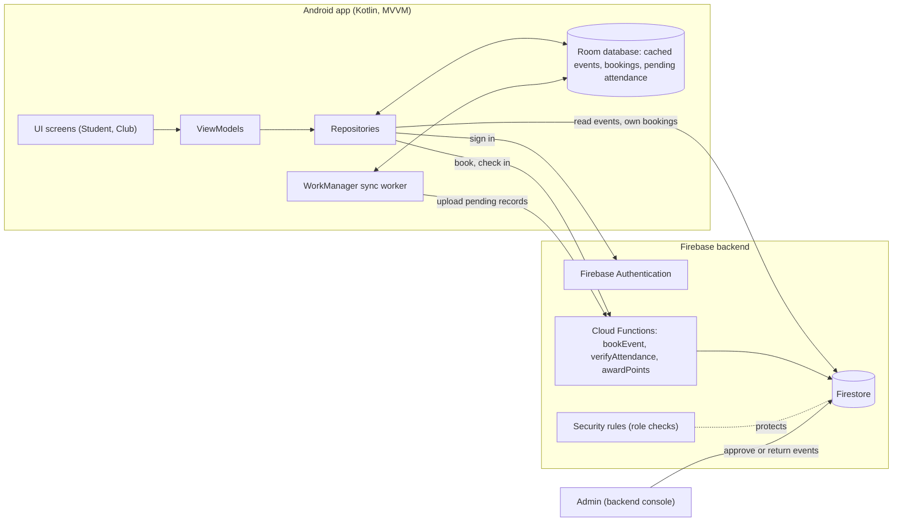
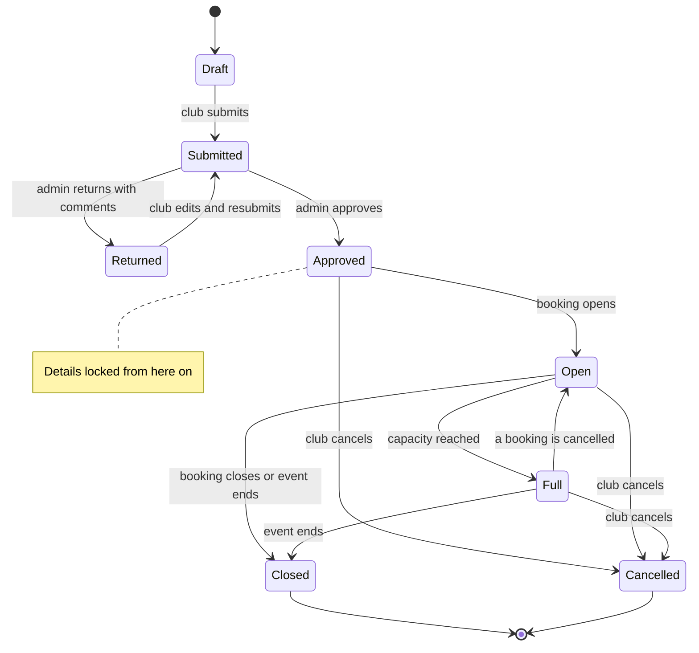
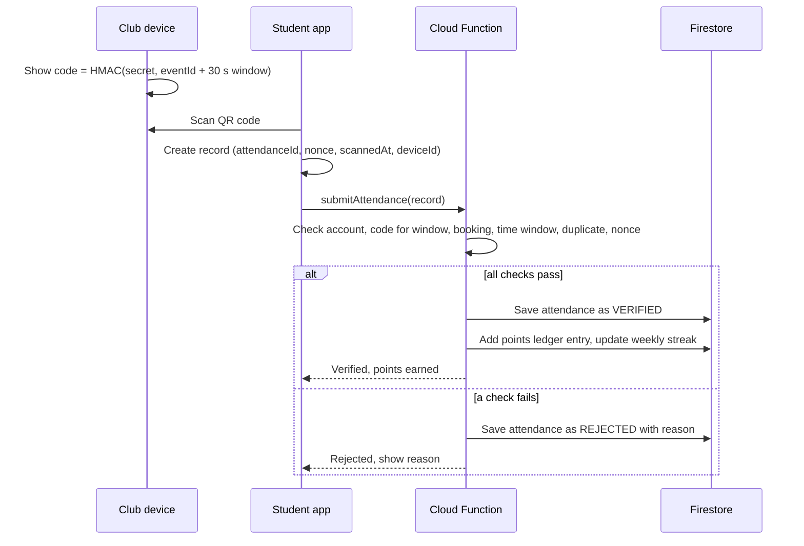
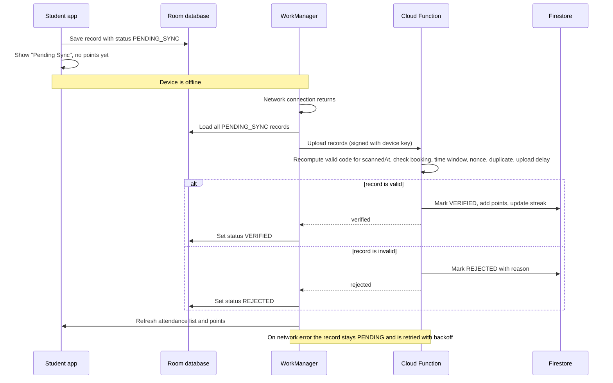

**COMP3040 Mobile Device Programming — CW1 Part 1: Requirements and Analysis**

| Group member | Main responsibility |
|---|---|
| [Name] | Requirements and user stories: R1–R6 |
| [Name] | Technical design and diagrams |
| [Name] | UI/UX design and wireframes |

> **Target:** approximately 1,500 words, excluding UI components and diagrams.

## 1. Project overview

[Describe the problem, the app’s purpose, and its scope.]

### Actors

- **Student:** [Main actions]
- **Club representative:** [Main actions]
- **Admin / s-CPD office:** [Main actions and whether handled in the backend]

## 2. Requirements analysis

### Functional requirements

| ID | Requirement | CW requirement |
|---|---|---|
| FR-01 | [System behaviour] | R1 |
| FR-02 | [System behaviour] | R2 |
| FR-03 | [System behaviour] | R3 |
| FR-04 | [System behaviour] | R4 |
| FR-05 | [System behaviour] | R5 |
| FR-06 | [System behaviour] | R6 |

### Non-functional requirements

| ID | Quality | Requirement / target |
|---|---|---|
| NFR-01 | Security | [How roles and permissions are protected] |
| NFR-02 | Usability | [How the app stays clear and easy to use] |
| NFR-03 | Reliability | [How errors or offline use are handled] |
| NFR-04 | Performance | [Measurable target, if agreed] |

### User stories and acceptance criteria

[Include Student, Club, and Admin stories covering R1–R6. Mark each Must-have or Nice-to-have, and include exceptional and cheating cases.]

| ID | Actor | Priority / type | User story | Acceptance criteria |
|---|---|---|---|---|
| S-R1-01 | [Actor] | [Must / normal] | [As a…, I want…, so that…] | Given…, when…, then… |
| S-R2-01 | [Actor] | [Must / exceptional] | [Story] | Given…, when…, then… |
| S-R3-01 | [Actor] | [Must / cheating] | [Story] | Given…, when…, then… |
| S-R4-01 | [Actor] | [Must / exceptional] | [Story] | Given…, when…, then… |
| S-R5-01 | [Actor] | [Must / normal] | [Story] | Given…, when…, then… |
| S-R6-01 | [Actor] | [Must / normal] | [Story] | Given…, when…, then… |

### Proposed feature: Interest Passport

**Feature:** [Explain interest tags, event recommendations, and progress stamps.]

**Value:** [How it helps students find relevant events or encourages participation.]

**Scope:** [What is included in this version; note any future extensions.]

## 3. Challenges, risks, and assumptions

### Challenges and risks

| Risk / challenge | Response | Remaining limitation |
|---|---|---|
| [Example: checking in for a friend] | [Defence] | [Weakness] |
| [Example: poor connection at an event] | [Offline handling] | [Limitation] |
| [Example: incorrect role access] | [Permission checks] | [Limitation] |

### Assumptions

- [Assumption about accounts, roles, or Club membership]
- [Assumption about devices, connectivity, or event information]

## 4. Technical design

### Architecture

The app is a native Kotlin Android app using MVVM with repositories. Screens only display state, ViewModels hold presentation logic, and repositories are the only layer that decides whether data comes from the device or the backend. A Room database stores cached events, bookings and every attendance record scanned on the device, so students can keep working offline. Firebase is the shared backend: Authentication for sign-in, Firestore for shared data, and Cloud Functions for trusted operations (booking, attendance verification, points). A WorkManager job uploads pending records when a connection returns.

**Roles and authentication.** Choosing Student, Club or Admin on launch only selects the sign-in screen and grants nothing. After university sign-in, the backend reads the role stored on the account (set by the backend, never by the app). Security rules and Cloud Functions check it on every request, so a student cannot call club operations, and the UI shows only the screens for the verified role. Admin approval is done in the backend console.

### Data model

All entities use stable IDs (`userId`, `clubId`, `eventId`, `bookingId`, `attendanceId`). `attendanceId` is a UUID created on the device, so a retried upload cannot create a duplicate. The event's QR secret is a server-only field. Points are stored as a ledger (one row per award or reversal) so they can be revoked with an audit trail, and the weekly streak counts calendar weeks containing at least one verified attendance. Booking capacity and clash checks run in one Cloud Function transaction, so two students cannot take the last place or hold overlapping bookings.

### Event approval workflow

A club creates an event as a Draft and submits it. The admin approves it or returns it with comments, and a returned event is editable and can be resubmitted. Once Approved, details are locked because security rules reject edits to an approved event, so a club cannot change an event after approval (R1). Approved events open for booking, then become Full, Closed or Cancelled. Cancelling is the club's only action after approval.

### Attendance security

The club's device shows a rotating QR code: `HMAC(eventSecret, eventId + 30-second window)`. The club device can generate it offline because it receives the secret when the committee member starts the attendance session. The student scans it and the app saves a record (code, scan time, nonce, device ID). The student device never holds the secret, so it never validates the code itself. The server checks that:

1. the record belongs to the signed-in student,
2. the code is valid for the claimed scan time (one window either side),
3. the student has a confirmed booking,
4. the scan is inside the check-in window (15 minutes before the start to 15 minutes after the end),
5. no attendance exists for this student and event, and the nonce is unused.

Failed records are Rejected with a reason the student can see. Students scan the club's code, and the profile ID card has no barcode, so there is no personal code to share. For emulator testing, the scan screen also accepts the short code typed in by hand, which goes through the same checks.

| Cheating attempt | Defence | Remaining weakness |
|---|---|---|
| Checking in for a friend | Record tied to the signed-in account and its booking, one per student per event, and the server flags a device used by several accounts | A friend who shares their login |
| Checking in from home | Code exists only on the club screen and expires after 30 seconds | Live relay or a photo sent within seconds |
| Checking in after the event | Server checks scan time against the event window and caps upload delay | Changed device clock while offline |
| Faked offline record | Server recomputes the code for the claimed time, the app stores a monotonic clock, and the server flags odd gaps and lone scans | Photographing a real code, setting the clock back and scanning later can pass the code check. Flagged records can be revoked |
| Replay or duplicate | Idempotent `attendanceId`, unique student-event key, nonce | None significant |
| Rooted device | Records signed with a Keystore key bound to the account's device | Root can bypass this, accepted risk |
| Dishonest committee member | Admin can audit counts and revoke | Detected, not prevented |

### Offline sync

Without a connection the scan still works. The record is saved in Room as Pending Sync and shown in the attendance list, with no points or streak credit yet. WorkManager uploads pending records when the network returns and sets each one to Verified or Rejected from the server's answer. Failed uploads stay Pending and retry with backoff, which is safe because uploads are idempotent. Points and streak credit come only from the server after verification. If a verified record is later invalidated, the ledger gets a reversing entry, totals and streak are recalculated, and the student sees it marked as revoked.

[If Admin review is handled in the backend, explain that no Admin Android screen is required.]

## 6. References

- [Coursework description sheet]
- [Other sources, assets, or tools used]
