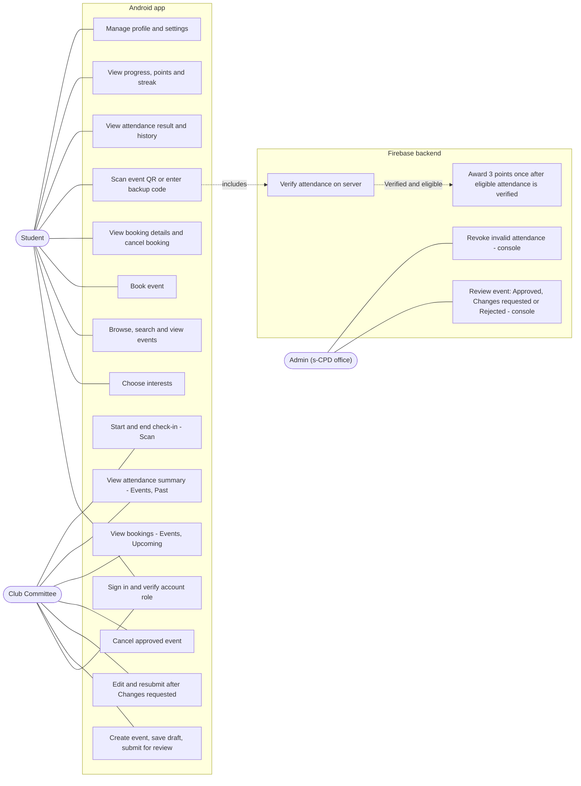
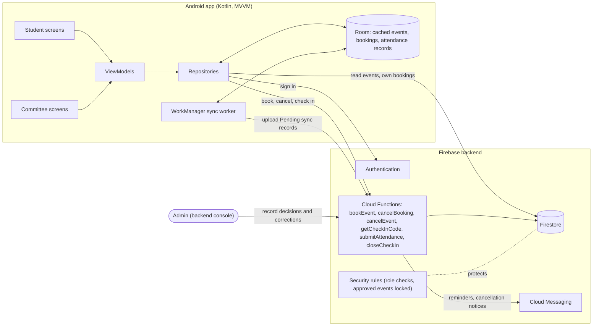

[s-CPD overview](../README.md) › **4. Technical design** › Architecture

## 4. Technical design

*Part 1 of 4: Architecture. The other parts are [screen flows](4-2-screen-flows.md), [status terms and data model](4-3-status-and-data-model.md), and [attendance security and offline sync](4-4-attendance-security-and-sync.md).*

### Architecture

The Kotlin Android app uses MVVM. ViewModels expose screen state, and repositories read from Room or the Firebase backend. Room caches events and bookings and stores queued QR scans. Firebase Authentication handles sign-in, Firestore stores shared data, Cloud Functions handle bookings and attendance, and Cloud Messaging sends reminders and cancellation notices. WorkManager uploads queued scans when the device reconnects.

Students use Home, Explore, My Events, Progress and Profile. Committees use Dashboard, Events, Scan and Submissions. The s-CPD office reviews submissions and corrects attendance in the backend console, so Admin has no Android screens.

**Roles and authentication.** The role picker only chooses which sign-in screen opens; it grants nothing. After sign-in, the backend checks the account, its assigned role and its club membership on every request. The prototype uses pre-approved test accounts, and a production build would use university single sign-on, subject to access. The profile badge reads **University account verified** after university sign-in and **Account verified** for prototype accounts.

**DG-01 Use-case overview (R1–R6)**

**DG-02 Architecture diagram (R4, R6)**

---

[← Previous: 3. Challenges, risks, and assumptions](3-challenges-risks-assumptions.md) · [Next: Screen flows →](4-2-screen-flows.md)
