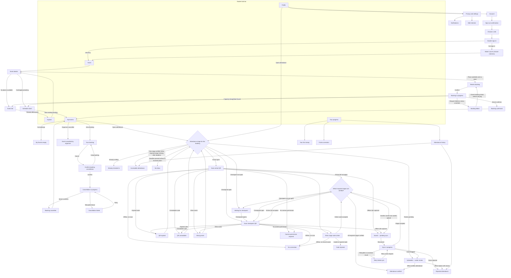
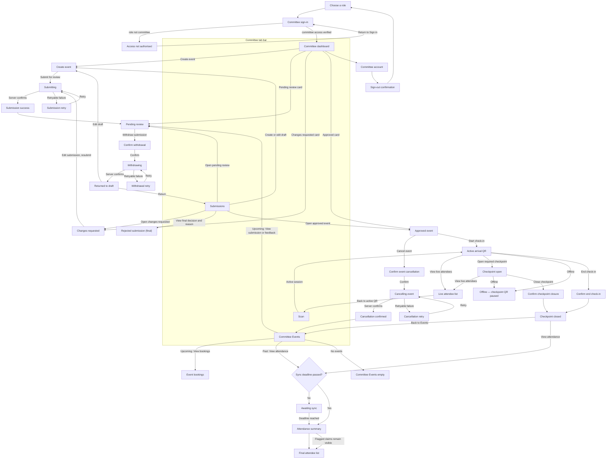

[s-CPD overview](../README.md) › **4. Technical design** › Screen flows

## 4. Technical design

*Part 2 of 4: Screen flows. The other parts are [architecture](4-1-architecture.md), [status terms and data model](4-3-status-and-data-model.md), and [attendance security and offline sync](4-4-attendance-security-and-sync.md).*

### Screen flows

The flows use the screen names from the Figma file, shown on the [Student](5-1-student-wireframes.md) and [Committee](5-2-committee-wireframes.md) wireframe pages. Each event's attendance requirement decides whether students need an arrival scan only, or an arrival scan and a later checkpoint. **Review booking** explains the requirement before the student confirms.

**DG-03 Student screen flow (R2–R6)**

**DG-04 Committee screen flow (R1, R3, R6)**

---

[← Previous: Architecture](4-1-architecture.md) · [Next: Status terms and data model →](4-3-status-and-data-model.md)
