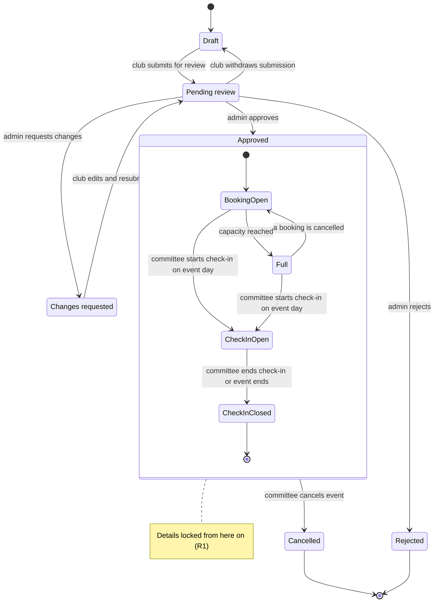
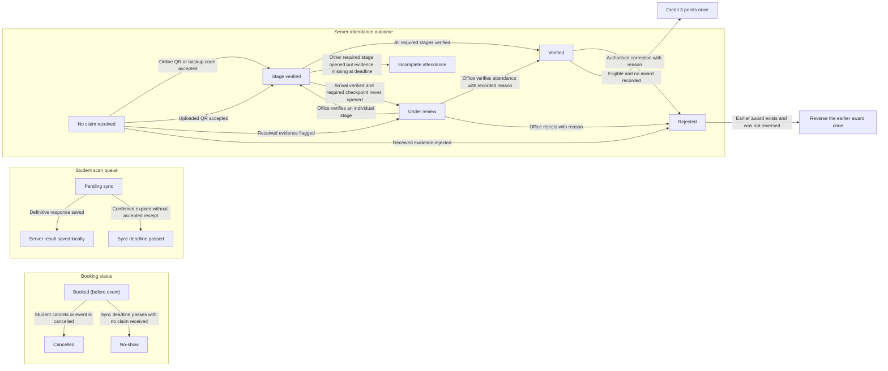
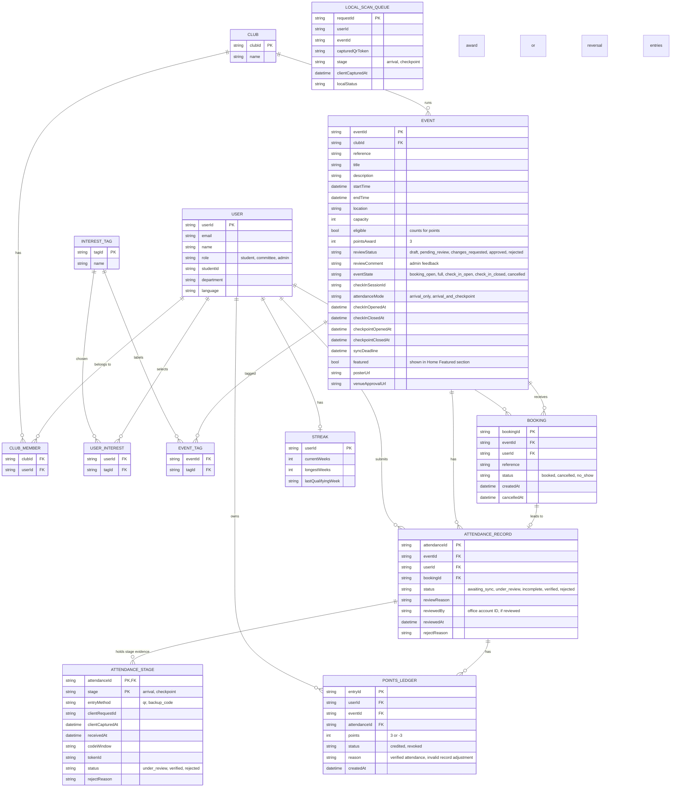

[s-CPD overview](../README.md) › **4. Technical design** › Status terms and data model

## 4. Technical design

*Part 3 of 4: Status terms and data model. The other parts are [architecture](4-1-architecture.md), [screen flows](4-2-screen-flows.md), and [attendance security and offline sync](4-4-attendance-security-and-sync.md).*

### Status terms

| Area | Terms | Notes |
|---|---|---|
| Event review | Draft, Pending review, Approved, Changes requested, Rejected | Draft is not a review status. Admin reviews submissions in the backend: **Approved** locks the event details, **Changes requested** allows edits and resubmission, and **Rejected** is final and cannot be booked. |
| Booking / participation | Booked, Cancelled, No-show | **Booked** reserves a place and **Cancelled** releases it. **No-show** is assigned after the sync deadline when the server has received no attendance claim. A claim still under review stays unresolved. |
| Student scan queue | Pending sync, Sync deadline passed | **Pending sync** is a scan saved on the student's device. A queued item can expire without a server rejection. An uncertain upload is reconciled by request ID. |
| Attendance record | Awaiting sync, Under review, Incomplete attendance, Verified, Rejected | **Awaiting sync** means the server may still receive missing claims. **Under review** stays unresolved until an authorised office decision. After the deadline, one verified stage with the other required stage missing is **Incomplete attendance**. If the organiser never opened a required checkpoint, a verified arrival goes to office review. **Verified** needs every stage or an authorised office decision. **Rejected** always includes a reason. |
| Points | +3 per eligible Verified attendance, 0 otherwise | Points are awarded once, after attendance is verified. If an authorised correction invalidates a credited record, the award is reversed once and progress is recalculated. |

### Data model

**DG-05 Event lifecycle (R1)**

A club creates an event as a Draft and submits it for Pending review. Admin approves it, requests changes or rejects it. The Committee can edit and resubmit an event marked Changes requested. Withdrawing a pending submission returns the same event to Draft, where it stays unpublished and can be edited and resubmitted. Rejected events are final and cannot be booked. Backend rules lock approved event details. After approval, the Committee can cancel the event, which closes bookings and notifies booked students.

**DG-06 Booking and attendance lifecycle (R2–R5)**

Before the sync deadline, a booking without a received claim stays unresolved. **Pending sync** and **Sync deadline passed** describe the device queue and do not change the server outcome. While a claim is under review, an office decision takes priority over automatic finalisation. The attendance result and any points ledger entry are saved together, so a retry cannot add a second award.

**DG-07 Entity-relationship diagram (R1–R5)**

Each queued scan has a client request ID for retries. The server keeps one attendance outcome per student and event, linked to the booking, and one evidence record per required stage. A ledger records every points award or reversal. Streaks use verified attendance by event week. Interest stamps and milestones come from attendance, event tags and points. Recommendations use saved interests and verified attendance history. Capacity and schedule clashes are checked in the same transaction as the booking.

`LOCAL_SCAN_QUEUE` lives in Room on the device. The backend holds the QR authentication key. The token and verification rules are on the [attendance security and offline sync](4-4-attendance-security-and-sync.md) page.

---

[← Previous: Screen flows](4-2-screen-flows.md) · [Next: Attendance security and offline sync →](4-4-attendance-security-and-sync.md)
