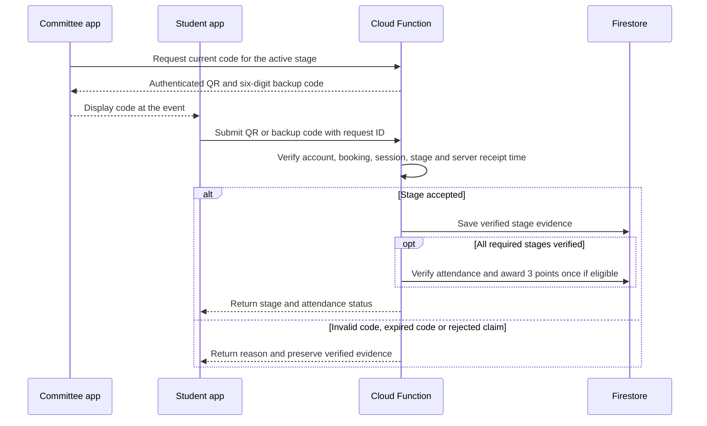
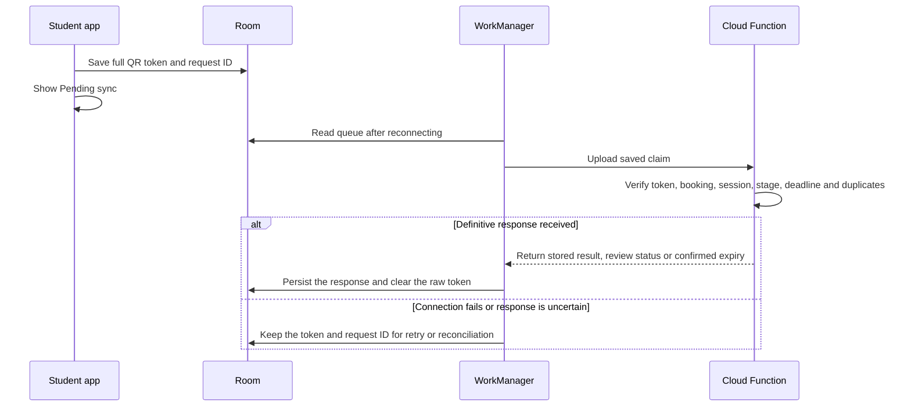

[s-CPD overview](../README.md) › **4. Technical design** › Attendance security and offline sync

## 4. Technical design

*Part 4 of 4: Attendance security and offline sync. The other parts are [architecture](4-1-architecture.md), [screen flows](4-2-screen-flows.md), and [status terms and data model](4-3-status-and-data-model.md).*

### Attendance security

Committee **Scan** asks the backend for a QR and a six-digit backup code. Both rotate every 30 seconds while the committee device is online. The QR carries the event ID, check-in session ID, attendance stage, token ID, issue time and expiry, protected by a server-generated authentication tag. Only the backend holds the key that creates the tag.

For events that need a checkpoint, students scan on arrival and again during a window that the organiser opens and announces in the final third of the event. **Review booking** explains both scans before the student confirms. The backend issues separate codes for arrival and checkpoint. The wireframes show a five-minute checkpoint as an example; the team still needs to agree which events qualify and how long the window lasts.

The server checks the account, its booking, the approved event, the expected stage and the active code window, and uses its own receipt time for online submissions. Manual entry needs internet, applies to the active stage only, and is rate-limited per account and session. The backend stores one evidence record per required stage and one attendance outcome per student and event.

A student can retry with a fresh, valid code while the stage is open. A failed attempt does not touch evidence that is already verified. Retrying the same request returns its recorded result, and a separate duplicate attempt cannot overwrite a verified result. Once every stage passes, or the office verifies attendance through an authorised decision, the server awards 3 points and updates the streak for an eligible event. The outcome and the award are recorded together to prevent a second award.

| Attempt | Defence | Remaining weakness |
|---|---|---|
| Proxy check-in | Tie the claim to the signed-in account and its booking. | Sharing a login or handing over an unlocked phone can still work. |
| Check-in from home | Rotate codes and validate the event, session and stage. A checkpoint adds evidence from a second moment. | Someone at the event can relay a live code at either stage. |
| Late or altered offline scan | Check the token tag, issue window and upload deadline. | A copied genuine token could still be used in an offline claim. |
| Duplicate claim | Deduplicate by request ID, keep one evidence record per stage, and cap the award at one per student and event. | Someone with access to the account can still try to submit the first claim. |

**DG-08 Attendance verification sequence (R3, R5)**

### Offline sync

With a cached booking, the student app can capture the arrival or checkpoint QR offline. Room saves the full token, the account and event IDs, the stage, a request ID and, optionally, the device capture time. The student sees **Pending sync**, and WorkManager submits the record when the device reconnects. The server checks the token tag, the stage's code window and the upload deadline against its own receipt time. The device capture time is for diagnosis only, and the office can review flagged claims before attendance is finalised. The token proves when the server issued the code; it cannot stop a relayed live code or a shared unlocked phone.

A configurable sync grace period runs after check-in closes; the wireframes use 24 hours as an example. While uploads are still accepted, the Committee sees the stages received so far and **Awaiting sync** for anything outstanding. At the deadline:

- One verified stage with the other required stage missing becomes **Incomplete attendance**.
- No claim received at all becomes **No-show**.
- A received claim that is **Under review** stays unresolved until the office decides.
- If the organiser never opened a required checkpoint, verified arrivals go to office review. The office records its decision and reason before attendance is verified or rejected.

The app saves a definitive server response on the device before it clears the raw token. After a timeout or a lost acknowledgement, it retries or queries with the same request ID. If the server confirms that the deadline passed without accepting the claim, the queue item becomes **Sync deadline passed**: the expired token is cleared and the request ID is kept for reconciliation. Any decision the server already recorded is preserved. A late or rejected upload shows its reason and the organiser's contact. An authorised correction reverses an existing award once and recalculates progress and streaks.

**DG-09 Offline sync sequence (R4, R5)**

The Student and Committee views of this flow are in [Student wireframes: Attendance and check-in](5-1-student-wireframes.md#attendance-and-check-in--r3-r4) and [Committee wireframes: Check-in](5-2-committee-wireframes.md#check-in--r3-r4-r5).

---

[← Previous: Status terms and data model](4-3-status-and-data-model.md) · [Next: 5. Student wireframes →](5-1-student-wireframes.md)
