[s-CPD overview](../README.md) › **5. UI design and wireframes** › Student

## 5. UI design and wireframes

*Part 1 of 2: Student journeys. The [Committee journeys](5-2-committee-wireframes.md) are on the next page. Every image links to its frame in the [Figma file](https://www.figma.com/design/Um4ZLQMFP2mEoEEnYOL8oM/Mobile-Device-Programming?node-id=0-1).*

Main tabs open with an expanded campus header that collapses into a compact dark-blue bar when the student scrolls. Secondary screens use the compact bar. The screens use sample accounts and static states, and canvas annotations are left out of the exports. Open a section's drop-down to see its other states.

### Student entry and interests — R6

Students choose Student or Club Committee before signing in. The prototype uses approved test accounts; production sign-in depends on access to university single sign-on. Password recovery and network errors keep the student signed out. New students then pick interests for their recommendations.

[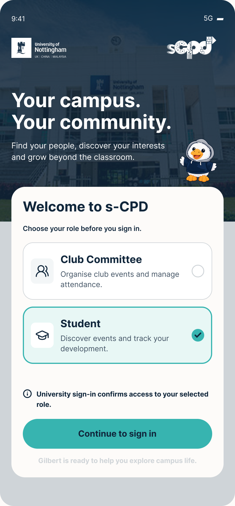](images/student/role-selection.png)

**Choose a role** · [Figma frame](https://www.figma.com/design/Um4ZLQMFP2mEoEEnYOL8oM/Mobile-Device-Programming?node-id=269-5)

Sign-in, recovery and interests

| Screen | Screen |
|---|---|
| **Student sign-in** [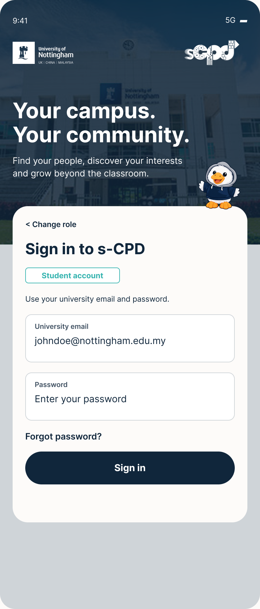](images/student/sign-in.png) [Figma frame](https://www.figma.com/design/Um4ZLQMFP2mEoEEnYOL8oM/Mobile-Device-Programming?node-id=269-97) | **Sign-in error** [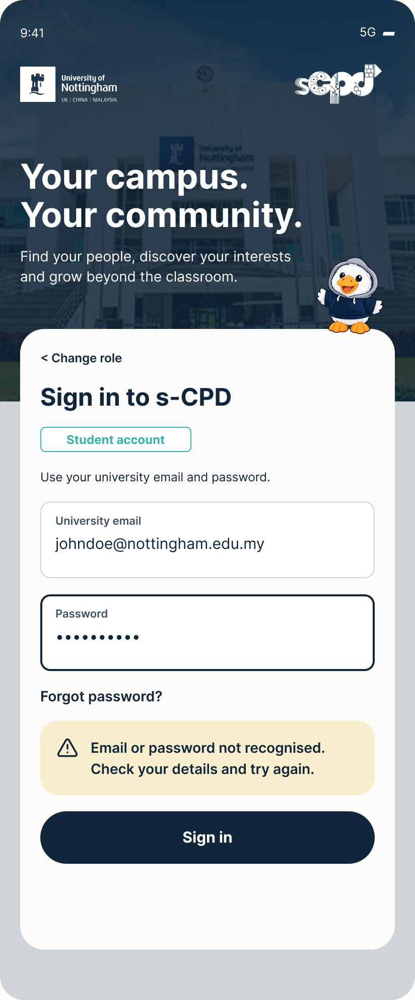](images/student/sign-in-error.png) [Figma frame](https://www.figma.com/design/Um4ZLQMFP2mEoEEnYOL8oM/Mobile-Device-Programming?node-id=269-173) |
| **Password recovery** [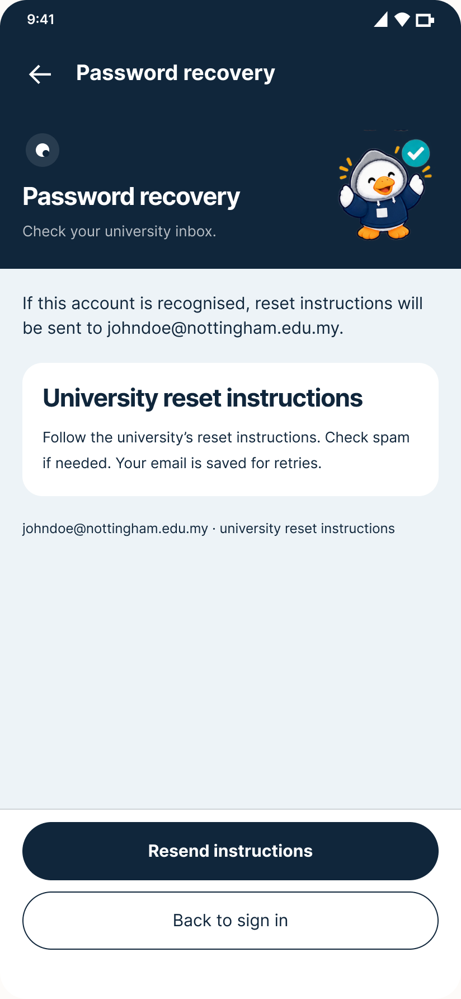](images/student/password-recovery.png) [Figma frame](https://www.figma.com/design/Um4ZLQMFP2mEoEEnYOL8oM/Mobile-Device-Programming?node-id=269-6550) | **Sign-in network error** [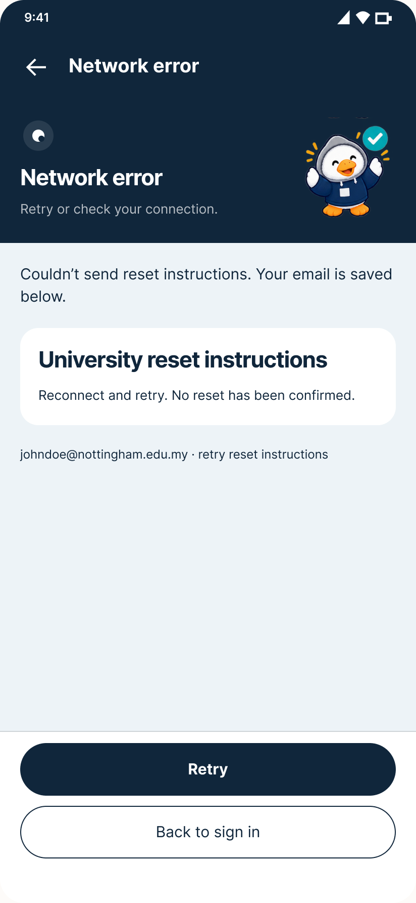](images/student/network-recovery.png) [Figma frame](https://www.figma.com/design/Um4ZLQMFP2mEoEEnYOL8oM/Mobile-Device-Programming?node-id=269-6608) |
| **Choose interests** [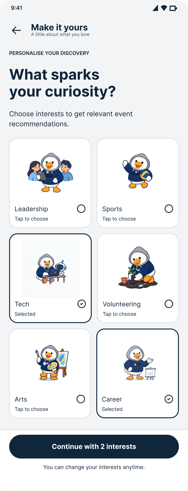](images/student/interests.png) [Figma frame](https://www.figma.com/design/Um4ZLQMFP2mEoEEnYOL8oM/Mobile-Device-Programming?node-id=269-254) |    |

### Event discovery — R2, Feature 1

Home and Explore show featured and recommended events, search and filters. Each recommendation says why it matches. Empty and offline states tell the student what to do next.

| Home | Explore |
|---|---|
| [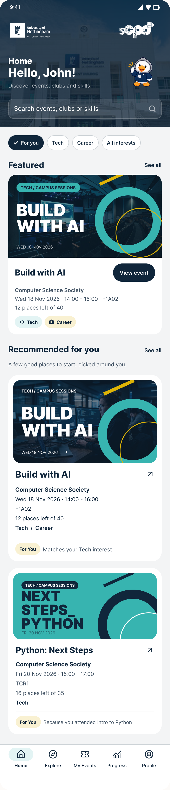](images/student/home.png) [Figma frame](https://www.figma.com/design/Um4ZLQMFP2mEoEEnYOL8oM/Mobile-Device-Programming?node-id=269-1044) | [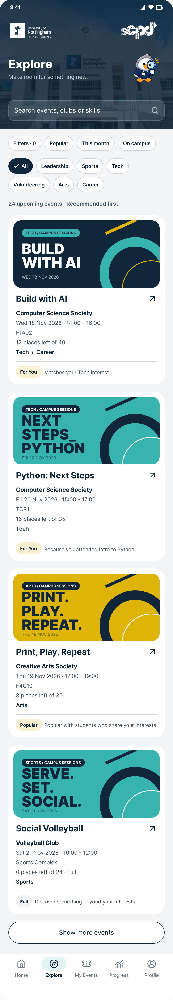](images/student/explore.png) [Figma frame](https://www.figma.com/design/Um4ZLQMFP2mEoEEnYOL8oM/Mobile-Device-Programming?node-id=269-838) |

Loading, search and offline states

| Screen | Screen |
|---|---|
| **Home loading** [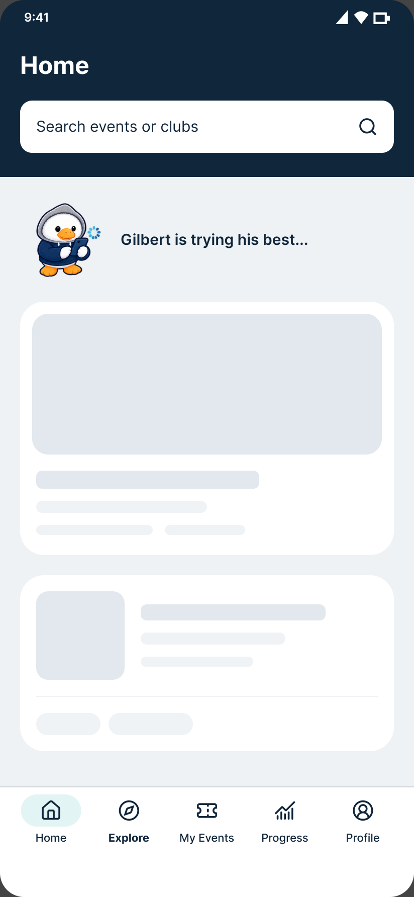](images/student/home-loading.png) [Figma frame](https://www.figma.com/design/Um4ZLQMFP2mEoEEnYOL8oM/Mobile-Device-Programming?node-id=269-1291) | **Explore loading** [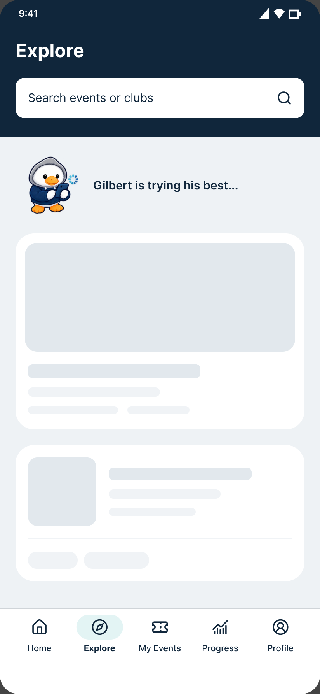](images/student/explore-loading.png) [Figma frame](https://www.figma.com/design/Um4ZLQMFP2mEoEEnYOL8oM/Mobile-Device-Programming?node-id=269-1227) |
| **No search results** [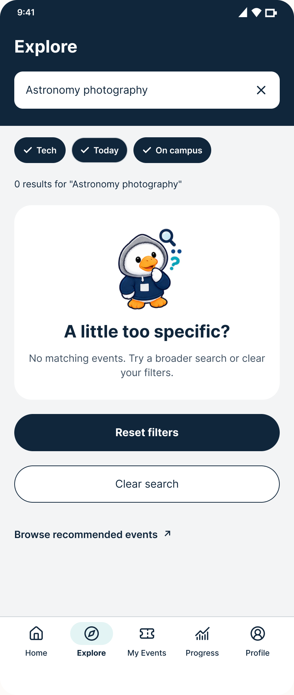](images/student/search-empty.png) [Figma frame](https://www.figma.com/design/Um4ZLQMFP2mEoEEnYOL8oM/Mobile-Device-Programming?node-id=269-691) | **Explore offline** [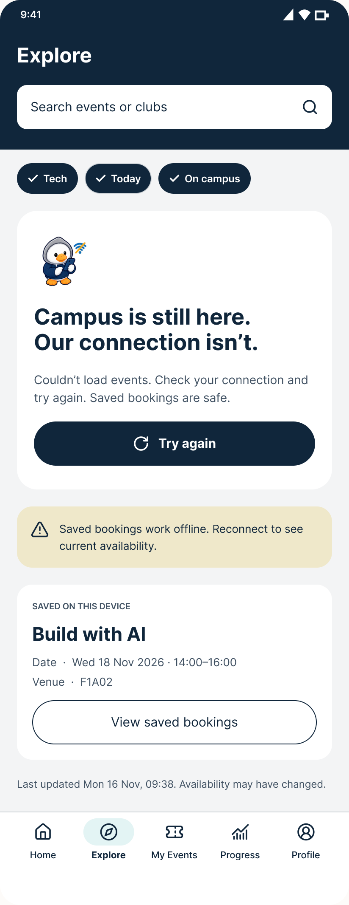](images/student/explore-offline.png) [Figma frame](https://www.figma.com/design/Um4ZLQMFP2mEoEEnYOL8oM/Mobile-Device-Programming?node-id=269-759) |

### Event details and booking — R2

Event details show availability and the attendance requirements before booking. The booking flow covers full events, schedule clashes, a request in progress, and a failed or confirmed result.

[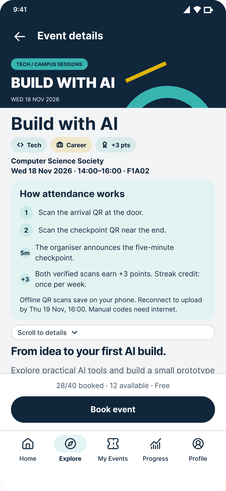](images/student/event-details.png)

**Event details and attendance requirements** · [Figma frame](https://www.figma.com/design/Um4ZLQMFP2mEoEEnYOL8oM/Mobile-Device-Programming?node-id=269-4537)

Booking and availability

| Screen | Screen |
|---|---|
| **Event full** [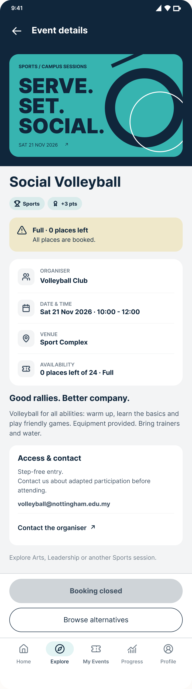](images/student/event-full.png) [Figma frame](https://www.figma.com/design/Um4ZLQMFP2mEoEEnYOL8oM/Mobile-Device-Programming?node-id=269-1453) | **Schedule clash** [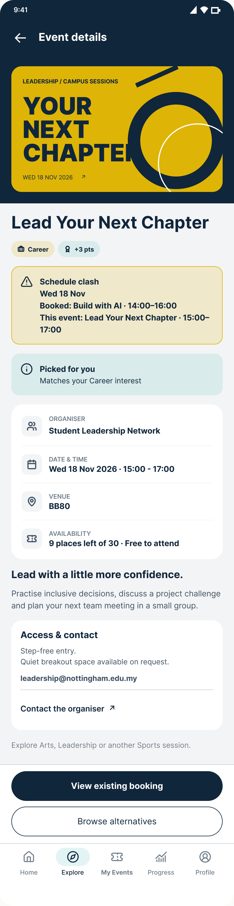](images/student/schedule-clash.png) [Figma frame](https://www.figma.com/design/Um4ZLQMFP2mEoEEnYOL8oM/Mobile-Device-Programming?node-id=269-1561) |
| **Review booking** [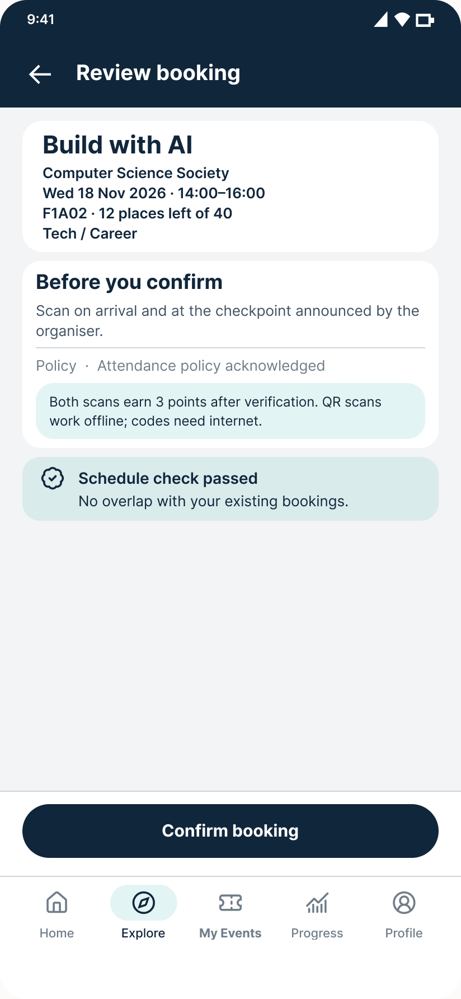](images/student/booking-review.png) [Figma frame](https://www.figma.com/design/Um4ZLQMFP2mEoEEnYOL8oM/Mobile-Device-Programming?node-id=269-1397) | **Booking in progress** [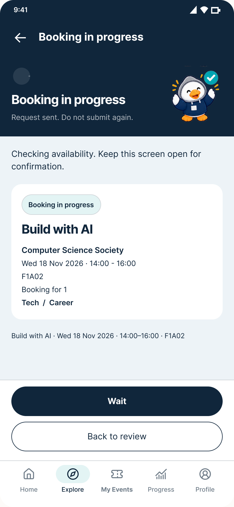](images/student/booking-in-progress.png) [Figma frame](https://www.figma.com/design/Um4ZLQMFP2mEoEEnYOL8oM/Mobile-Device-Programming?node-id=269-6305) |
| **Booking failed** [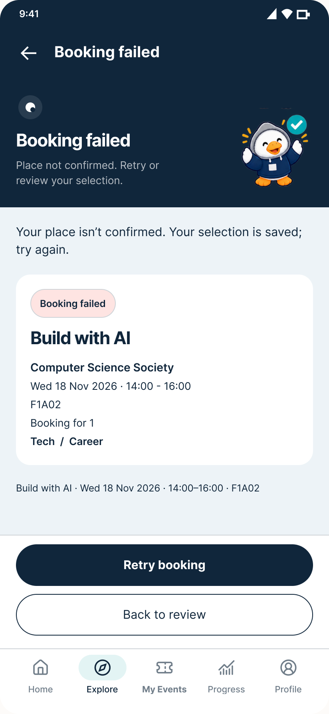](images/student/booking-failed.png) [Figma frame](https://www.figma.com/design/Um4ZLQMFP2mEoEEnYOL8oM/Mobile-Device-Programming?node-id=269-6363) | **Booking confirmed** [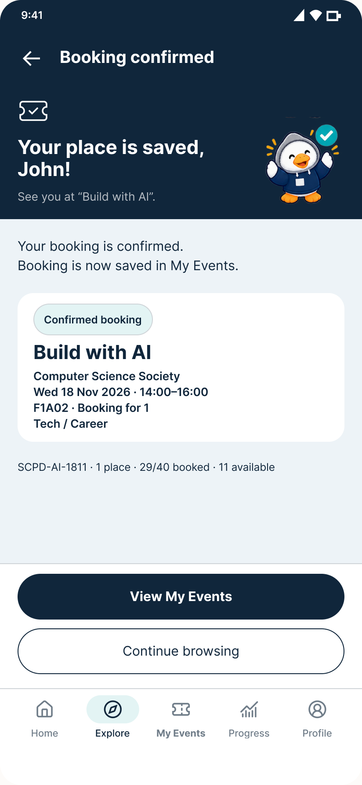](images/student/booking-confirmed.png) [Figma frame](https://www.figma.com/design/Um4ZLQMFP2mEoEEnYOL8oM/Mobile-Device-Programming?node-id=269-1923) |

### My Events and cancellations — R2, R3, R4

My Events lists the student's bookings and shows whether the arrival or checkpoint scan is open. An arrival scan waiting to upload does not hide the checkpoint action once it opens. Cancelling a booking and an organiser cancelling the event lead to different outcomes.

[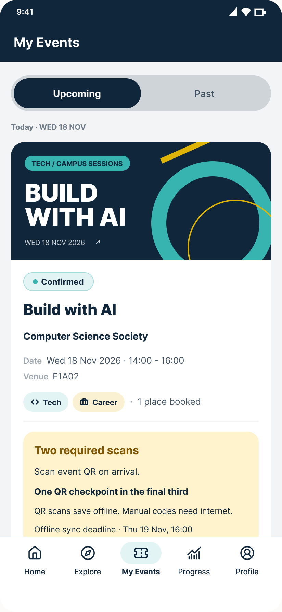](images/student/my-events-arrival-required.png)

**My Events — arrival required** · [Figma frame](https://www.figma.com/design/Um4ZLQMFP2mEoEEnYOL8oM/Mobile-Device-Programming?node-id=269-4680)

Upcoming events and checkpoint access

| Screen | Screen |
|---|---|
| **My Events empty** [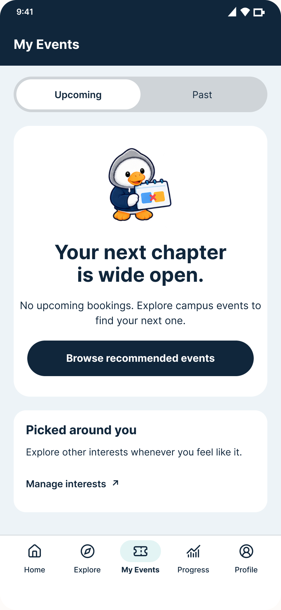](images/student/my-events-empty.png) [Figma frame](https://www.figma.com/design/Um4ZLQMFP2mEoEEnYOL8oM/Mobile-Device-Programming?node-id=269-2104) | **Waiting for checkpoint — arrival verified** [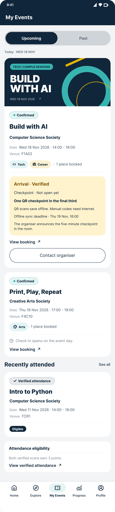](images/student/waiting-arrival-verified.png) [Figma frame](https://www.figma.com/design/Um4ZLQMFP2mEoEEnYOL8oM/Mobile-Device-Programming?node-id=269-5694) |
| **Waiting for checkpoint — arrival pending sync** [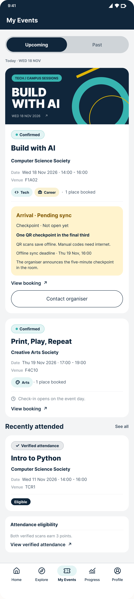](images/student/waiting-arrival-pending.png) [Figma frame](https://www.figma.com/design/Um4ZLQMFP2mEoEEnYOL8oM/Mobile-Device-Programming?node-id=269-5839) | **Checkpoint open — arrival verified** [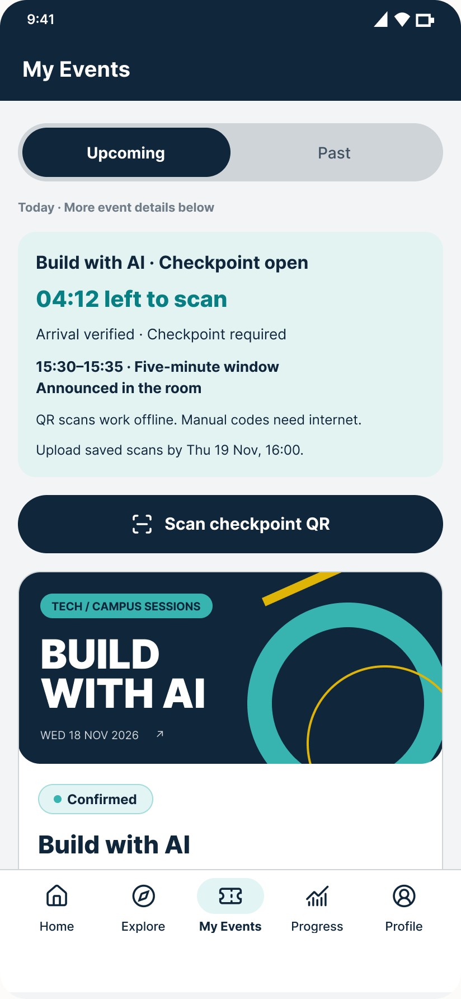](images/student/checkpoint-open-arrival-verified.png) [Figma frame](https://www.figma.com/design/Um4ZLQMFP2mEoEEnYOL8oM/Mobile-Device-Programming?node-id=269-4930) |
| **Checkpoint open — arrival pending sync** [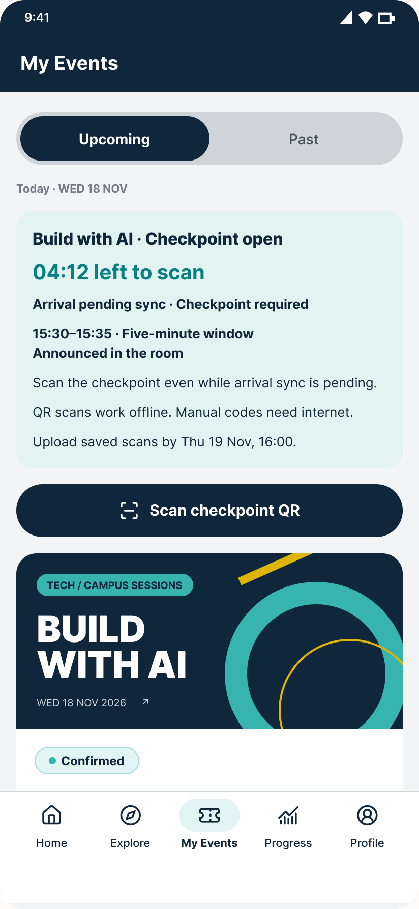](images/student/checkpoint-open-arrival-pending.png) [Figma frame](https://www.figma.com/design/Um4ZLQMFP2mEoEEnYOL8oM/Mobile-Device-Programming?node-id=269-5380) |    |

Cancelling a booking

| Screen | Screen |
|---|---|
| **Confirm booking cancellation** [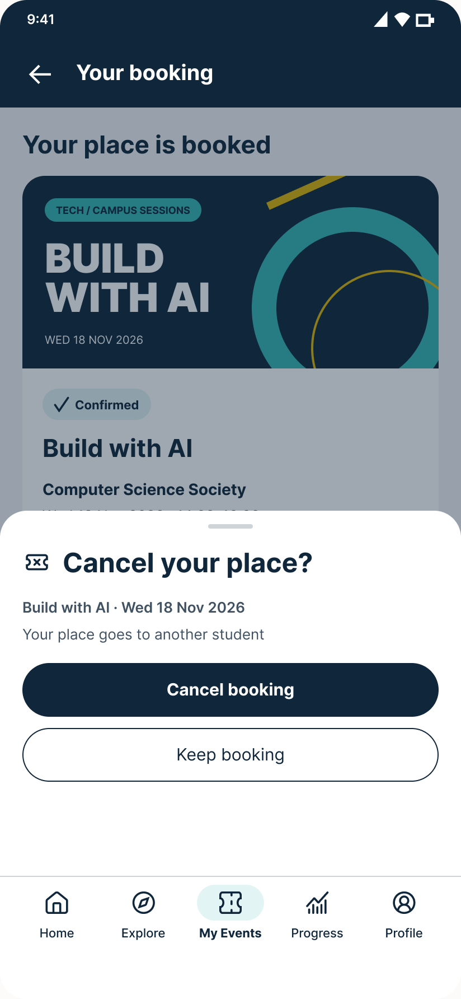](images/student/cancel-booking-confirm.png) [Figma frame](https://www.figma.com/design/Um4ZLQMFP2mEoEEnYOL8oM/Mobile-Device-Programming?node-id=269-2222) | **Cancellation in progress** [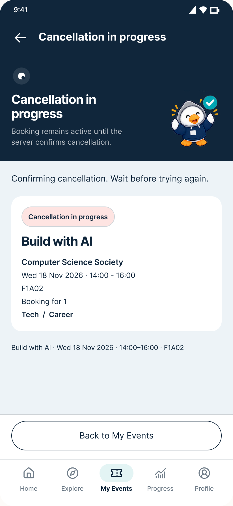](images/student/cancellation-in-progress.png) [Figma frame](https://www.figma.com/design/Um4ZLQMFP2mEoEEnYOL8oM/Mobile-Device-Programming?node-id=269-6666) |
| **Cancellation failed** [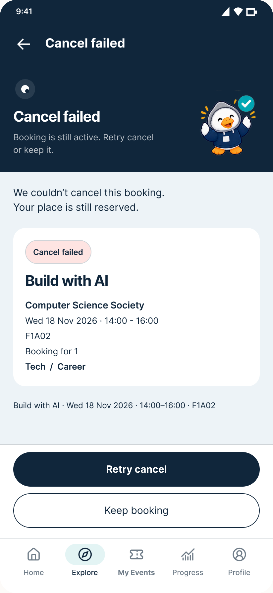](images/student/cancel-failed.png) [Figma frame](https://www.figma.com/design/Um4ZLQMFP2mEoEEnYOL8oM/Mobile-Device-Programming?node-id=269-6422) | **Booking cancelled** [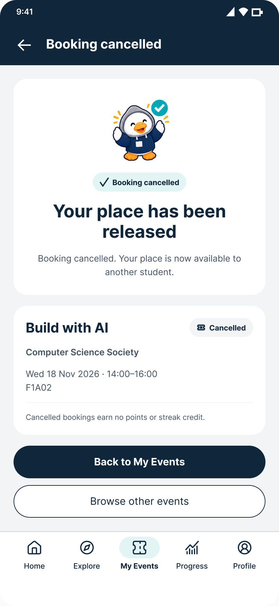](images/student/booking-cancelled.png) [Figma frame](https://www.figma.com/design/Um4ZLQMFP2mEoEEnYOL8oM/Mobile-Device-Programming?node-id=269-2157) |
| **Event cancelled by organiser** [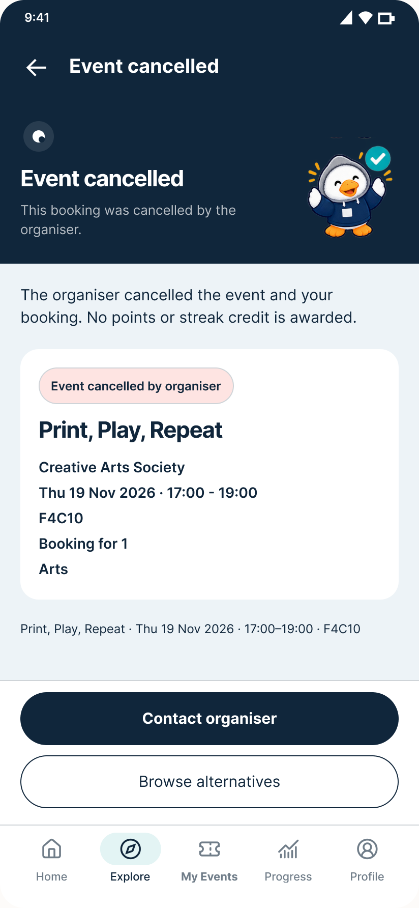](images/student/event-cancelled.png) [Figma frame](https://www.figma.com/design/Um4ZLQMFP2mEoEEnYOL8oM/Mobile-Device-Programming?node-id=269-6723) |    |

### Attendance and check-in — R3, R4

Events with a checkpoint need an arrival scan and a later checkpoint scan. Students scan the rotating QR, or enter the current stage's backup code while online. Each offline scan stays **Pending sync** on the device until the app stores a definitive server response. The screens separate saved scans, retries, office review, rejection and incomplete attendance.

[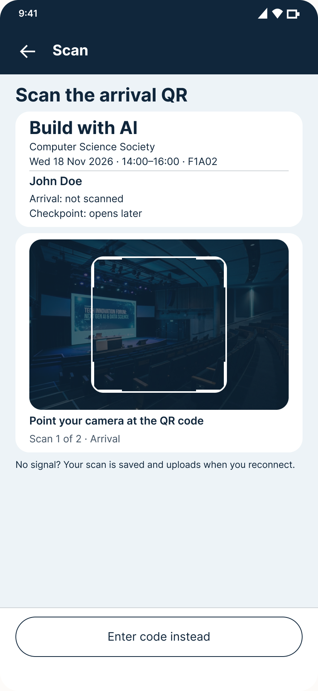](images/student/arrival-scanner.png)

**Scan arrival QR** · [Figma frame](https://www.figma.com/design/Um4ZLQMFP2mEoEEnYOL8oM/Mobile-Device-Programming?node-id=269-4828)

Arrival and checkpoint scanning

| Screen | Screen |
|---|---|
| **Arrival saved — verified** [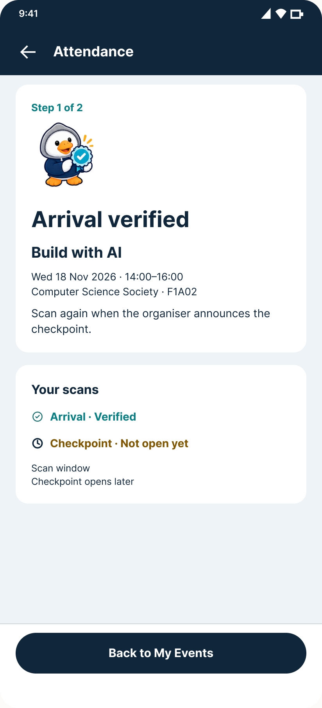](images/student/arrival-verified.png) [Figma frame](https://www.figma.com/design/Um4ZLQMFP2mEoEEnYOL8oM/Mobile-Device-Programming?node-id=269-5341) | **Arrival saved — pending sync** [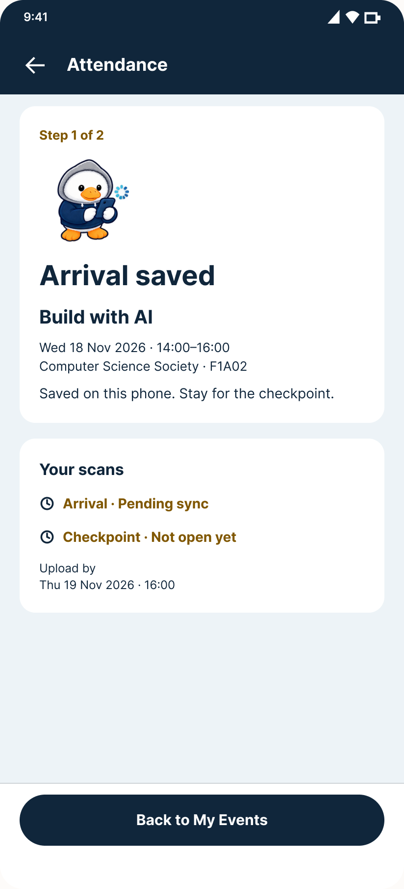](images/student/arrival-pending-sync.png) [Figma frame](https://www.figma.com/design/Um4ZLQMFP2mEoEEnYOL8oM/Mobile-Device-Programming?node-id=269-4890) |
| **Scan checkpoint QR** [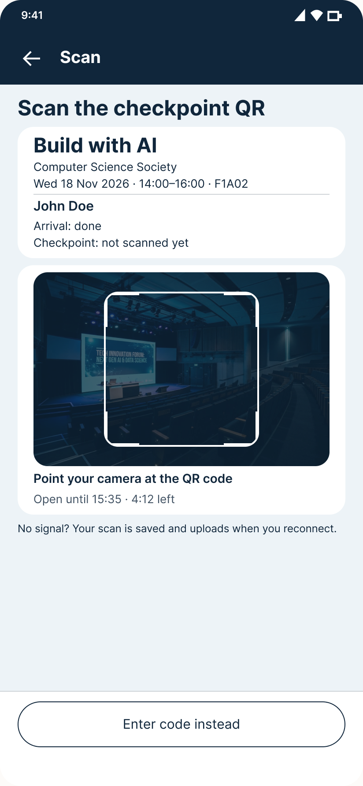](images/student/checkpoint-scanner-arrival-verified.png) [Figma frame](https://www.figma.com/design/Um4ZLQMFP2mEoEEnYOL8oM/Mobile-Device-Programming?node-id=269-5079) | **Scan checkpoint QR — arrival pending sync** [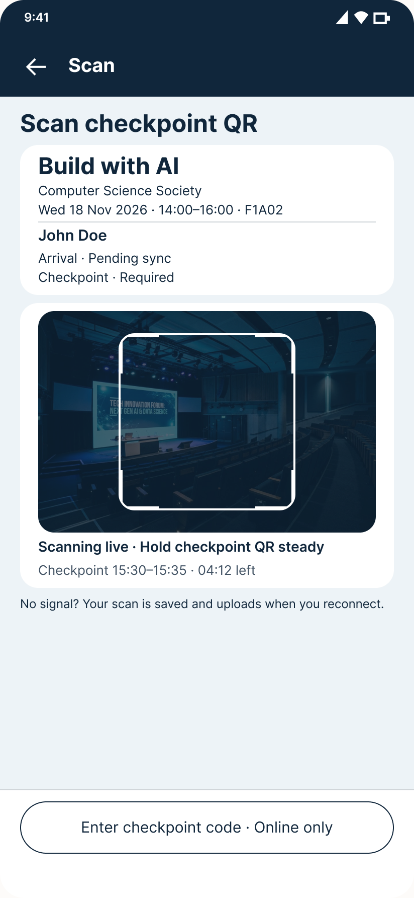](images/student/checkpoint-scanner-arrival-pending.png) [Figma frame](https://www.figma.com/design/Um4ZLQMFP2mEoEEnYOL8oM/Mobile-Device-Programming?node-id=269-5530) |

Camera access and QR errors

| Screen | Screen |
|---|---|
| **Camera permission required** [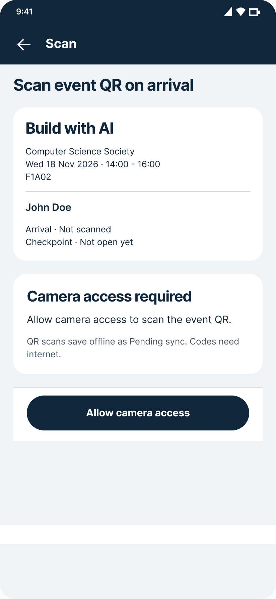](images/student/camera-required.png) [Figma frame](https://www.figma.com/design/Um4ZLQMFP2mEoEEnYOL8oM/Mobile-Device-Programming?node-id=269-5984) | **Camera permission denied** [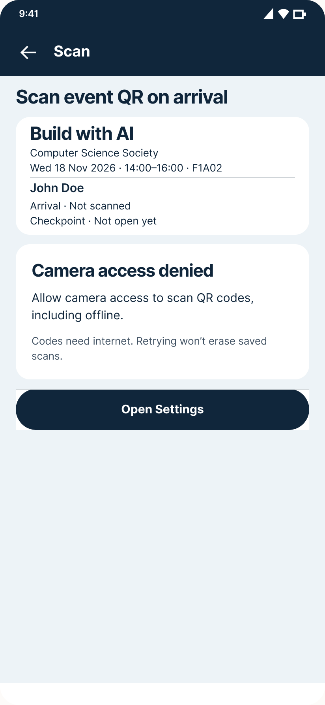](images/student/camera-denied.png) [Figma frame](https://www.figma.com/design/Um4ZLQMFP2mEoEEnYOL8oM/Mobile-Device-Programming?node-id=269-6037) |
| **QR unreadable** [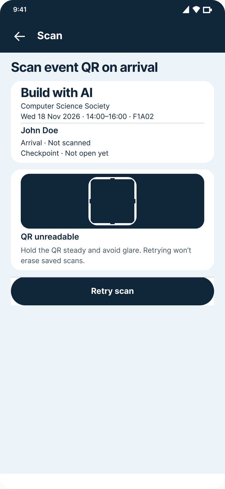](images/student/qr-unreadable.png) [Figma frame](https://www.figma.com/design/Um4ZLQMFP2mEoEEnYOL8oM/Mobile-Device-Programming?node-id=269-6090) | **QR expired** [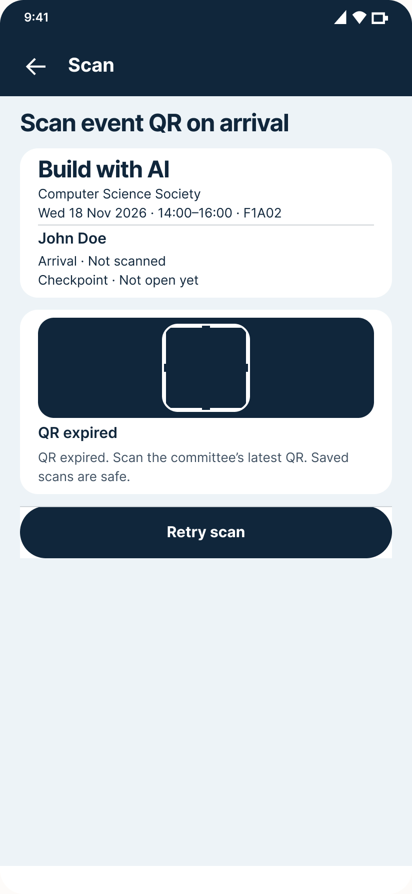](images/student/qr-expired.png) [Figma frame](https://www.figma.com/design/Um4ZLQMFP2mEoEEnYOL8oM/Mobile-Device-Programming?node-id=269-6150) |

Manual codes and connection recovery

| Screen | Screen |
|---|---|
| **Enter arrival code online** [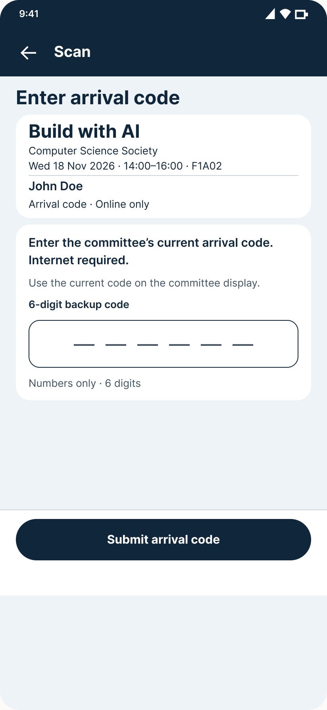](images/student/arrival-code.png) [Figma frame](https://www.figma.com/design/Um4ZLQMFP2mEoEEnYOL8oM/Mobile-Device-Programming?node-id=269-5631) | **Enter checkpoint code online** [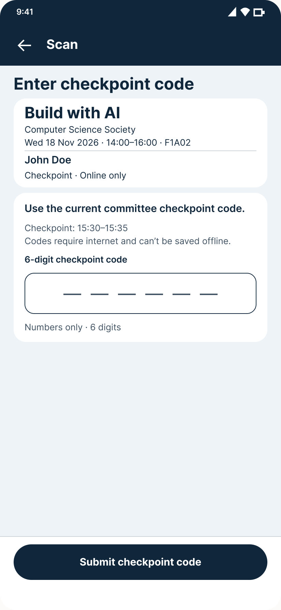](images/student/checkpoint-code-entry.png) [Figma frame](https://www.figma.com/design/Um4ZLQMFP2mEoEEnYOL8oM/Mobile-Device-Programming?node-id=269-6782) |
| **Arrival code — connection lost** [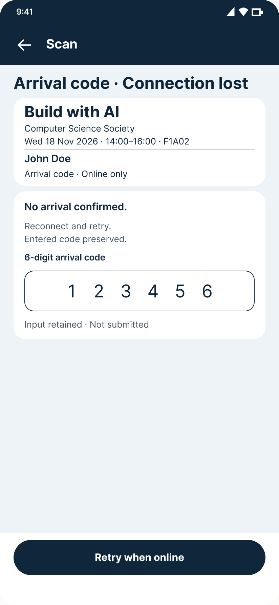](images/student/arrival-code-connection-lost.png) [Figma frame](https://www.figma.com/design/Um4ZLQMFP2mEoEEnYOL8oM/Mobile-Device-Programming?node-id=269-6845) | **Checkpoint code — connection lost** [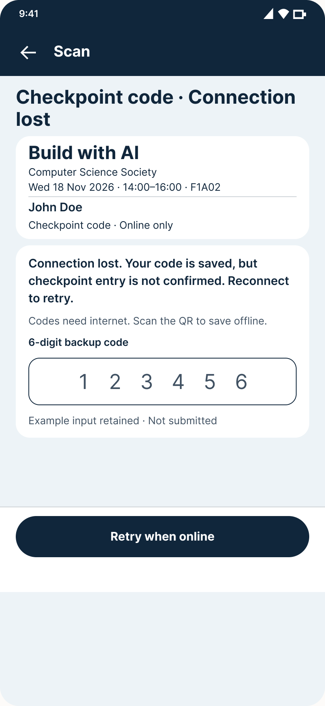](images/student/checkpoint-code.png) [Figma frame](https://www.figma.com/design/Um4ZLQMFP2mEoEEnYOL8oM/Mobile-Device-Programming?node-id=269-5276) |
| **Checkpoint code — offline** [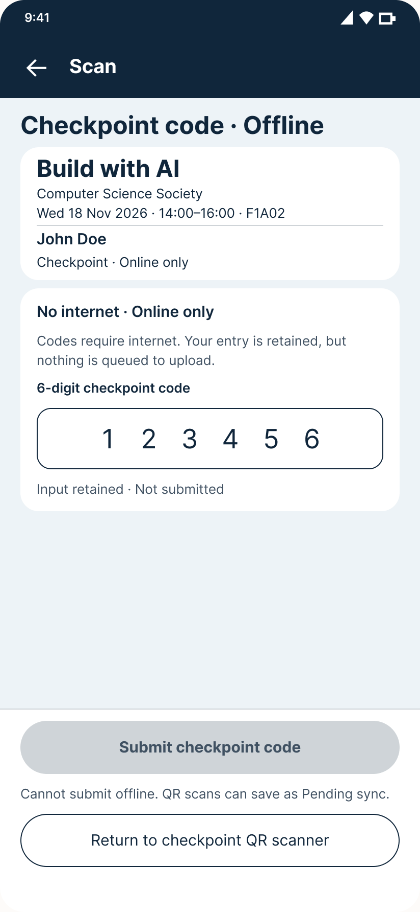](images/student/checkpoint-code-offline.png) [Figma frame](https://www.figma.com/design/Um4ZLQMFP2mEoEEnYOL8oM/Mobile-Device-Programming?node-id=269-6908) |    |

Offline sync and attendance outcomes

| Screen | Screen |
|---|---|
| **Checkpoint saved — pending sync** [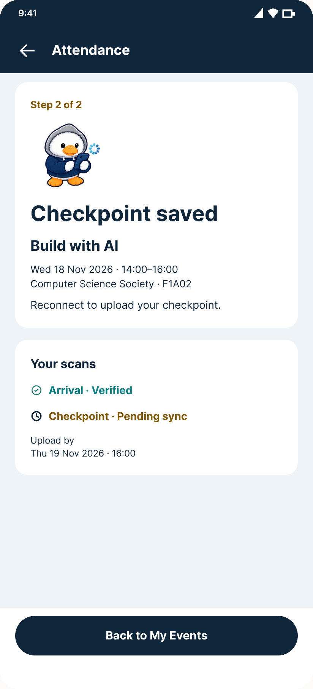](images/student/checkpoint-pending-sync.png) [Figma frame](https://www.figma.com/design/Um4ZLQMFP2mEoEEnYOL8oM/Mobile-Device-Programming?node-id=269-5141) | **Both scans saved — pending sync** [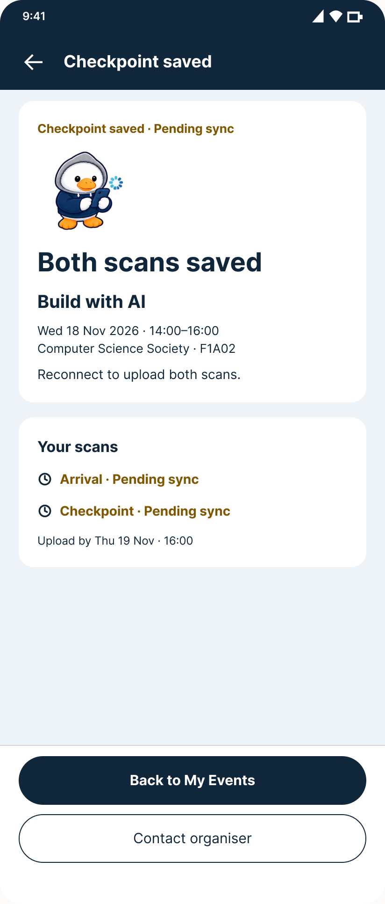](images/student/both-scans-pending-sync.png) [Figma frame](https://www.figma.com/design/Um4ZLQMFP2mEoEEnYOL8oM/Mobile-Device-Programming?node-id=269-5592) |
| **Sync in progress** [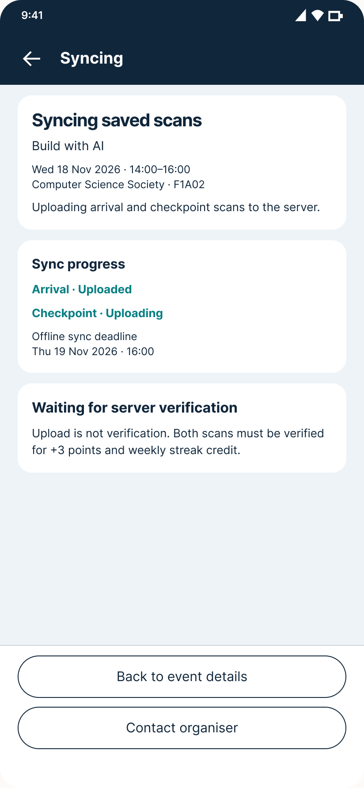](images/student/sync-in-progress.png) [Figma frame](https://www.figma.com/design/Um4ZLQMFP2mEoEEnYOL8oM/Mobile-Device-Programming?node-id=269-6210) | **Uploaded — under review** [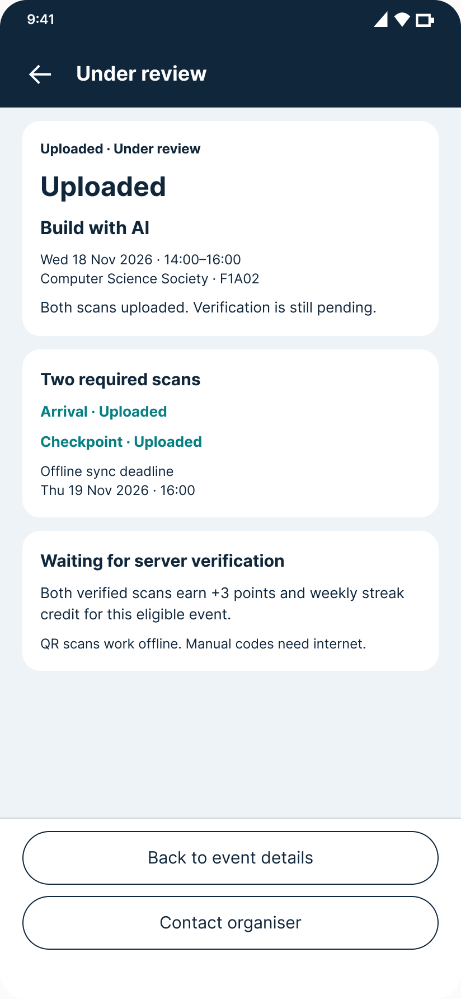](images/student/under-review.png) [Figma frame](https://www.figma.com/design/Um4ZLQMFP2mEoEEnYOL8oM/Mobile-Device-Programming?node-id=269-6240) |
| **Retry failed sync** [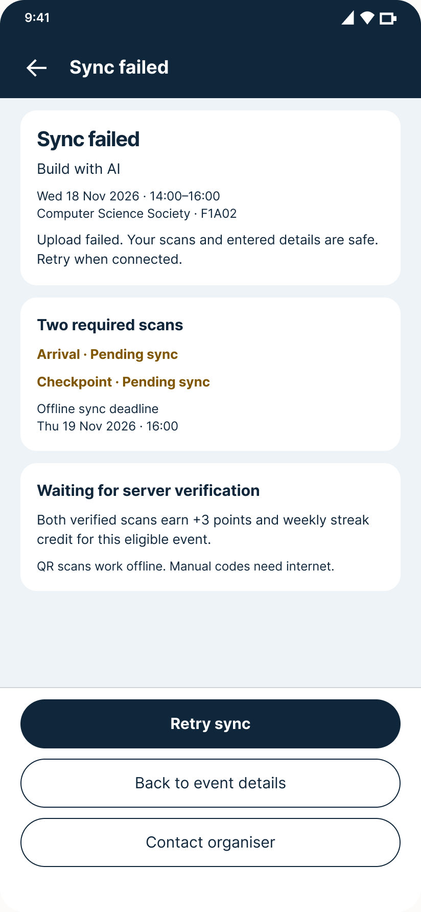](images/student/sync-retry.png) [Figma frame](https://www.figma.com/design/Um4ZLQMFP2mEoEEnYOL8oM/Mobile-Device-Programming?node-id=269-6272) | **Incomplete attendance** [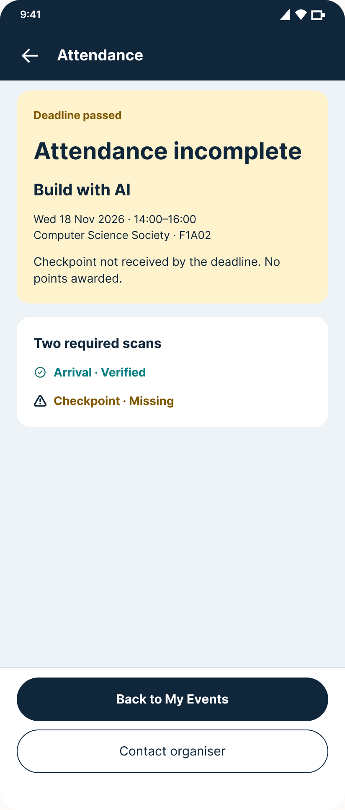](images/student/incomplete-attendance.png) [Figma frame](https://www.figma.com/design/Um4ZLQMFP2mEoEEnYOL8oM/Mobile-Device-Programming?node-id=269-5240) |
| **Rejected attendance**  [Figma frame](https://www.figma.com/design/Um4ZLQMFP2mEoEEnYOL8oM/Mobile-Device-Programming?node-id=269-7669) | **Already checked in**  [Figma frame](https://www.figma.com/design/Um4ZLQMFP2mEoEEnYOL8oM/Mobile-Device-Programming?node-id=269-7346) |

### Points and progress — R5, Feature 2

Verified attendance at an eligible event earns 3 points once. Verification needs every stage to pass or an authorised office decision. Progress shows verified attendance, points, interest stamps and the weekly streak. Pending scans earn nothing, and an authorised correction can reverse an earlier award.

**Attendance verified — +3 pts** · [Figma frame](https://www.figma.com/design/Um4ZLQMFP2mEoEEnYOL8oM/Mobile-Device-Programming?node-id=269-5179)

Progress, history and corrections

| Screen | Screen |
|---|---|
| **Your progress**  [Figma frame](https://www.figma.com/design/Um4ZLQMFP2mEoEEnYOL8oM/Mobile-Device-Programming?node-id=269-3090) | **Your first stamp**  [Figma frame](https://www.figma.com/design/Um4ZLQMFP2mEoEEnYOL8oM/Mobile-Device-Programming?node-id=269-2973) |
| **Attendance history**  [Figma frame](https://www.figma.com/design/Um4ZLQMFP2mEoEEnYOL8oM/Mobile-Device-Programming?node-id=269-2521) | **Points correction**  [Figma frame](https://www.figma.com/design/Um4ZLQMFP2mEoEEnYOL8oM/Mobile-Device-Programming?node-id=269-2572) |

### Profile and settings — R6

Students see their account and can change interests, notifications and privacy settings. The attendance entry on Profile opens the right event stage.

**Student profile** · [Figma frame](https://www.figma.com/design/Um4ZLQMFP2mEoEEnYOL8oM/Mobile-Device-Programming?node-id=269-3587)

Account and preferences

| Screen | Screen |
|---|---|
| **Privacy and settings**  [Figma frame](https://www.figma.com/design/Um4ZLQMFP2mEoEEnYOL8oM/Mobile-Device-Programming?node-id=269-3939) | **Notifications**  [Figma frame](https://www.figma.com/design/Um4ZLQMFP2mEoEEnYOL8oM/Mobile-Device-Programming?node-id=269-3751) |
| **Edit interests**  [Figma frame](https://www.figma.com/design/Um4ZLQMFP2mEoEEnYOL8oM/Mobile-Device-Programming?node-id=269-4010) | **Account**  [Figma frame](https://www.figma.com/design/Um4ZLQMFP2mEoEEnYOL8oM/Mobile-Device-Programming?node-id=269-4386) |
| **Sign-out confirmation**  [Figma frame](https://www.figma.com/design/Um4ZLQMFP2mEoEEnYOL8oM/Mobile-Device-Programming?node-id=269-4455) |    |

---

[← Previous: 4. Attendance security and offline sync](4-4-attendance-security-and-sync.md) · [Next: Committee wireframes →](5-2-committee-wireframes.md)
