[s-CPD overview](../README.md) › **5. UI design and wireframes** › Committee

## 5. UI design and wireframes

*Part 2 of 2: Committee journeys. The [Student journeys](5-1-student-wireframes.md) are on the previous page. The s-CPD office reviews submissions in the backend, so it has no app screens.*

### Committee entry and access — R6

Committee members start at the same [role picker](5-1-student-wireframes.md#student-entry-and-interests--r6) as students. Sign-in checks the account's assigned role and society. The prototype uses approved test accounts.

| Committee sign-in | Sign-in error | Access not authorised |
|---|---|---|
| [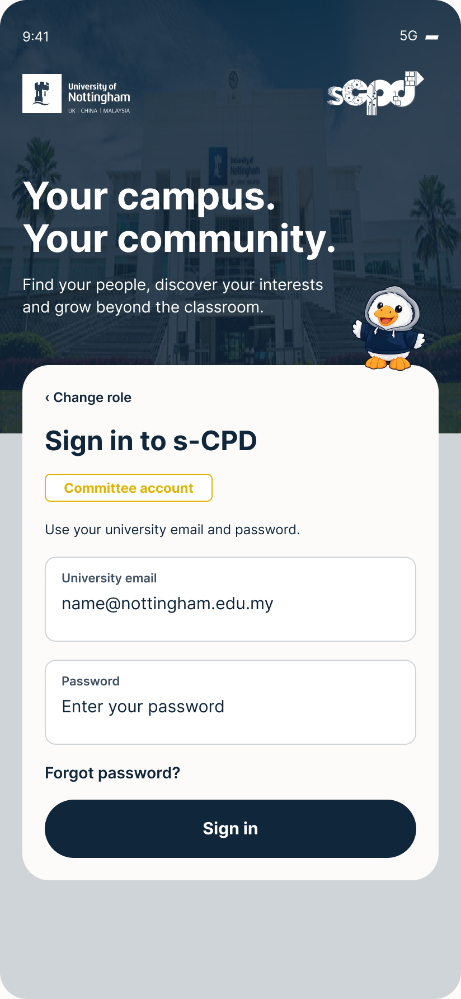](images/committee/sign-in.png) [Figma frame](https://www.figma.com/design/Um4ZLQMFP2mEoEEnYOL8oM/Mobile-Device-Programming?node-id=269-8314) | [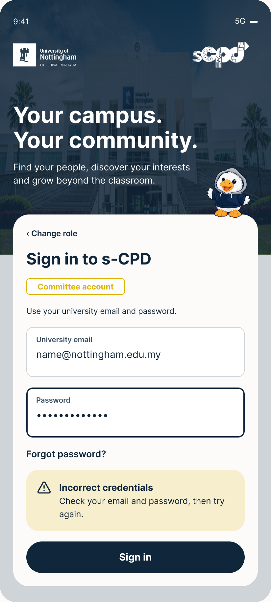](images/committee/sign-in-error.png) [Figma frame](https://www.figma.com/design/Um4ZLQMFP2mEoEEnYOL8oM/Mobile-Device-Programming?node-id=269-8389) | [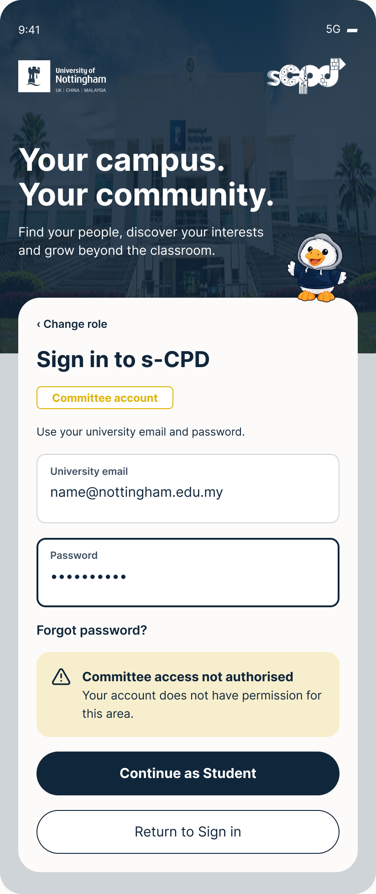](images/committee/access-not-authorised.png) [Figma frame](https://www.figma.com/design/Um4ZLQMFP2mEoEEnYOL8oM/Mobile-Device-Programming?node-id=269-8469) |

### Committee dashboard — R1, R3, R6

The dashboard shows event and submission status, the next public event, and shortcuts to creating an event and running check-in.

| Dashboard | Loading |
|---|---|
| [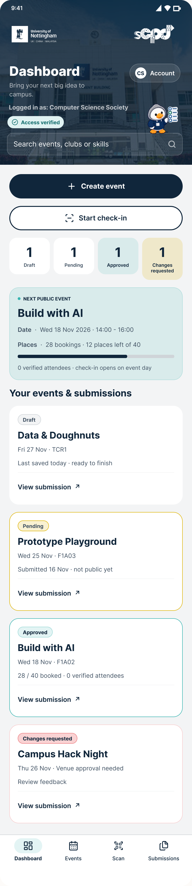](images/committee/dashboard.png) [Figma frame](https://www.figma.com/design/Um4ZLQMFP2mEoEEnYOL8oM/Mobile-Device-Programming?node-id=269-8702) | [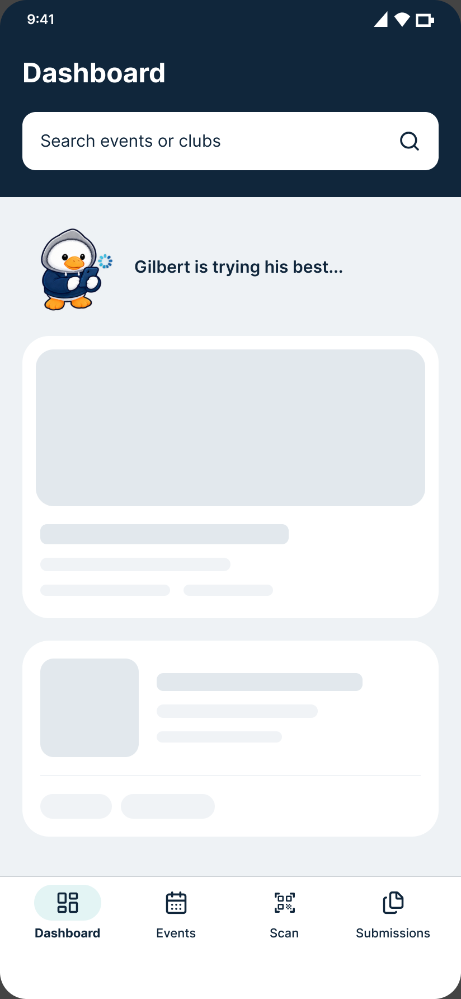](images/committee/dashboard-loading.png) [Figma frame](https://www.figma.com/design/Um4ZLQMFP2mEoEEnYOL8oM/Mobile-Device-Programming?node-id=269-8644) |

### Event submissions — R1

Submissions groups drafts, pending reviews, decisions and approved events. Withdrawing a pending submission returns the same event to an editable draft. A final rejection shows the reason and closes the submission. Committee members can update a submission marked Changes requested and cancel an approved event. Each action shows its progress, retry and confirmed states.

[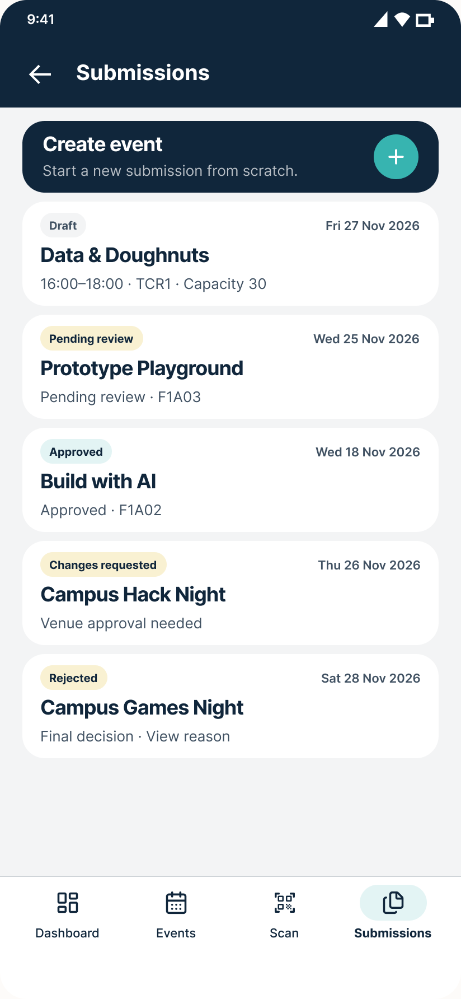](images/committee/submissions.png)

**Submissions** · [Figma frame](https://www.figma.com/design/Um4ZLQMFP2mEoEEnYOL8oM/Mobile-Device-Programming?node-id=269-11387)

Create and submit an event

| Screen | Screen |
|---|---|
| **Create event** [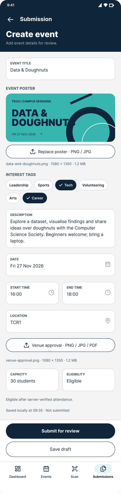](images/committee/create-event.png) [Figma frame](https://www.figma.com/design/Um4ZLQMFP2mEoEEnYOL8oM/Mobile-Device-Programming?node-id=269-9170) | **Submitting** [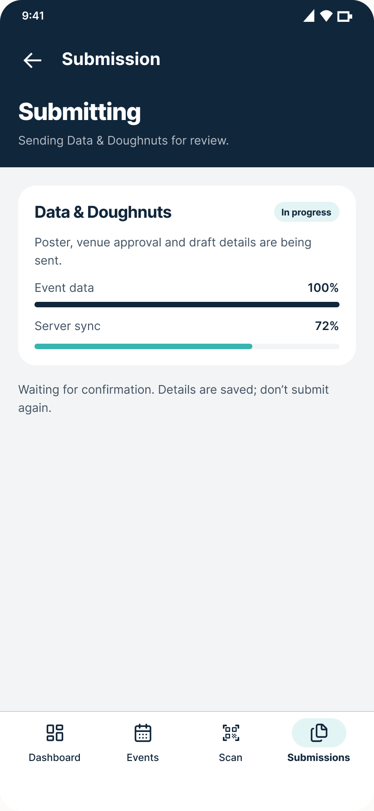](images/committee/submitting.png) [Figma frame](https://www.figma.com/design/Um4ZLQMFP2mEoEEnYOL8oM/Mobile-Device-Programming?node-id=269-11464) |
| **Submission retry** [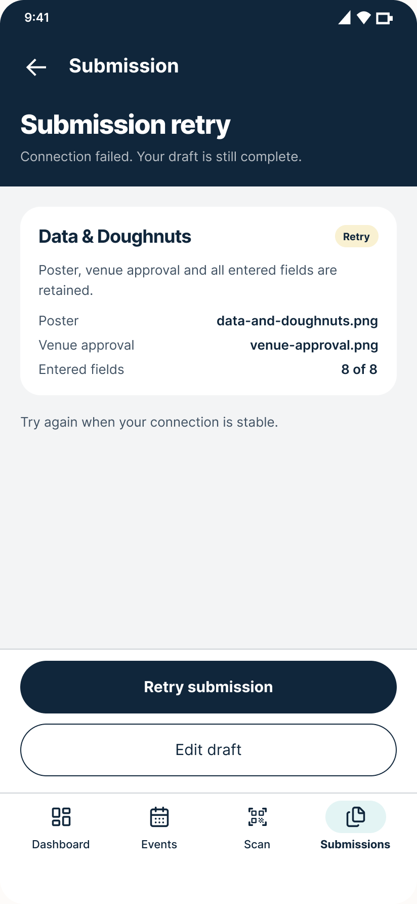](images/committee/submit-retry.png) [Figma frame](https://www.figma.com/design/Um4ZLQMFP2mEoEEnYOL8oM/Mobile-Device-Programming?node-id=269-11516) | **Submission success** [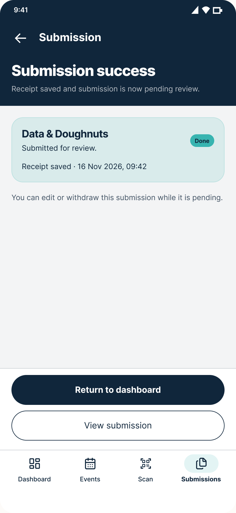](images/committee/submit-success.png) [Figma frame](https://www.figma.com/design/Um4ZLQMFP2mEoEEnYOL8oM/Mobile-Device-Programming?node-id=269-11572) |

Review, withdrawal and rejection

| Screen | Screen |
|---|---|
| **Changes requested** [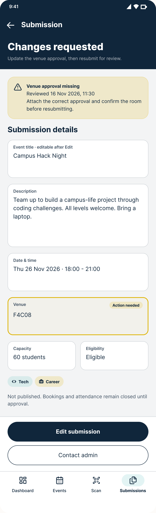](images/committee/changes-requested.png) [Figma frame](https://www.figma.com/design/Um4ZLQMFP2mEoEEnYOL8oM/Mobile-Device-Programming?node-id=269-8998) | **Pending review** [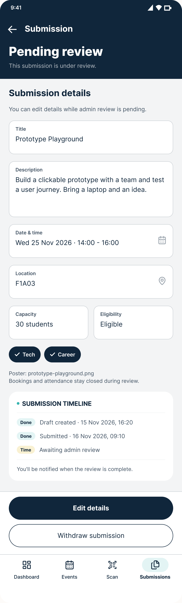](images/committee/pending-review.png) [Figma frame](https://www.figma.com/design/Um4ZLQMFP2mEoEEnYOL8oM/Mobile-Device-Programming?node-id=269-9076) |
| **Confirm withdrawal** [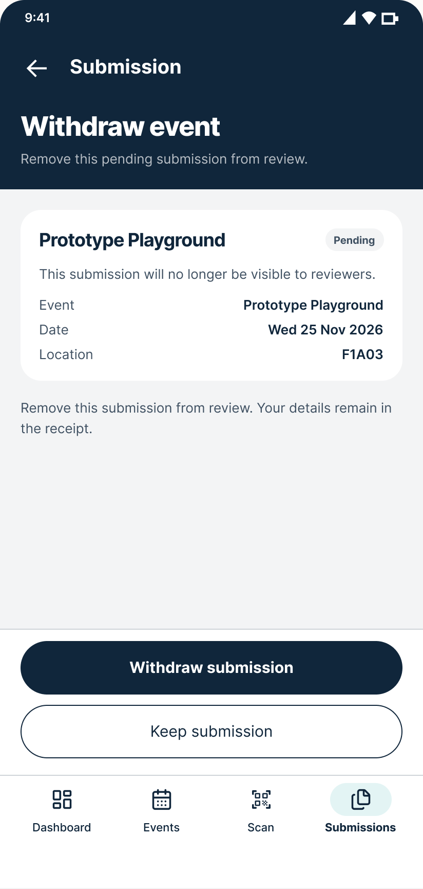](images/committee/withdraw.png) [Figma frame](https://www.figma.com/design/Um4ZLQMFP2mEoEEnYOL8oM/Mobile-Device-Programming?node-id=269-11620) | **Withdrawing** [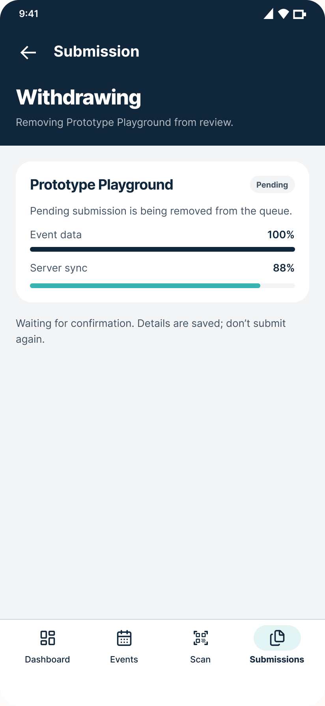](images/committee/withdrawing.png) [Figma frame](https://www.figma.com/design/Um4ZLQMFP2mEoEEnYOL8oM/Mobile-Device-Programming?node-id=269-11676) |
| **Returned to draft** [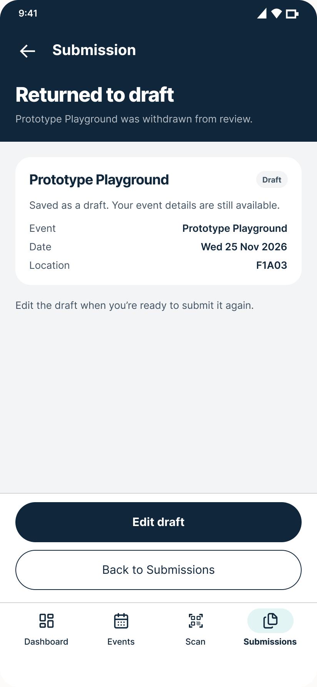](images/committee/withdrawn.png) [Figma frame](https://www.figma.com/design/Um4ZLQMFP2mEoEEnYOL8oM/Mobile-Device-Programming?node-id=269-11728) | **Withdrawal retry** [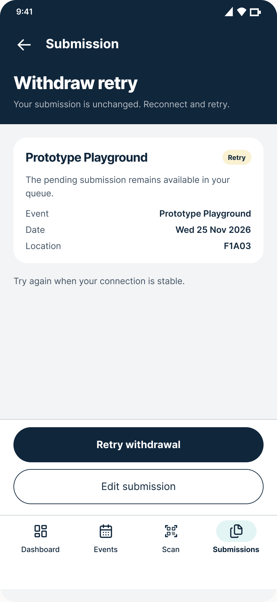](images/committee/withdraw-retry.png) [Figma frame](https://www.figma.com/design/Um4ZLQMFP2mEoEEnYOL8oM/Mobile-Device-Programming?node-id=269-11784) |
| **Rejected submission** [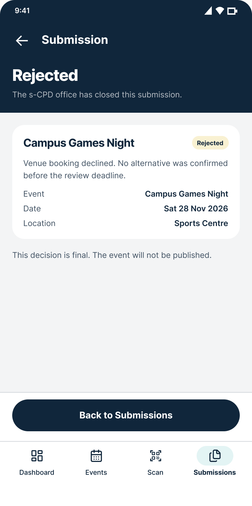](images/committee/rejected-decision.png) [Figma frame](https://www.figma.com/design/Um4ZLQMFP2mEoEEnYOL8oM/Mobile-Device-Programming?node-id=269-12178) |    |

Approved event cancellation

| Screen | Screen |
|---|---|
| **Approved event** [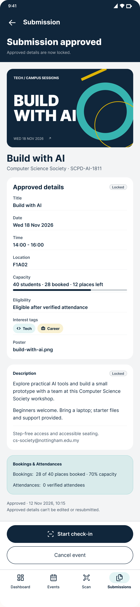](images/committee/event-approved.png) [Figma frame](https://www.figma.com/design/Um4ZLQMFP2mEoEEnYOL8oM/Mobile-Device-Programming?node-id=269-8874) | **Confirm event cancellation** [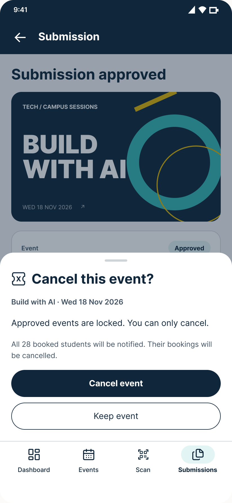](images/committee/cancel-confirm.png) [Figma frame](https://www.figma.com/design/Um4ZLQMFP2mEoEEnYOL8oM/Mobile-Device-Programming?node-id=269-9283) |
| **Cancelling event** [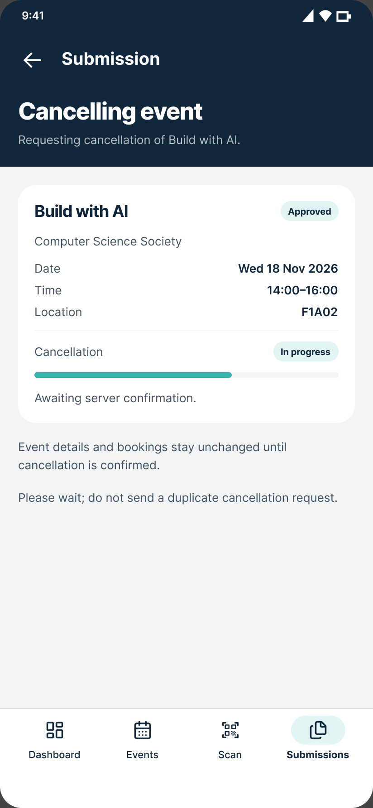](images/committee/cancelling-event.png) [Figma frame](https://www.figma.com/design/Um4ZLQMFP2mEoEEnYOL8oM/Mobile-Device-Programming?node-id=269-12024) | **Cancellation confirmed** [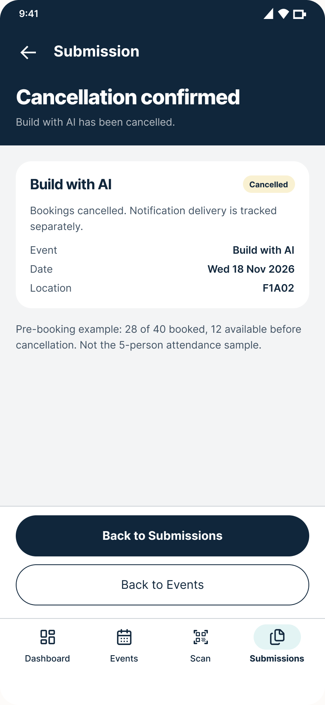](images/committee/cancel-success.png) [Figma frame](https://www.figma.com/design/Um4ZLQMFP2mEoEEnYOL8oM/Mobile-Device-Programming?node-id=269-11840) |
| **Cancellation retry** [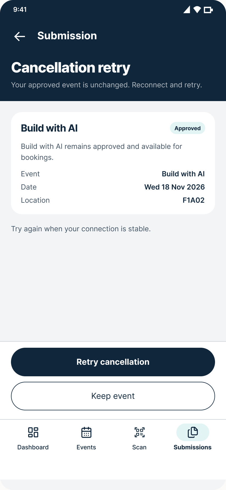](images/committee/cancel-retry.png) [Figma frame](https://www.figma.com/design/Um4ZLQMFP2mEoEEnYOL8oM/Mobile-Device-Programming?node-id=269-11896) |    |

### Committee Events — R1, R2, R3

Upcoming events link to their bookings, and past events link to their attendance summaries.

[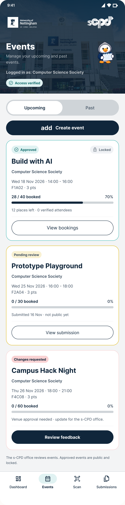](images/committee/upcoming-events.png)

**Upcoming events** · [Figma frame](https://www.figma.com/design/Um4ZLQMFP2mEoEEnYOL8oM/Mobile-Device-Programming?node-id=269-9646)

Past and empty events

| Screen | Screen |
|---|---|
| **Past events** [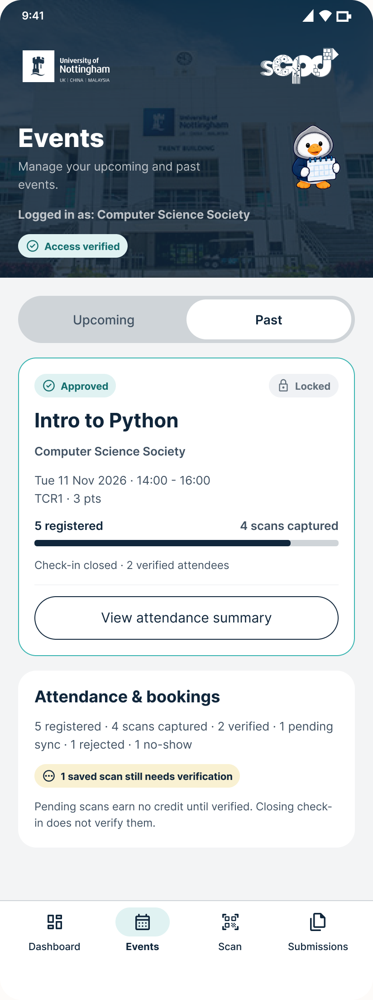](images/committee/past-events.png) [Figma frame](https://www.figma.com/design/Um4ZLQMFP2mEoEEnYOL8oM/Mobile-Device-Programming?node-id=269-9526) | **Committee Events empty** [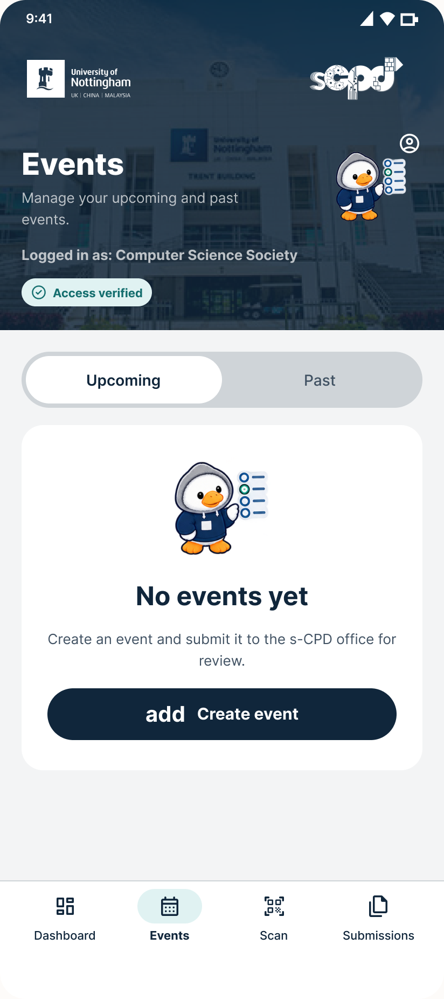](images/committee/events-empty.png) [Figma frame](https://www.figma.com/design/Um4ZLQMFP2mEoEEnYOL8oM/Mobile-Device-Programming?node-id=269-9426) |

### Check-in — R3, R4, R5

The Committee shows the rotating arrival or checkpoint QR with its short-lived backup code. The checkpoint view shows a countdown and asks for confirmation before closing. An offline committee device pauses code refresh until it reconnects, while students can still upload scans they saved during the sync window.

[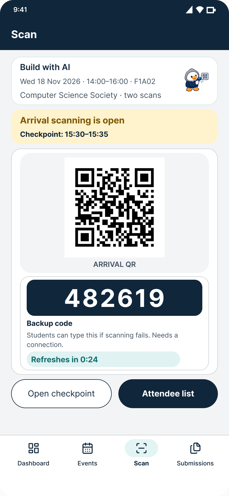](images/committee/arrival-qr.png)

**Active arrival QR** · [Figma frame](https://www.figma.com/design/Um4ZLQMFP2mEoEEnYOL8oM/Mobile-Device-Programming?node-id=269-10631)

QR display and checkpoint closure

| Screen | Screen |
|---|---|
| **Checkpoint open** [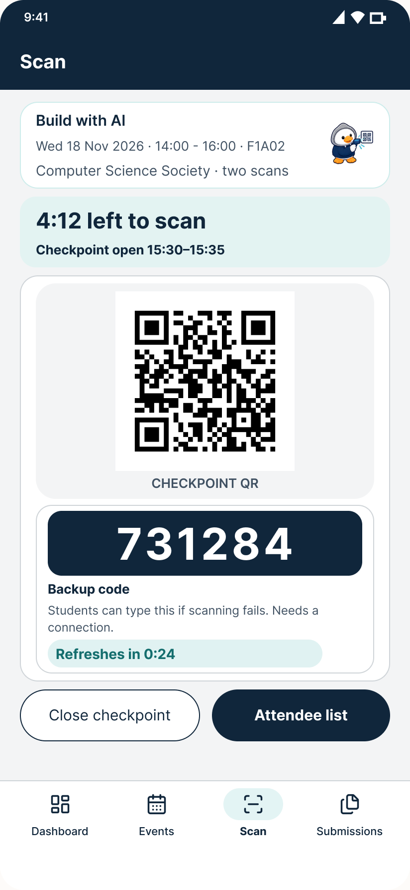](images/committee/checkpoint-qr.png) [Figma frame](https://www.figma.com/design/Um4ZLQMFP2mEoEEnYOL8oM/Mobile-Device-Programming?node-id=269-10713) | **Offline — checkpoint QR paused** [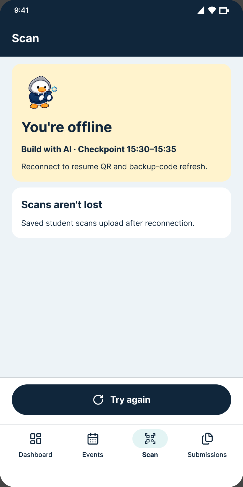](images/committee/checkpoint-offline.png) [Figma frame](https://www.figma.com/design/Um4ZLQMFP2mEoEEnYOL8oM/Mobile-Device-Programming?node-id=269-10793) |
| **Confirm checkpoint closure** [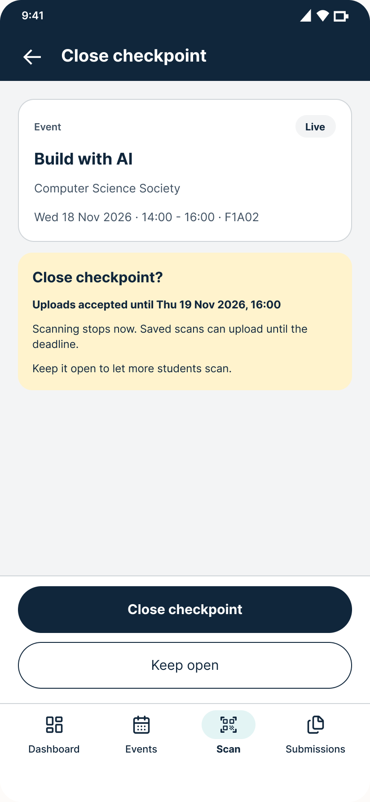](images/committee/close-checkpoint.png) [Figma frame](https://www.figma.com/design/Um4ZLQMFP2mEoEEnYOL8oM/Mobile-Device-Programming?node-id=269-11290) | **Checkpoint closed** [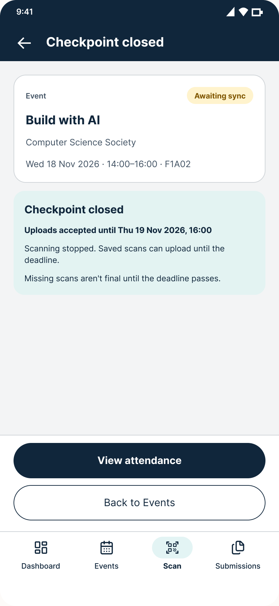](images/committee/checkpoint-closed.png) [Figma frame](https://www.figma.com/design/Um4ZLQMFP2mEoEEnYOL8oM/Mobile-Device-Programming?node-id=269-11336) |

### Bookings and attendance — R2, R3, R4, R5

Before check-in opens, the bookings list shows each reservation as **Booked**. During and after the event, the Committee sees live attendance, claims awaiting sync and final outcomes. Missing uploads stay provisional until the sync deadline. At the deadline, one verified stage with the other required stage missing becomes **Incomplete attendance**, and **No-show** applies when the server received no claim. If an organiser never opens a required checkpoint, students with a verified arrival go to office review. **Under review** stays unresolved until an authorised decision.

[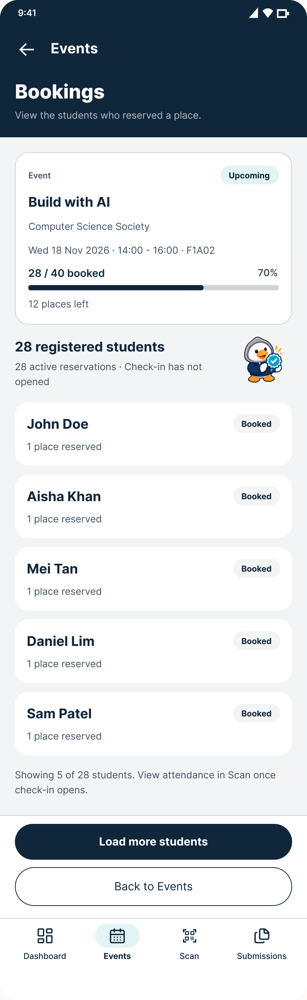](images/committee/bookings-list.png)

**Event bookings** · [Figma frame](https://www.figma.com/design/Um4ZLQMFP2mEoEEnYOL8oM/Mobile-Device-Programming?node-id=269-12084)

Attendance lists and summaries

| Screen | Screen |
|---|---|
| **Live attendee list** [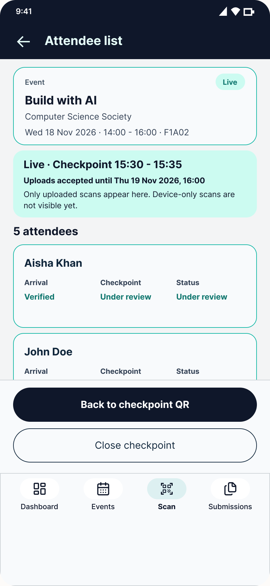](images/committee/live-attendees.png) [Figma frame](https://www.figma.com/design/Um4ZLQMFP2mEoEEnYOL8oM/Mobile-Device-Programming?node-id=269-10854) | **Awaiting sync** [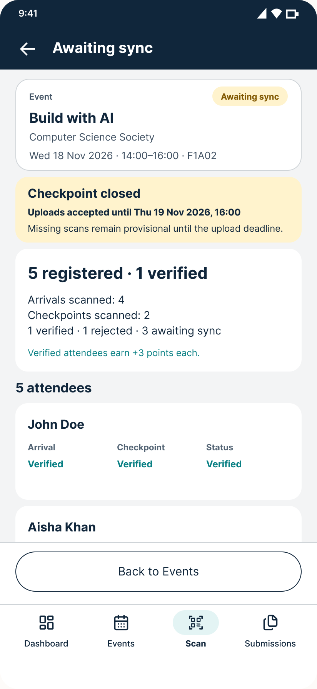](images/committee/awaiting-sync.png) [Figma frame](https://www.figma.com/design/Um4ZLQMFP2mEoEEnYOL8oM/Mobile-Device-Programming?node-id=269-11180) |
| **Attendance summary** [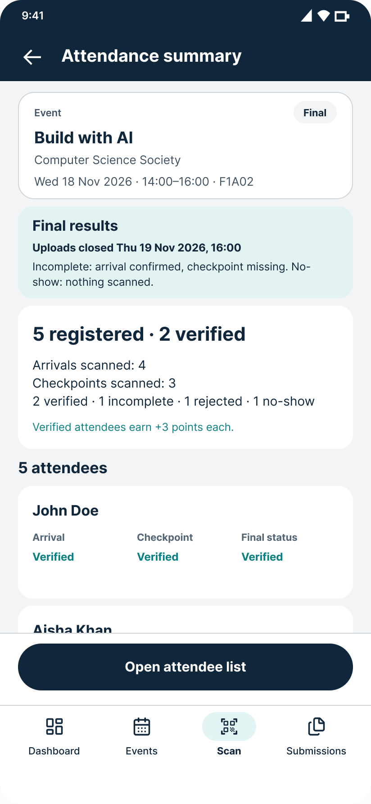](images/committee/final-summary.png) [Figma frame](https://www.figma.com/design/Um4ZLQMFP2mEoEEnYOL8oM/Mobile-Device-Programming?node-id=269-10962) | **Final attendee list** [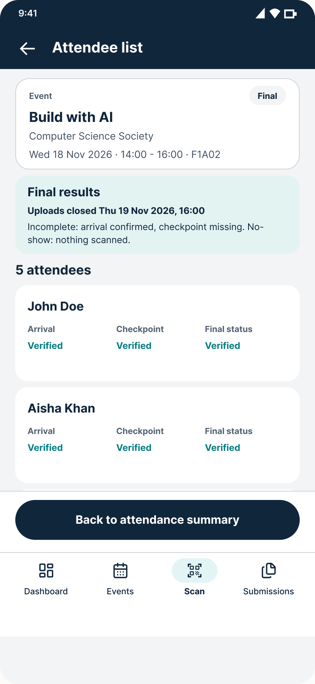](images/committee/final-attendees.png) [Figma frame](https://www.figma.com/design/Um4ZLQMFP2mEoEEnYOL8oM/Mobile-Device-Programming?node-id=269-11070) |

### Committee account — R6

Committee members can check their verified club access and sign out after confirming.

[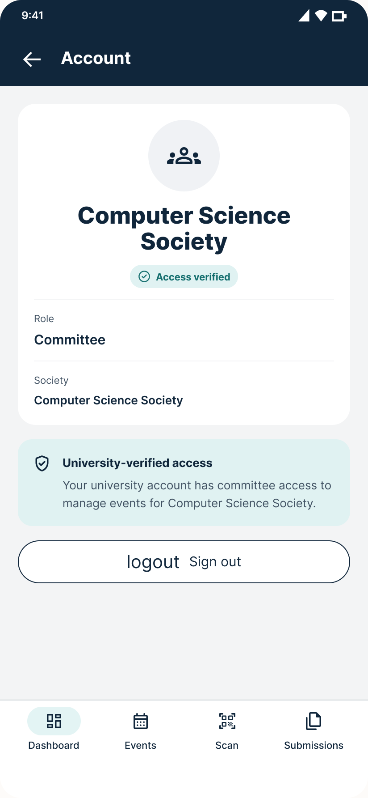](images/committee/account.png)

**Committee account** · [Figma frame](https://www.figma.com/design/Um4ZLQMFP2mEoEEnYOL8oM/Mobile-Device-Programming?node-id=269-10508)

Sign-out

| Screen | Screen |
|---|---|
| **Sign-out confirmation** [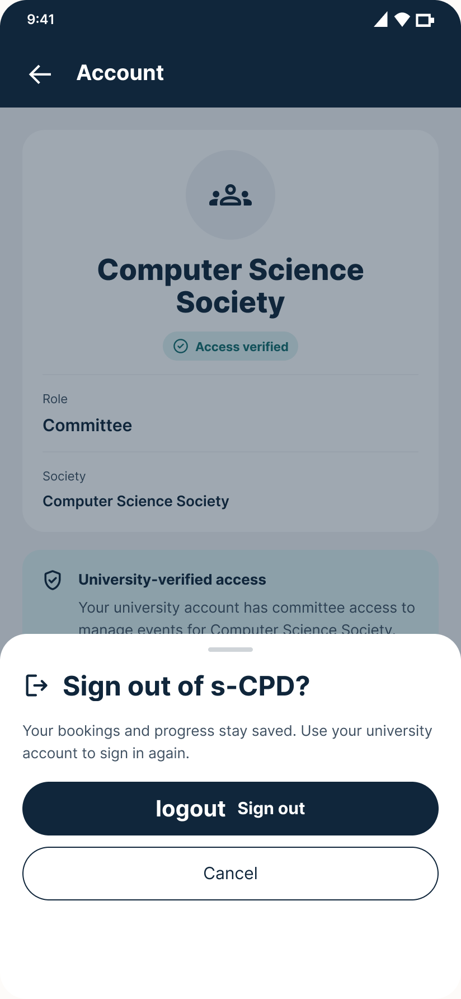](images/committee/sign-out.png) [Figma frame](https://www.figma.com/design/Um4ZLQMFP2mEoEEnYOL8oM/Mobile-Device-Programming?node-id=269-10563) |    |

---

[← Previous: Student wireframes](5-1-student-wireframes.md) · [Back to the overview](../README.md)
