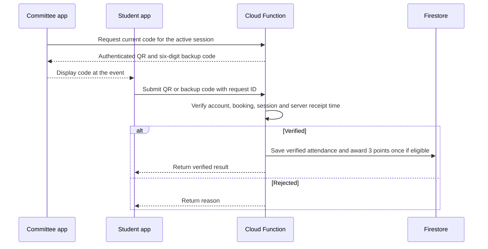
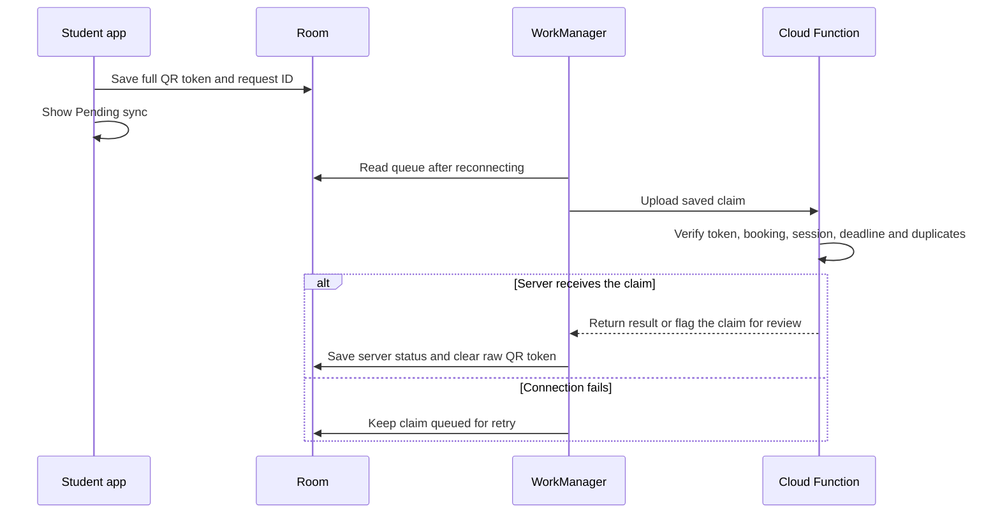

# 4. Attendance security and offline sync

## Attendance verification

Committee **Scan** requests a QR and a six-digit backup code from the backend. Both rotate every 30 seconds while the committee device is online. The QR carries the event ID, check-in session ID, token ID, issue time and expiry. A server-generated authentication tag protects those fields. The backend keeps the key used to generate the tag.

The server checks the account, its booking, the approved event and the active code window. Online submissions use server receipt time. Manual entry requires internet and is rate-limited by account and session. The backend uses one attendance record and one points award per student and event. Retrying the same request returns its recorded result. A separate duplicate attempt cannot overwrite a verified result.

| Attempt | Defence | Remaining weakness |
|---|---|---|
| Proxy check-in | Tie the claim to the authenticated account and booking. | Sharing a login or handing over an unlocked phone can still work. |
| Check-in from home | Rotate codes and validate their event and session. | Someone at the event can relay a live code. |
| Late or altered offline scan | Check the token tag, issuance window and upload deadline. | A copied authentic token could still be used in an offline claim. |
| Duplicate claim | Deduplicate by request ID and enforce one attendance record and award per student and event. | Someone else can still try to submit the first claim with access to the account. |

**DG-08 Attendance verification sequence (R3, R5)**

## Offline sync

The student app saves the full captured QR, account and event IDs, request ID and optional device capture time in Room. It shows **Pending sync** and queues no points. WorkManager submits the record when the device reconnects. The server verifies the token's tag, checks that its issue time fell in the actual check-in window, and applies a deadline based on server receipt time. Device time is diagnostic only. The server can flag suspicious claims for s-CPD office review and withhold points until the review is complete. The token shows when the server issued the code. A student's physical presence and capture time remain unverified by the token itself.

Use a configurable sync grace period after the session closes. The proposed default is 24 hours. Until it expires, a missing claim can still arrive. Assign **No-show** only after the deadline when no claim has reached the server. For a late upload, tell the student that the sync deadline passed. A rejected or previously verified claim must retain its recorded outcome and reason. An authorised reversal removes any points already awarded and recalculates progress and streaks.

**DG-09 Offline sync sequence (R4, R5)**

## Proposed late-event checkpoint

For longer events, students scan the arrival QR and one separate checkpoint QR in the final third of the event. Tell students in advance that the event requires both scans. The committee opens and announces the checkpoint in the room during the final third. Start with a proposed five-minute scan window. The team still needs to agree which events qualify and confirm the window and grace period.

The backend issues codes separately for arrival and checkpoint so an arrival QR cannot satisfy the second scan. The scanner can save either QR offline. The six-digit backup stays online only and is valid for the active stage. Keep one evidence record per stage and one attendance outcome per booking. Award the 3 points and update the streak only after the server verifies the required stages and applies event eligibility.

Before the sync deadline, show the received stages and whether the result is still waiting for a scan or sync. After the deadline, use **Incomplete attendance** when arrival is verified and the required checkpoint is missing. Use **No-show** when the server has received no claim. Show **Rejected** and its reason for a rejected scan. Any claim already under review stays unresolved until the office decides. If an access or connectivity issue prevents a student from completing the checkpoint, they can contact the organiser for s-CPD office review.

This provides evidence at two moments. It still allows live code relay or someone using the same unlocked phone at both moments. The proposal avoids location tracking and biometric data collection. See [the wireframe changes](ui-and-wireframes.md#proposed-checkpoint-wireframes).

[Back to project overview](../README.md)
