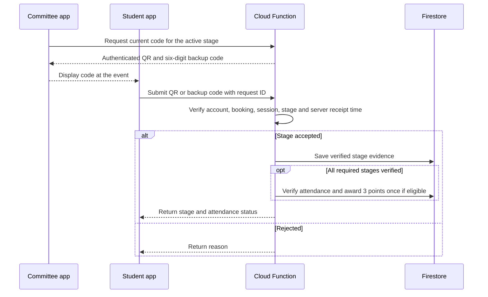
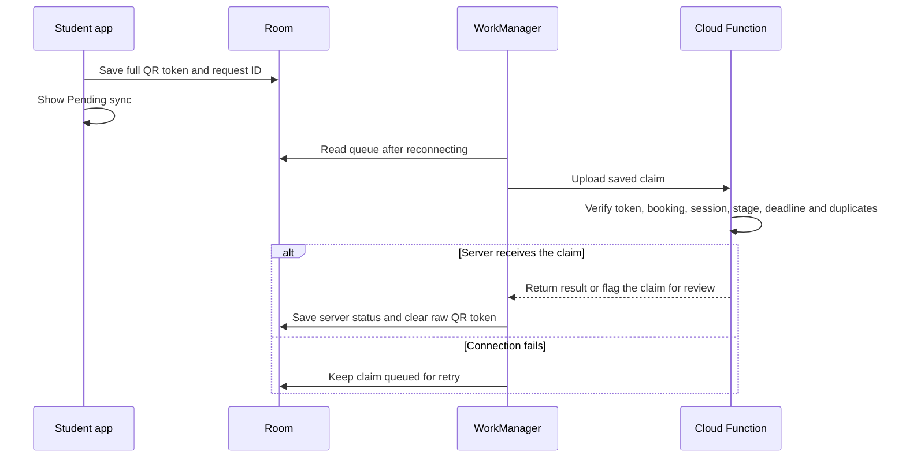

# 4. Attendance security and offline sync

## Attendance verification

Committee **Scan** requests a QR and a six-digit backup code from the backend. Both rotate every 30 seconds while the committee device is online. The QR carries the event ID, check-in session ID, attendance stage, token ID, issue time and expiry. A server-generated authentication tag protects those fields. The backend keeps the key used to generate the tag.

For events that require a checkpoint, students scan on arrival and again during a window the organiser opens and announces in the final third of the event. Booking review explains both scans before students confirm. The backend issues separate codes for arrival and checkpoint. The wireframes show a five-minute checkpoint as an example. The event eligibility rule and window duration still need team agreement.

The server checks the account, its booking, the approved event, the expected stage and the active code window. Online submissions use server receipt time. Manual entry requires internet, applies to the active stage and is rate-limited by account and session. The backend stores one evidence record per required stage and one attendance outcome per student and event. It awards 3 points once and updates the streak only after all required stages are verified and the event is eligible. Retrying the same request returns its recorded result. A separate duplicate attempt cannot overwrite a verified result.

| Attempt | Defence | Remaining weakness |
|---|---|---|
| Proxy check-in | Tie the claim to the authenticated account and booking. | Sharing a login or handing over an unlocked phone can still work. |
| Check-in from home | Rotate codes and validate the event, session and stage. A checkpoint adds evidence at a second moment. | Someone at the event can relay a live code at either stage. |
| Late or altered offline scan | Check the token tag, issuance window and upload deadline. | A copied authentic token could still be used in an offline claim. |
| Duplicate claim | Deduplicate by request ID, keep one evidence record per stage and cap the award at one per student and event. | Someone else can still try to submit the first claim with access to the account. |

**DG-08 Attendance verification sequence (R3, R5)**

## Offline sync

With a cached booking, the student app can capture the arrival or checkpoint QR offline. Room saves the full token, account and event IDs, stage, request ID and optional device capture time. The student sees **Pending sync**. WorkManager submits the record on reconnection. The server checks the token tag, the stage’s code window and the upload deadline using server receipt time. Device capture time is diagnostic. The office can review flagged claims before the server finalises attendance. The token confirms when the server issued the code. Live code relay and shared access to an unlocked phone remain possible.

Use a configurable sync grace period after check-in closes. The wireframes use 24 hours as an example. While uploads are still accepted, the committee sees received stages and **Awaiting sync** for outstanding claims. After the deadline, a verified arrival with a missing required checkpoint becomes **Incomplete attendance**. Use **No-show** when the server received no claim. **Under review** stays unresolved until the office decides. For a late or rejected upload, show the reason and provide the organiser contact for review. Preserve previously verified or rejected claims with their recorded outcomes and reasons. An authorised reversal removes any points already awarded and recalculates progress and streaks.

**DG-09 Offline sync sequence (R4, R5)**

See the [arrival and checkpoint wireframes](ui-and-wireframes.md#55-attendance-and-check-in--r3-r4) for the Student and Committee views.

[Back to project overview](../README.md)
