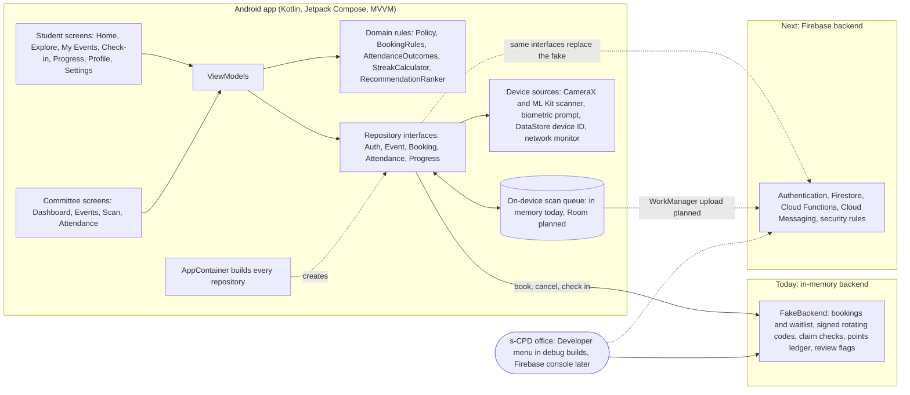
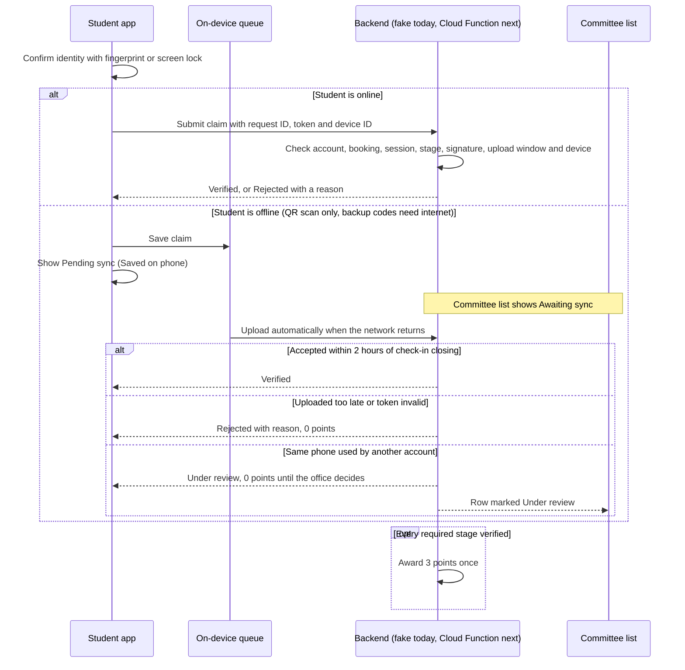

[s-CPD overview](../../README.md) › **6. Changes since Part 1**

## 6. Changes since Part 1

Part 1 is unchanged in sections 2 to 5. This page lists what we changed while building the app, and why. Our answers to the Part 1 feedback from the lecturer and TA are at the top of [7. User stories v2](7-user-stories-v2.md#response-to-the-part-1-feedback). The user stories that come out of these changes are in [7. User stories v2](7-user-stories-v2.md), and the attacks they answer are in [8. Threat model](8-threat-model.md). The requirements review from our SQA team, and what we changed for each finding, is in [9. SQA review response](9-sqa-review-response.md).

### What the app runs on this week

The front end is complete for both roles and runs on an in-memory backend (`data/fake/FakeBackend.kt`). The fake plays the server's part: it owns the shared data, runs the booking transaction, signs the rotating codes, checks claims and keeps the points ledger. Every screen reads from a ViewModel, and every ViewModel talks only to repository interfaces in `data/Repositories.kt`. Next week the Firebase implementations replace the fakes behind the same interfaces, so no screen needs to change.

The fake keeps everything in memory, so data resets when the app process ends. Saved offline scans therefore do not survive an app restart yet. That needs the Room queue planned for the Firebase work.

### Design changes

| Area | Part 1 | Now | Why |
|---|---|---|---|
| Home header | Tall campus photo, logo row and mascot above the fold | About 200 dp, collapsing to a sticky search bar on scroll | The marking device is a Pixel 2 (411 × 731 dp). The old header pushed the first event below the fold. |
| Event day | Check-in reached from My Events only | A **Happening now** card on Home opens check-in in one tap | Checking in is the most important task on the day, so it should not be hidden. |
| Check-in screen | Separate prototype screen with its own two-tab bar and demo buttons | Themed screen inside the student navigation, with simulation controls only in a debug-build menu | It looked like a different app, and demo controls should never reach a release build. |
| Event details | Facts and a Book button | Adds the description, a "Needs 1 scan" or "Needs 2 scans" card, the cancellation rule and the organiser's contact. The bottom navigation is hidden on this screen. | Part 1 said students see the attendance requirement before booking. The screen now does that. |
| Full events | "Check again later" | **Join waitlist**. The first student in the queue is booked automatically when a place opens. | It answers the brief's question about full events properly. |
| Booking limits | None | At most 5 active bookings, cancellation closes 2 hours before the start, and booking pauses after 3 no-shows in a semester | Without limits, one student could book every event and block places for others. |
| Points request | Every event earned a fixed 3 points | The club switches on **Request s-CPD points** and gives a reason. The office grants points by approving the event. | The brief says the club *requests* points, so the request is now visible. |
| Approved events | Locked | Still locked. The committee can only cancel with a reason, which booked students see. | This matches the brief's answer ("Can a club change an event after approval? NO") with a clear way forward. |
| Recommendations | Filter by interest tags, with an optional "similar students" ranking | A ranked list with a reason on each card, for example "Because you like Tech". Clashing and already-booked events are left out. The "similar students" idea (US-21) is dropped. | A plain filter is hard to call a real feature, and we would not have the data the similar-students idea needs. |
| Streak | Breaks in any week without verified attendance | Weeks with no approved events at all, such as exam weeks, are skipped | Students should not lose a streak because no events ran. |
| Stamps and milestones | Stamps on Progress | Kept, together with a points ring to the next milestone and the full points history, including reversals | Points come from the ledger, so a reversal by the office shows as its own line with the reason. |
| Sign-out | Not covered | Signing out with scans still on the phone shows a warning first | Saved scans belong to the account and are removed on sign-out, so they would never earn points. |

### Security changes

These are summarised here. The full table is in [8. Threat model](8-threat-model.md).

- **Device ID.** Each install has a random ID that is sent with every check-in. A second account checking in with the same phone at the same event is refused and flagged for the office.
- **Identity confirmation.** Before a check-in is sent, the phone asks for the fingerprint or screen lock. If the phone has no screen lock, the check-in still goes through and the student is told to set one.
- **Offline upload window.** A scan saved offline must reach the server within 2 hours of check-in closing. Part 1 used a 24-hour grace period as an example, which gave a photographed QR code a whole day of use.
- **Backup code rate limit.** After 5 wrong codes in one session, backup codes are blocked for that student. Scanning the live QR still works.

### Code structure changes

The code now follows the layers from the MVVM lecture: `model/` (plain data), `domain/` (pure Kotlin rules), `data/` (repository interfaces, fakes and device sources) and `ui/` (screens and ViewModels per feature). Navigation Compose replaced the hand-written screen switch, with separate student and committee graphs chosen by the signed-in account's role.

### Architecture as built

The Part 1 diagram (DG-02 in [Architecture](../4-1-architecture.md)) shows the finished product with Room and Firebase. This diagram shows what the app is made of today, and which parts the Firebase work will replace. Dashed lines mark the parts still to come.

**DG-02b Architecture as built (R4, R6)**

### Check-in and offline sync as built

This replaces DG-09 for the current app. The student's phone and the committee's list use different words on purpose: a scan still on a student's phone is **Pending sync**, and the committee sees **Awaiting sync** for any stage the server has not received yet.

**DG-09b Check-in and offline sync as built (R3, R4, R5)**

| Where it shows | Term | Meaning |
|---|---|---|
| Student's phone, one scan | Pending sync (Saved on phone) | Saved on the device, not yet uploaded |
| Committee attendee list | Awaiting sync | The server has not received this stage yet, and it may still arrive while the upload window is open |
| Student's history and committee list | Under review | The office is checking a flagged record. No points until it decides. |
| Student's history | Rejected, Incomplete attendance, No-show, Verified | Final outcomes, as in the status terms in [Status terms and data model](../4-3-status-and-data-model.md) |

Not built yet: saved scans do not survive an app restart, and the committee list does not yet turn Awaiting sync into No-show when the 2-hour window ends. Both come with the Firebase work.

---

[Next: 7. User stories v2 →](7-user-stories-v2.md)
