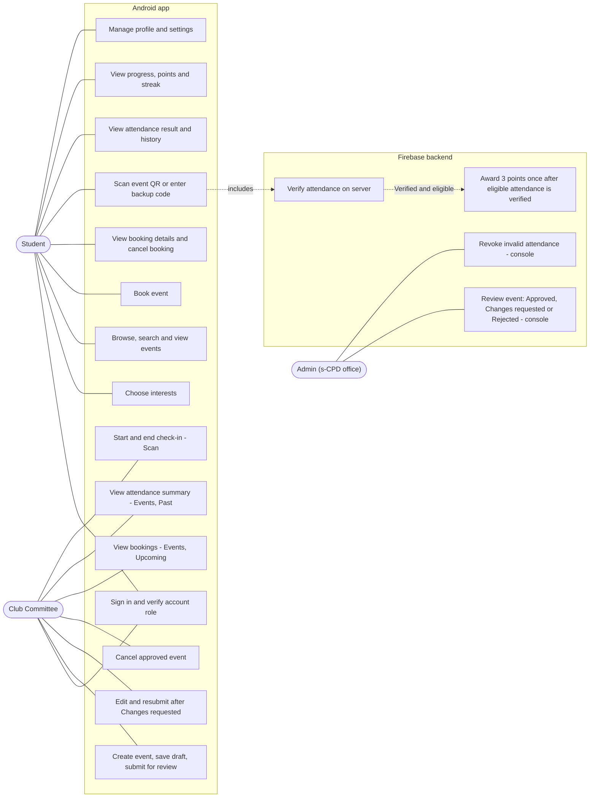
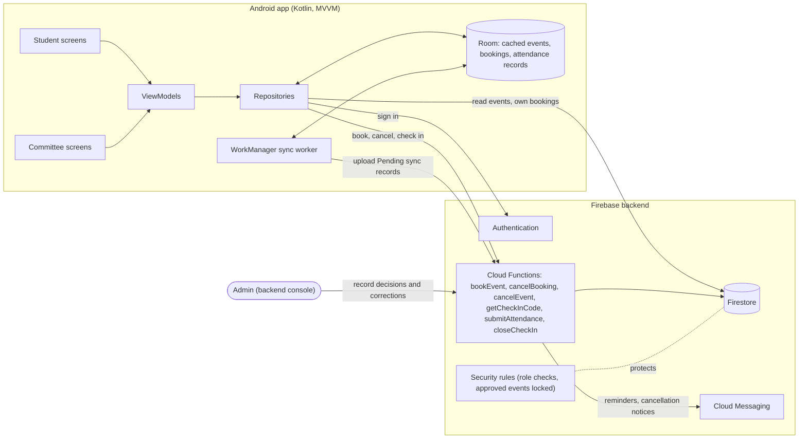
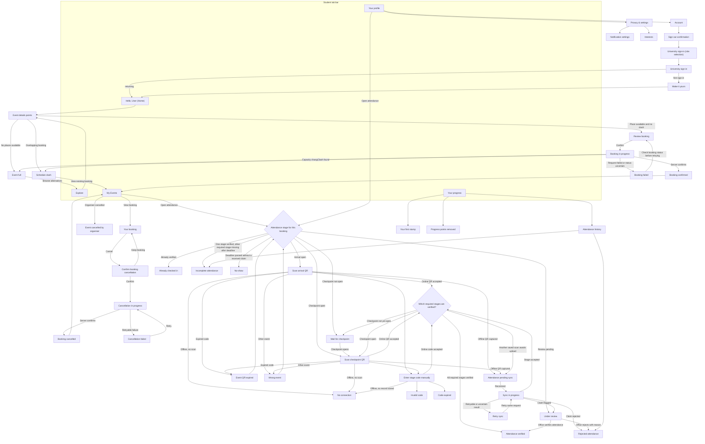
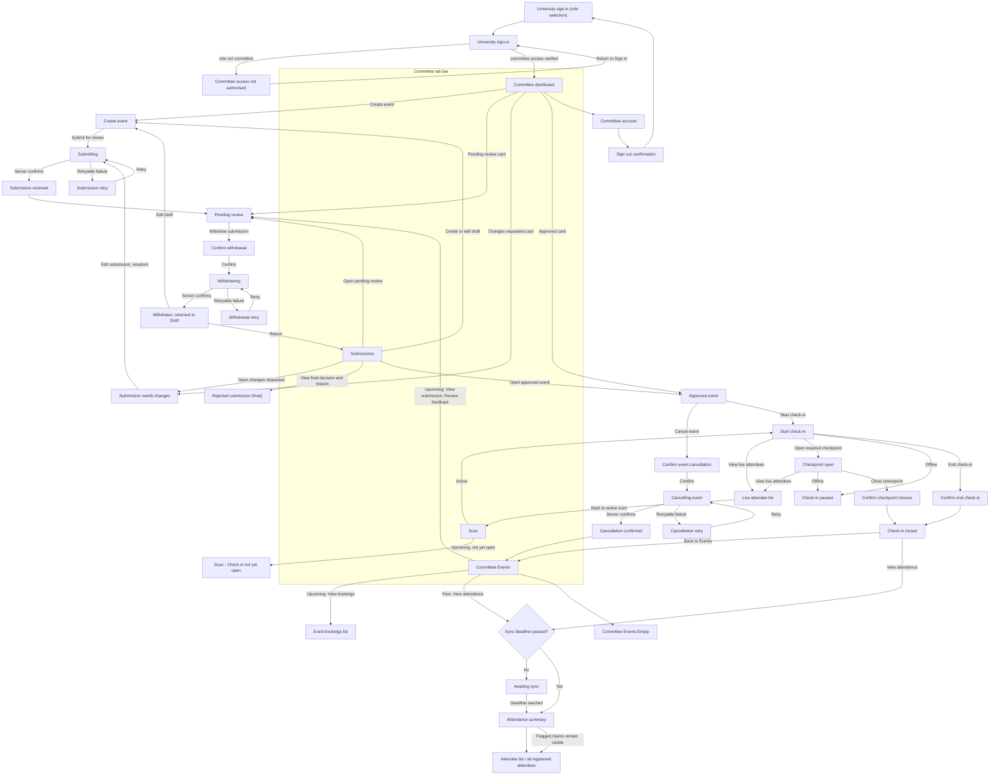
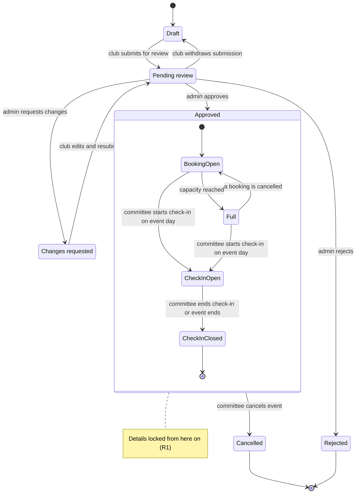
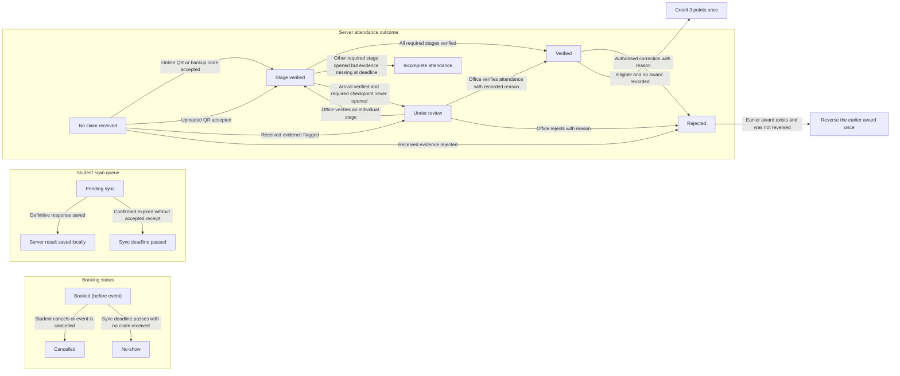
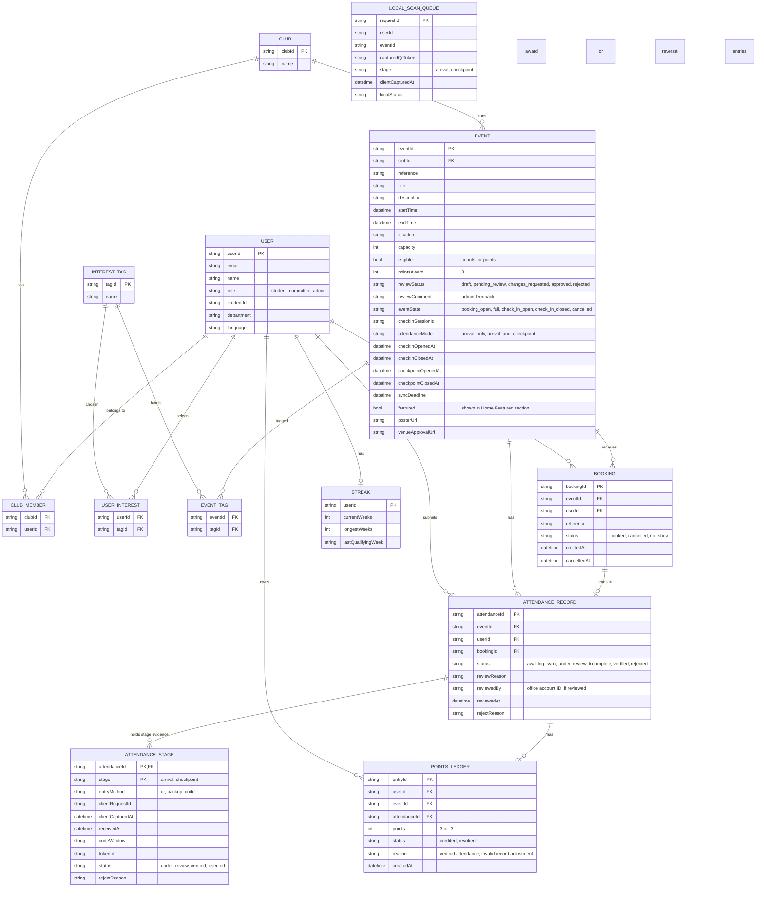

# 4. Technical design
 
### Architecture
 
The Kotlin Android app uses MVVM. ViewModels expose screen state, and repositories read from Room or the Firebase backend. Room caches events and bookings and stores queued QR scans. Firebase Authentication handles sign-in, Firestore stores shared data, Cloud Functions handle bookings and attendance, and Cloud Messaging sends reminders and cancellation notices. WorkManager uploads queued scans when the device reconnects.
 
Students use Home, Explore, My Events, Progress and Profile. Committees use Dashboard, Events, Scan and Submissions. The s-CPD office reviews submissions and corrects attendance in the backend console.
 
**Roles and authentication.** The role picker opens the relevant sign-in flow. The backend checks the authenticated account, assigned role and club membership. The prototype uses pre-approved test accounts. A production build would use university single sign-on, subject to access. The profile badge refers to account verification. Use **University account verified** after university sign-in and **Account verified** for prototype accounts.
 
**DG-01 Use-case overview (R1–R6)**
 

 
**DG-02 Architecture diagram (R4, R6)**
 

 
### Screen flows
 
The flows use the Figma screen names where applicable. An event’s attendance requirement determines whether students need an arrival scan only or both an arrival scan and a later checkpoint. The booking review explains the requirement before confirmation.
 
**DG-03 Student screen flow (R2–R6)**
 

 
**DG-04 Committee screen flow (R1, R3, R6)**
 

 
### Status terms
 
| Area | Terms | Notes |
|---|---|---|
| Event review | Draft, Pending review, Approved, Changes requested, Rejected | Draft is not a review status. Admin reviews submissions in the backend: **Approved** locks event details; **Changes requested** allows edits and resubmission; **Rejected** is final and cannot be booked. |
| Booking / participation | Booked, Cancelled, No-show | **Booked** reserves a place. **Cancelled** releases it. Assign **No-show** after the sync deadline if the server has received no attendance claim. A received claim still under review stays unresolved. |
| Student scan queue | Pending sync, Sync deadline passed | **Pending sync** describes a scan saved on the student’s device. A queue item can expire without a server rejection. Reconcile an uncertain upload by request ID. |
| Attendance record | Awaiting sync, Under review, Incomplete attendance, Verified, Rejected | **Awaiting sync** means the server may still receive missing claims. **Under review** stays unresolved until an authorised office decision. After the deadline, one verified stage with the other required stage missing is **Incomplete attendance**. A verified arrival at an event where the organiser never opened the required checkpoint goes to office review. **Verified** requires all stages or an authorised office decision. **Rejected** includes the reason. |
| Points | +3 per eligible Verified attendance, 0 otherwise | Award points once after attendance is verified. If an authorised correction invalidates a credited record, reverse its award once and recalculate progress. |
 
### Data model
 
**DG-05 Event lifecycle (R1)**
 
A club creates an event as a Draft and submits it for Pending review. Admin can approve it, request changes, or reject it. The Committee can edit and resubmit events marked Changes requested. Withdrawing a pending submission returns the same event to Draft, where it stays unpublished and can be edited and resubmitted. Rejected events are final and cannot be booked. Approved event details are locked by backend rules. After approval, the Committee can cancel the event, which closes bookings and notifies booked students.
 

 
**DG-06 Booking and attendance lifecycle (R2–R5)**
 

Before the sync deadline, a booking without a received claim remains unresolved. **Pending sync** and **Sync deadline passed** describe the device queue and do not change the server outcome. An office decision takes precedence over automatic finalisation while a claim is under review. The attendance result and any points ledger entry are saved together so a retry cannot add a second award.

**DG-07 Entity-relationship diagram (R1–R5)**
 
Each queued scan has a client request ID for retries. The server keeps one attendance outcome per student and event, linked to the booking, and one evidence record per required stage. A ledger records each points award or reversal. Streaks use verified attendance by event week. Interest stamps and milestones are derived from attendance, event tags and points. Recommendations use saved interests and verified attendance history. Booking capacity and schedule clashes are checked in the same transaction.
 

`LOCAL_SCAN_QUEUE` is stored in Room. The QR authentication key is held by the backend. See [attendance security and offline sync](attendance-security-and-sync.md) for the token and verification rules.

[Back to project overview](../README.md)
