# 5. UI design and wireframes

The wireframes cover Student and Club Committee journeys. The s-CPD office reviews event submissions in the backend. [Open the Figma file](https://www.figma.com/design/Um4ZLQMFP2mEoEEnYOL8oM/Mobile-Device-Programming?node-id=0-1).

Main landing screens use an expanded campus header that collapses into a compact dark-blue app bar on scroll. Secondary screens use the compact bar. Screenshots show sample accounts and static interface states. Canvas annotations are excluded from the phone exports.

### 5.1. Student entry and interests — R6

Students choose Student or Club Committee before signing in. The prototype uses approved test accounts. Production sign-in depends on access to university single sign-on. Password recovery and network recovery stay signed out. Students can select interests for event recommendations.

[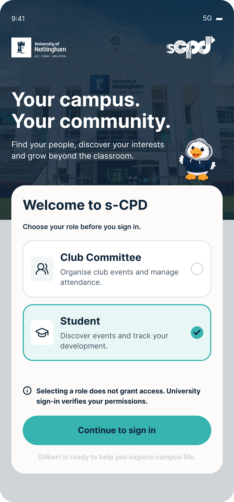](images/wireframes/student-role-selection.png)

**Choose a role** · [Figma frame](https://www.figma.com/design/Um4ZLQMFP2mEoEEnYOL8oM/Mobile-Device-Programming?node-id=82-101)

Sign-in and account recovery

| Screen | Screen |
|---|---|
| **Student sign-in** [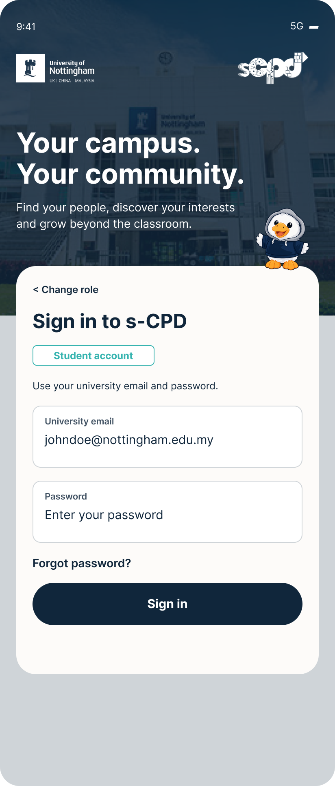](images/wireframes/student-sign-in.png) [Figma frame](https://www.figma.com/design/Um4ZLQMFP2mEoEEnYOL8oM/Mobile-Device-Programming?node-id=82-193) | **Sign-in error** [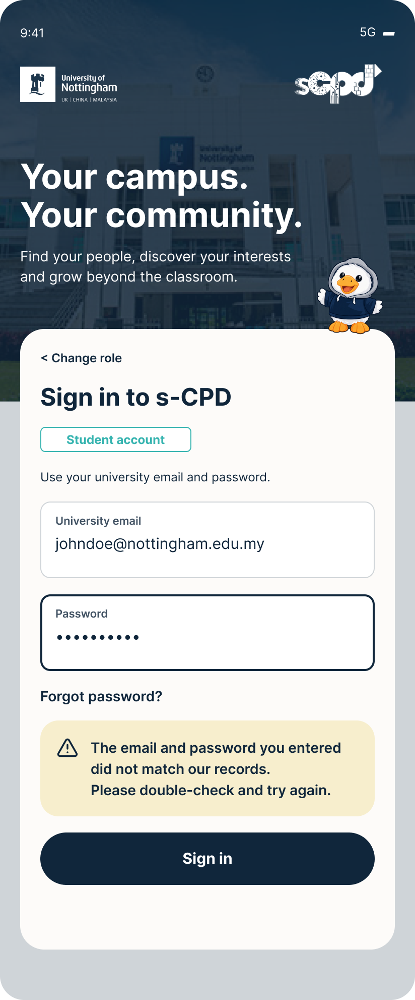](images/wireframes/student-sign-in-error.png) [Figma frame](https://www.figma.com/design/Um4ZLQMFP2mEoEEnYOL8oM/Mobile-Device-Programming?node-id=82-269) |
| **Password recovery** [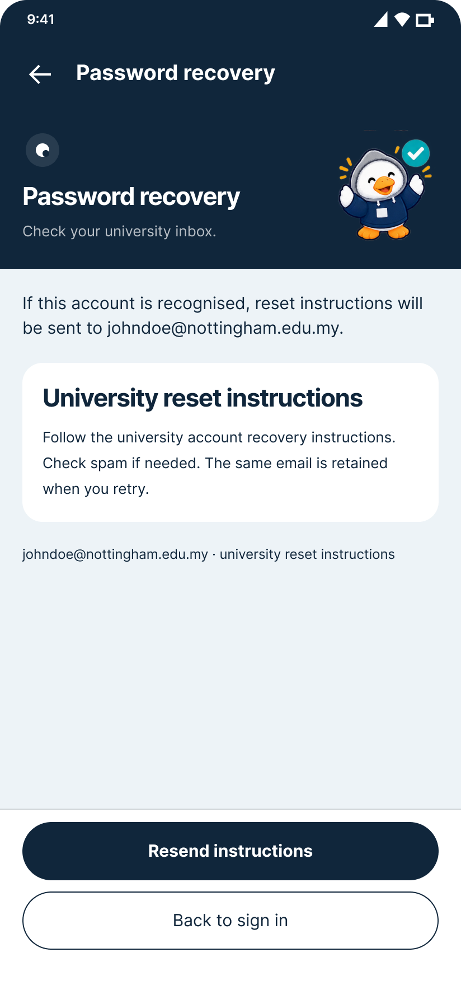](images/wireframes/student-password-recovery.png) [Figma frame](https://www.figma.com/design/Um4ZLQMFP2mEoEEnYOL8oM/Mobile-Device-Programming?node-id=147-711) | **Sign-in network error** [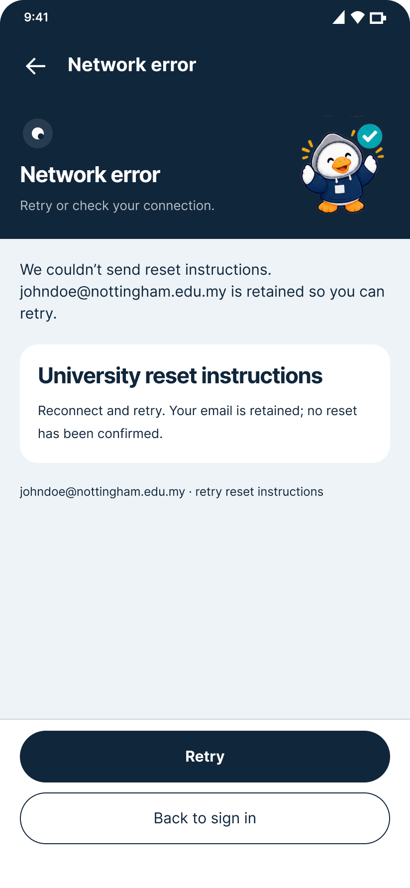](images/wireframes/student-network-recovery.png) [Figma frame](https://www.figma.com/design/Um4ZLQMFP2mEoEEnYOL8oM/Mobile-Device-Programming?node-id=147-768) |
| **Choose interests** [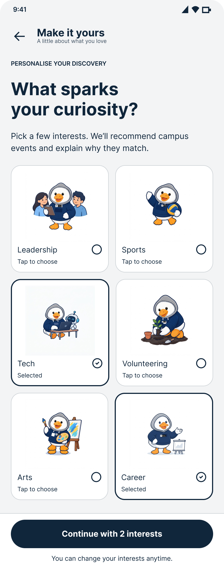](images/wireframes/student-interests.png) [Figma frame](https://www.figma.com/design/Um4ZLQMFP2mEoEEnYOL8oM/Mobile-Device-Programming?node-id=82-350) |   |

### 5.2. Event discovery — R2, Feature 1

Home and Explore show featured and recommended events, search and filters. Empty and offline states explain what the student can do next.

| Home | Explore |
|---|---|
| **Home** [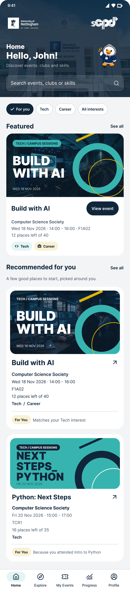](images/wireframes/student-home.png) [Figma frame](https://www.figma.com/design/Um4ZLQMFP2mEoEEnYOL8oM/Mobile-Device-Programming?node-id=82-1045) | **Explore** [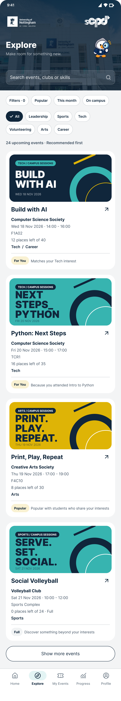](images/wireframes/student-explore.png) [Figma frame](https://www.figma.com/design/Um4ZLQMFP2mEoEEnYOL8oM/Mobile-Device-Programming?node-id=82-839) |

Loading, search and offline states

| Screen | Screen |
|---|---|
| **Home loading** [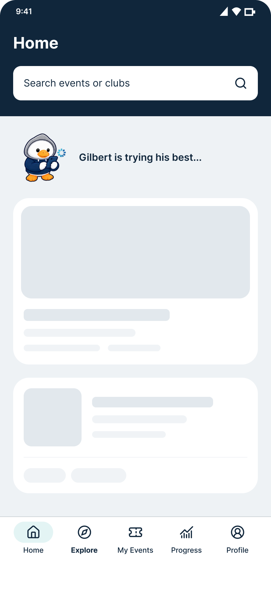](images/wireframes/student-home-loading.png) [Figma frame](https://www.figma.com/design/Um4ZLQMFP2mEoEEnYOL8oM/Mobile-Device-Programming?node-id=82-1292) | **Explore loading** [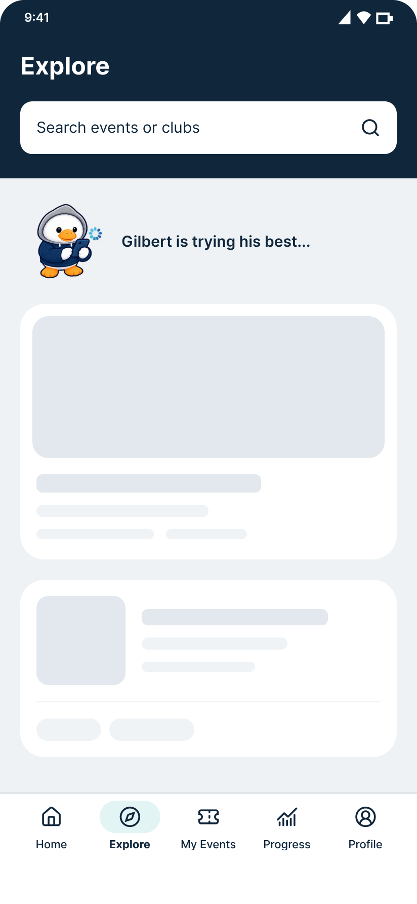](images/wireframes/student-explore-loading.png) [Figma frame](https://www.figma.com/design/Um4ZLQMFP2mEoEEnYOL8oM/Mobile-Device-Programming?node-id=82-1228) |
| **No search results** [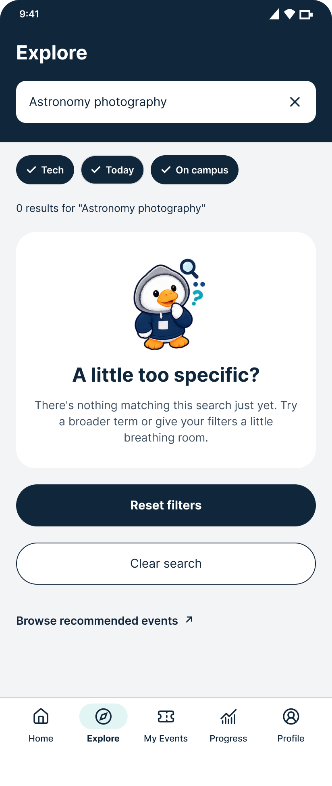](images/wireframes/student-search-empty.png) [Figma frame](https://www.figma.com/design/Um4ZLQMFP2mEoEEnYOL8oM/Mobile-Device-Programming?node-id=82-692) | **Explore offline** [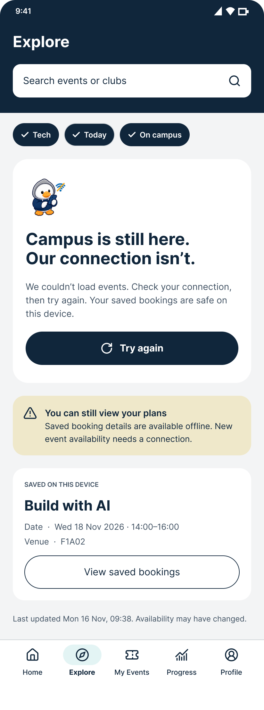](images/wireframes/student-explore-offline.png) [Figma frame](https://www.figma.com/design/Um4ZLQMFP2mEoEEnYOL8oM/Mobile-Device-Programming?node-id=82-760) |

### 5.3. Event details and booking — R2

Event details show availability and the attendance requirements before booking. The booking flow handles full events, schedule clashes, an in-progress request, and a failed or confirmed result.

[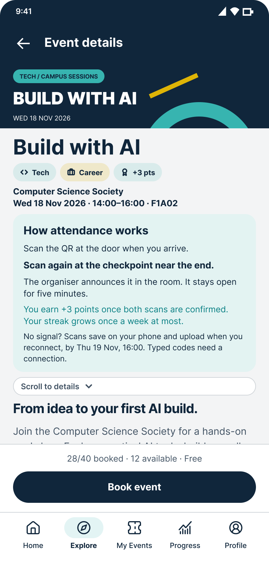](images/checkpoint/student-event-details.png)

**Event details and attendance requirements** · [Figma frame](https://www.figma.com/design/Um4ZLQMFP2mEoEEnYOL8oM/Mobile-Device-Programming?node-id=110-2)

Booking and availability

| Screen | Screen |
|---|---|
| **Event full** [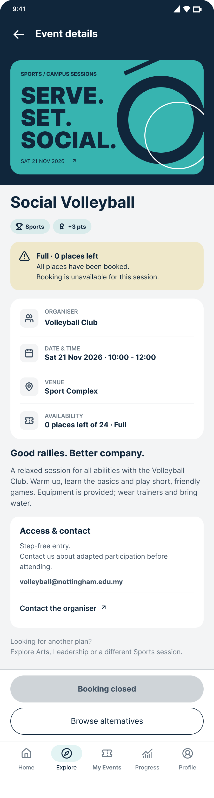](images/wireframes/student-event-full.png) [Figma frame](https://www.figma.com/design/Um4ZLQMFP2mEoEEnYOL8oM/Mobile-Device-Programming?node-id=82-1460) | **Schedule clash** [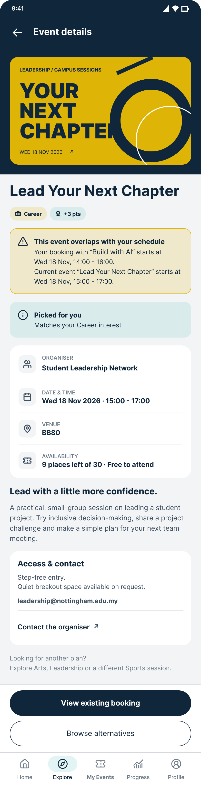](images/wireframes/student-schedule-clash.png) [Figma frame](https://www.figma.com/design/Um4ZLQMFP2mEoEEnYOL8oM/Mobile-Device-Programming?node-id=82-1568) |
| **Review booking** [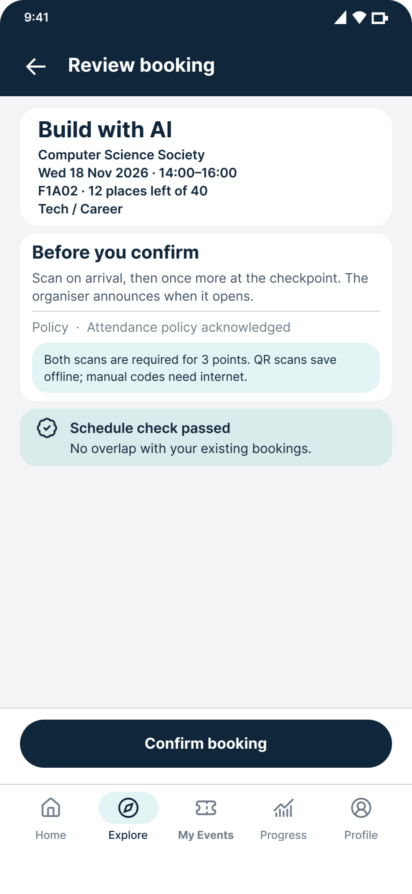](images/wireframes/student-booking-review.png) [Figma frame](https://www.figma.com/design/Um4ZLQMFP2mEoEEnYOL8oM/Mobile-Device-Programming?node-id=82-1398) | **Booking in progress** [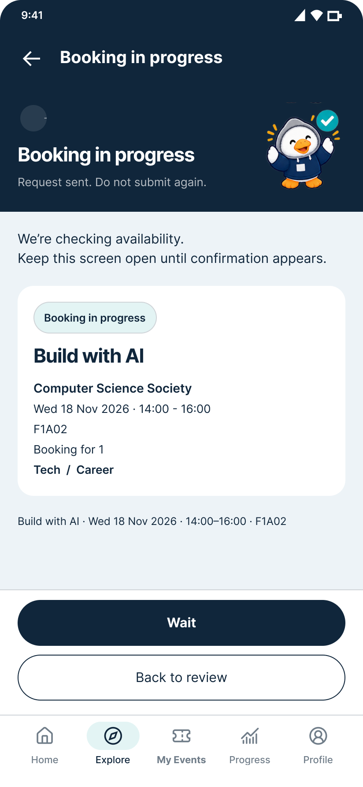](images/wireframes/student-booking-in-progress.png) [Figma frame](https://www.figma.com/design/Um4ZLQMFP2mEoEEnYOL8oM/Mobile-Device-Programming?node-id=147-478) |
| **Booking failed** [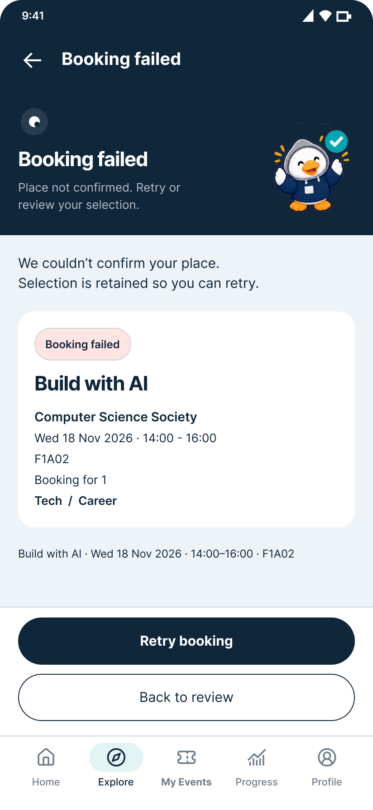](images/wireframes/student-booking-failed.png) [Figma frame](https://www.figma.com/design/Um4ZLQMFP2mEoEEnYOL8oM/Mobile-Device-Programming?node-id=147-536) | **Booking confirmed** [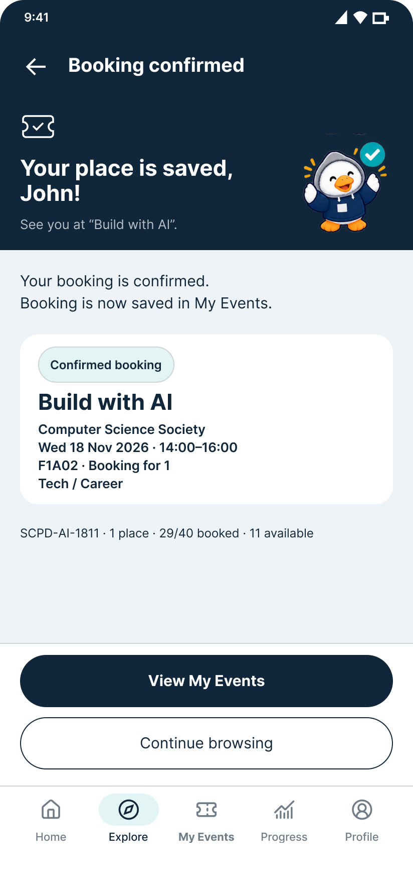](images/wireframes/student-booking-confirmed.png) [Figma frame](https://www.figma.com/design/Um4ZLQMFP2mEoEEnYOL8oM/Mobile-Device-Programming?node-id=82-2052) |

### 5.4. My Events and cancellations — R2, R3, R4

Students view their bookings and see whether arrival or checkpoint scanning is available. A queued arrival scan stays pending without removing the checkpoint action when it opens. Booking cancellation and organiser cancellation have distinct outcomes.

[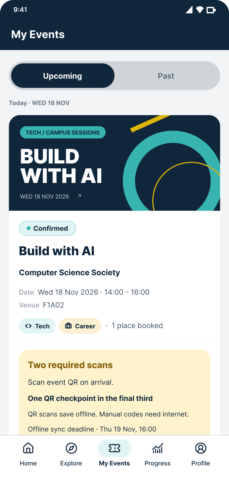](images/checkpoint/student-my-events-arrival-required.png)

**My Events — arrival required** · [Figma frame](https://www.figma.com/design/Um4ZLQMFP2mEoEEnYOL8oM/Mobile-Device-Programming?node-id=110-125)

Upcoming events and checkpoint access

| Screen | Screen |
|---|---|
| **Waiting for checkpoint — arrival verified** [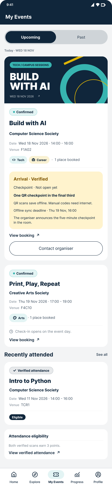](images/checkpoint/student-waiting-arrival-verified.png) [Figma frame](https://www.figma.com/design/Um4ZLQMFP2mEoEEnYOL8oM/Mobile-Device-Programming?node-id=115-456) | **Waiting for checkpoint — arrival pending sync** [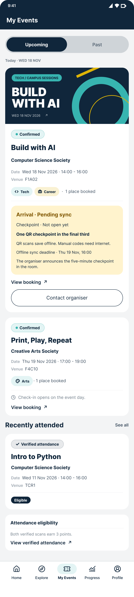](images/checkpoint/student-waiting-arrival-pending.png) [Figma frame](https://www.figma.com/design/Um4ZLQMFP2mEoEEnYOL8oM/Mobile-Device-Programming?node-id=115-605) |
| **Checkpoint open — arrival verified** [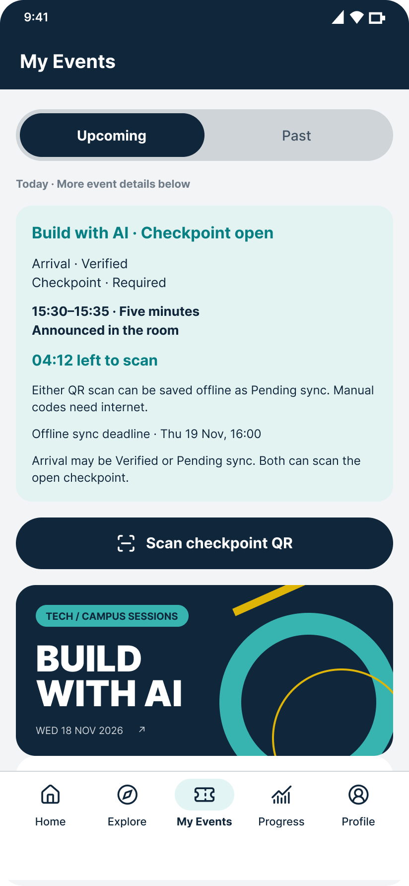](images/checkpoint/student-checkpoint-open-arrival-verified.png) [Figma frame](https://www.figma.com/design/Um4ZLQMFP2mEoEEnYOL8oM/Mobile-Device-Programming?node-id=110-441) | **Checkpoint open — arrival pending sync** [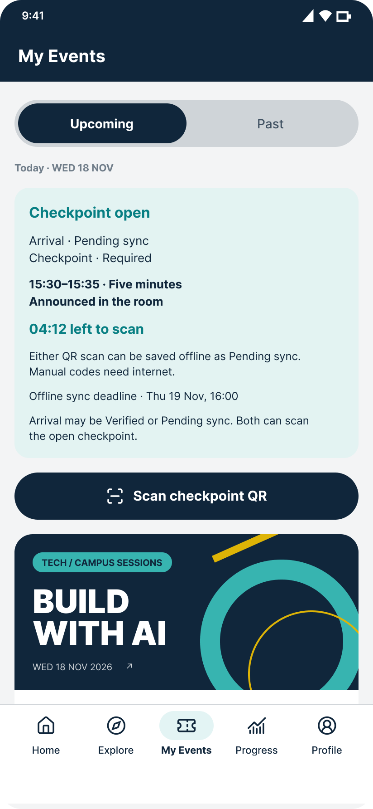](images/checkpoint/student-checkpoint-open-arrival-pending.png) [Figma frame](https://www.figma.com/design/Um4ZLQMFP2mEoEEnYOL8oM/Mobile-Device-Programming?node-id=115-35) |

Cancelling a booking

| Screen | Screen |
|---|---|
| **Confirm booking cancellation** [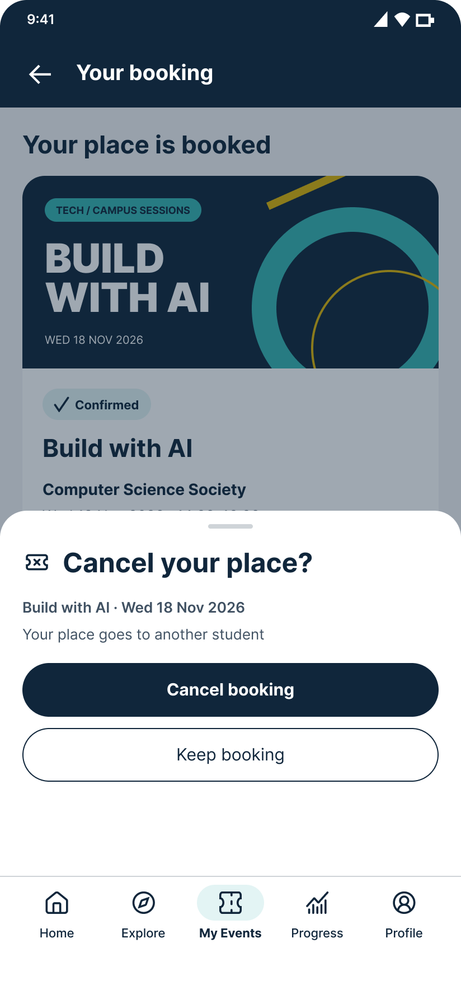](images/wireframes/student-cancel-booking-confirm.png) [Figma frame](https://www.figma.com/design/Um4ZLQMFP2mEoEEnYOL8oM/Mobile-Device-Programming?node-id=82-2429) | **Cancellation in progress** [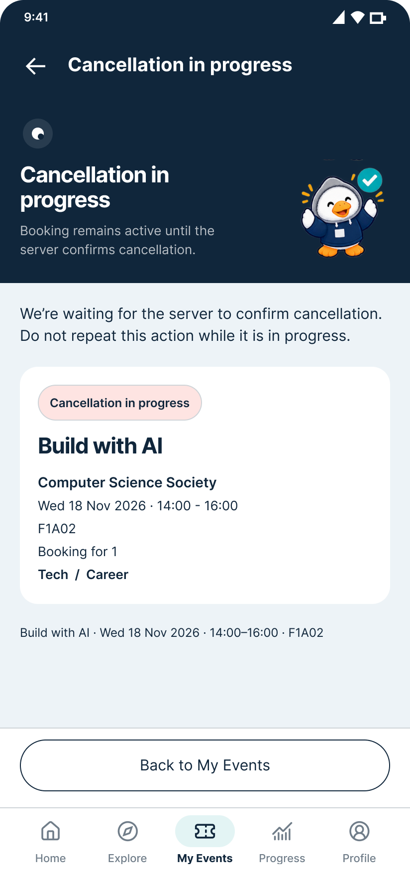](images/wireframes/student-cancellation-in-progress.png) [Figma frame](https://www.figma.com/design/Um4ZLQMFP2mEoEEnYOL8oM/Mobile-Device-Programming?node-id=147-825) |
| **Cancellation failed** [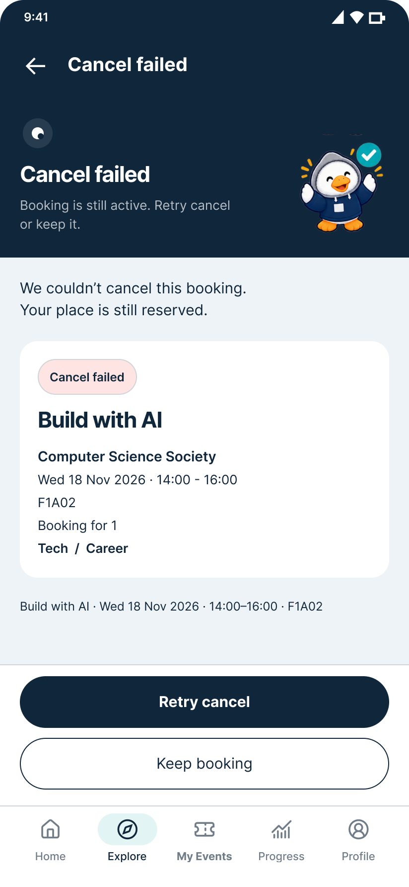](images/wireframes/student-cancel-failed.png) [Figma frame](https://www.figma.com/design/Um4ZLQMFP2mEoEEnYOL8oM/Mobile-Device-Programming?node-id=147-595) | **Booking cancelled** [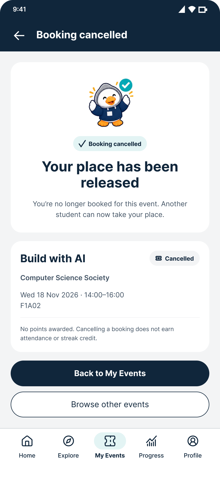](images/wireframes/student-booking-cancelled.png) [Figma frame](https://www.figma.com/design/Um4ZLQMFP2mEoEEnYOL8oM/Mobile-Device-Programming?node-id=82-2364) |
| **Event cancelled by organiser** [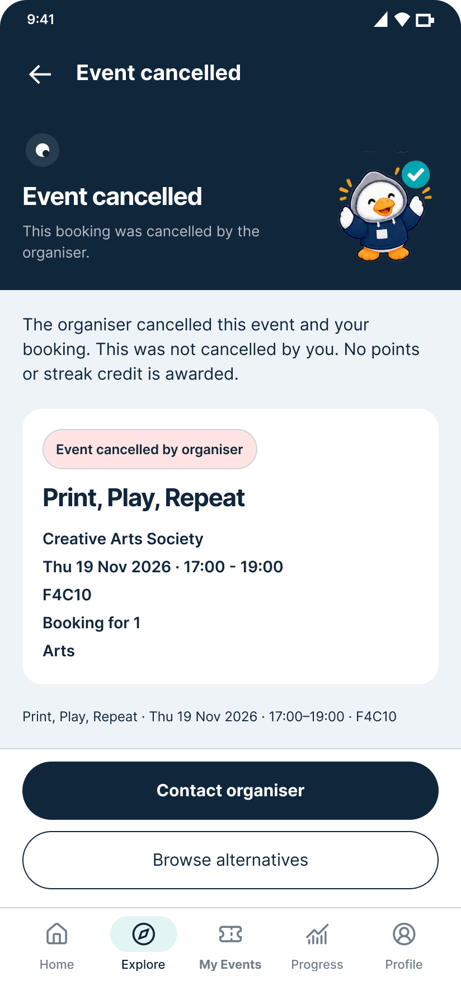](images/wireframes/student-event-cancelled.png) [Figma frame](https://www.figma.com/design/Um4ZLQMFP2mEoEEnYOL8oM/Mobile-Device-Programming?node-id=147-882) |   |

### 5.5. Attendance and check-in — R3, R4

Events with a checkpoint require an arrival scan and a later checkpoint scan. Students scan the rotating QR or enter the active stage’s backup code online. Each offline scan remains **Pending sync** on the device until the app stores a definitive server response. The interface distinguishes saved scans, retries, office review and incomplete attendance.

[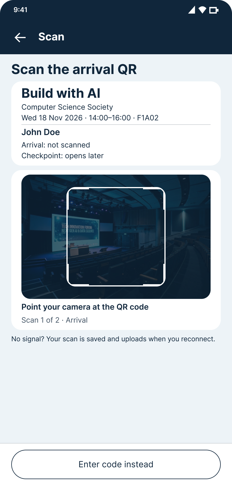](images/checkpoint/student-arrival-scanner.png)

**Scan arrival QR** · [Figma frame](https://www.figma.com/design/Um4ZLQMFP2mEoEEnYOL8oM/Mobile-Device-Programming?node-id=110-326)

Arrival and checkpoint scanning

| Screen | Screen |
|---|---|
| **Arrival saved — verified** [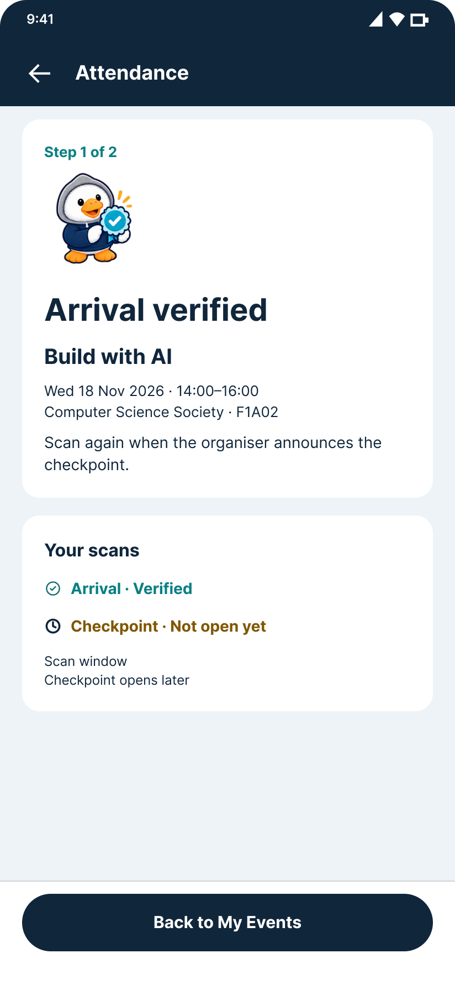](images/checkpoint/student-arrival-verified.png) [Figma frame](https://www.figma.com/design/Um4ZLQMFP2mEoEEnYOL8oM/Mobile-Device-Programming?node-id=115-2) | **Arrival saved — pending sync** [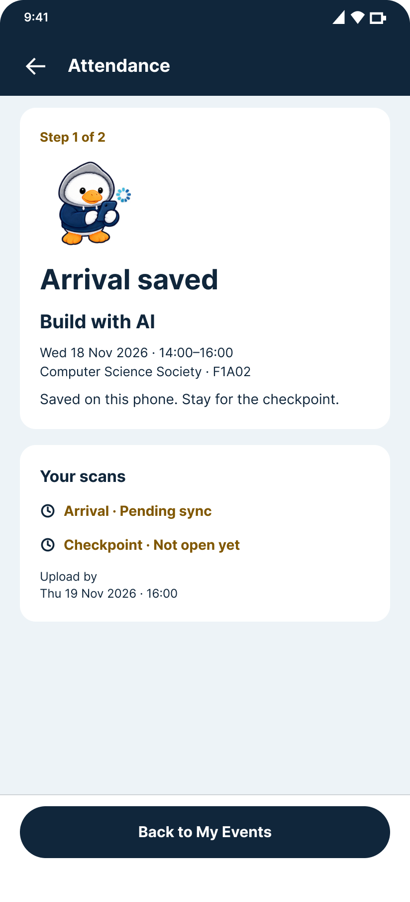](images/checkpoint/student-arrival-pending-sync.png) [Figma frame](https://www.figma.com/design/Um4ZLQMFP2mEoEEnYOL8oM/Mobile-Device-Programming?node-id=110-389) |
| **Scan checkpoint QR** [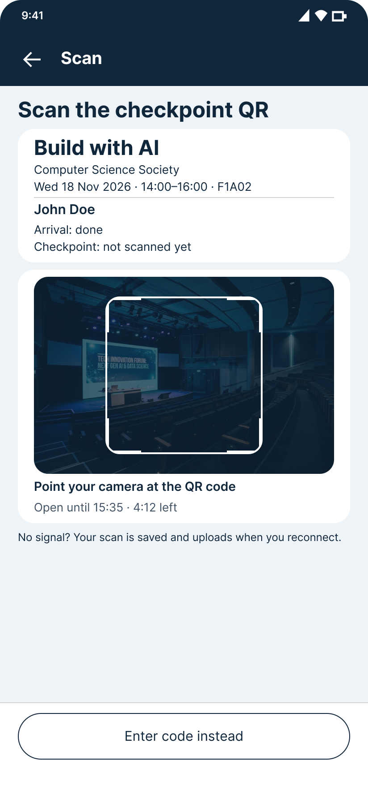](images/checkpoint/student-checkpoint-scanner-arrival-verified.png) [Figma frame](https://www.figma.com/design/Um4ZLQMFP2mEoEEnYOL8oM/Mobile-Device-Programming?node-id=110-642) | **Scan checkpoint — arrival pending sync** [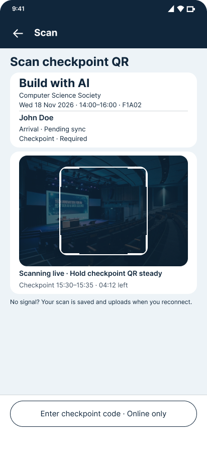](images/checkpoint/student-checkpoint-scanner-arrival-pending.png) [Figma frame](https://www.figma.com/design/Um4ZLQMFP2mEoEEnYOL8oM/Mobile-Device-Programming?node-id=115-185) |

Camera access and QR errors

| Screen | Screen |
|---|---|
| **Camera permission required** [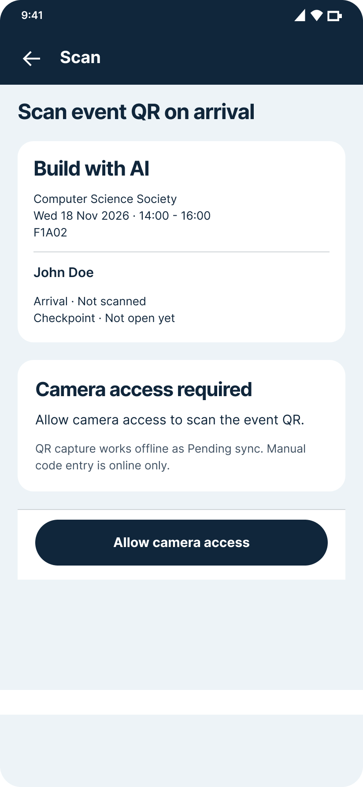](images/wireframes/student-camera-required.png) [Figma frame](https://www.figma.com/design/Um4ZLQMFP2mEoEEnYOL8oM/Mobile-Device-Programming?node-id=147-3) | **Camera permission denied** [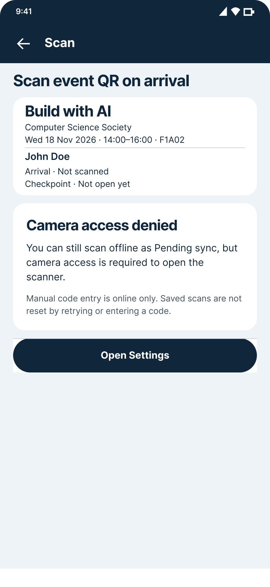](images/wireframes/student-camera-denied.png) [Figma frame](https://www.figma.com/design/Um4ZLQMFP2mEoEEnYOL8oM/Mobile-Device-Programming?node-id=147-56) |
| **QR unreadable** [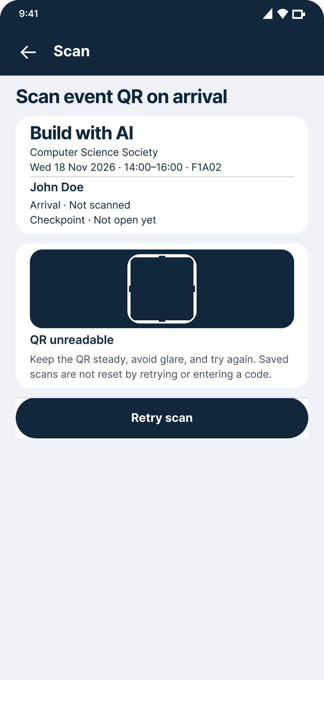](images/wireframes/student-qr-unreadable.png) [Figma frame](https://www.figma.com/design/Um4ZLQMFP2mEoEEnYOL8oM/Mobile-Device-Programming?node-id=147-109) | **QR expired** [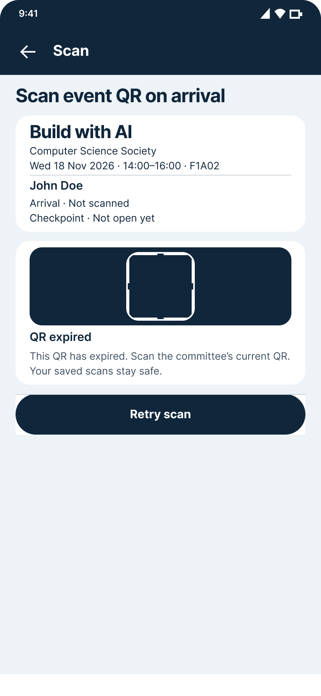](images/wireframes/student-qr-expired.png) [Figma frame](https://www.figma.com/design/Um4ZLQMFP2mEoEEnYOL8oM/Mobile-Device-Programming?node-id=147-169) |

Manual codes and connection recovery

| Screen | Screen |
|---|---|
| **Enter arrival code online** [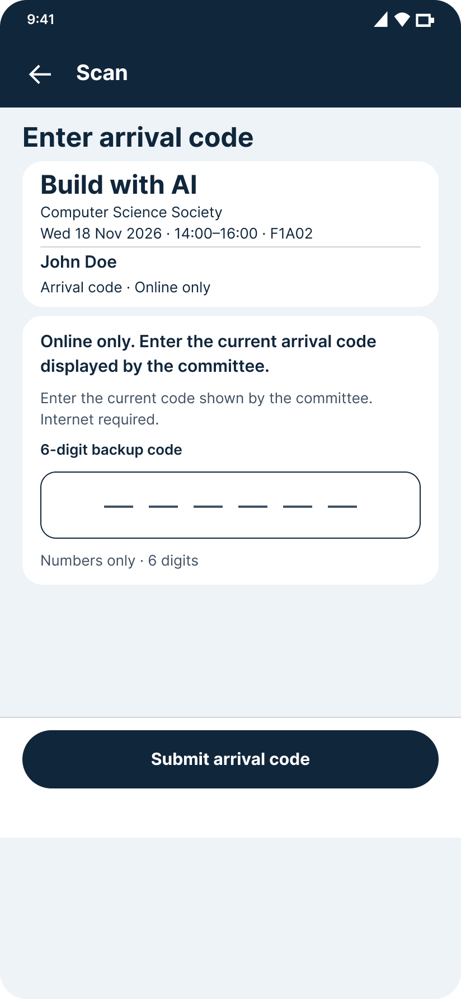](images/checkpoint/student-arrival-code.png) [Figma frame](https://www.figma.com/design/Um4ZLQMFP2mEoEEnYOL8oM/Mobile-Device-Programming?node-id=115-283) | **Enter checkpoint code online** [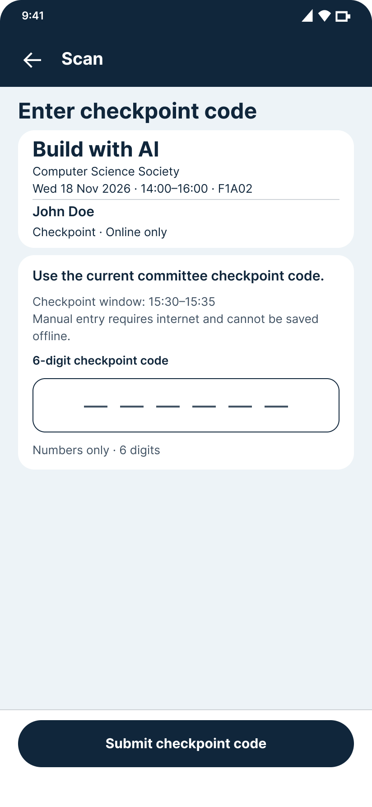](images/wireframes/student-checkpoint-code-entry.png) [Figma frame](https://www.figma.com/design/Um4ZLQMFP2mEoEEnYOL8oM/Mobile-Device-Programming?node-id=149-63) |
| **Arrival code — connection lost** [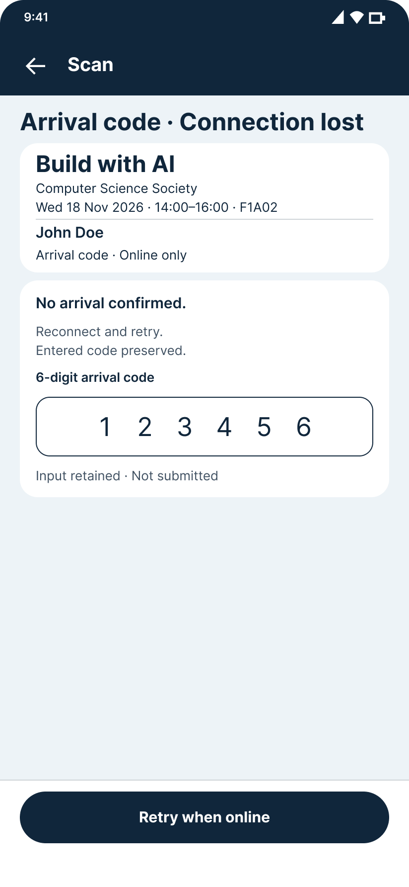](images/wireframes/student-arrival-code-connection-lost.png) [Figma frame](https://www.figma.com/design/Um4ZLQMFP2mEoEEnYOL8oM/Mobile-Device-Programming?node-id=149-126) | **Checkpoint code — connection lost** [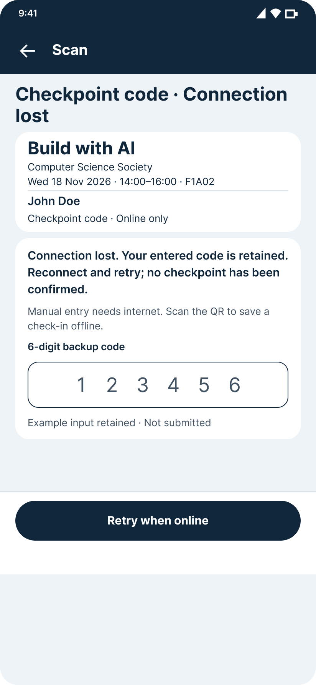](images/checkpoint/student-checkpoint-code.png) [Figma frame](https://www.figma.com/design/Um4ZLQMFP2mEoEEnYOL8oM/Mobile-Device-Programming?node-id=110-861) |
| **Checkpoint code — offline** [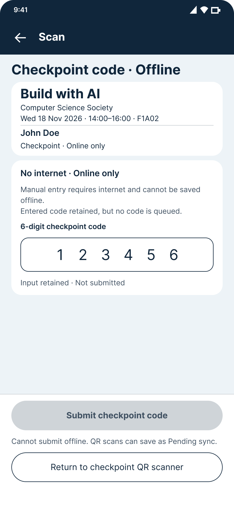](images/wireframes/student-checkpoint-code-offline.png) [Figma frame](https://www.figma.com/design/Um4ZLQMFP2mEoEEnYOL8oM/Mobile-Device-Programming?node-id=149-189) |   |

Offline sync and attendance outcomes

| Screen | Screen |
|---|---|
| **Checkpoint saved — pending sync** [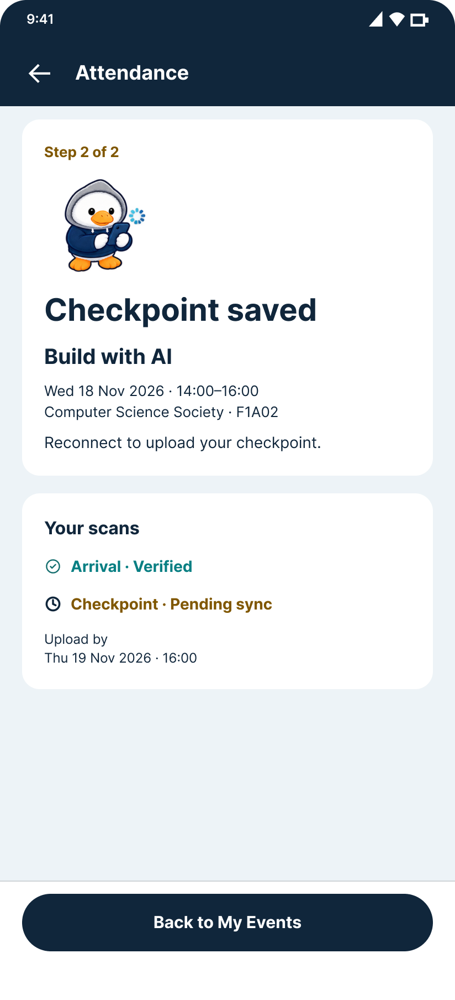](images/checkpoint/student-checkpoint-pending-sync.png) [Figma frame](https://www.figma.com/design/Um4ZLQMFP2mEoEEnYOL8oM/Mobile-Device-Programming?node-id=110-705) | **Both scans saved — pending sync** [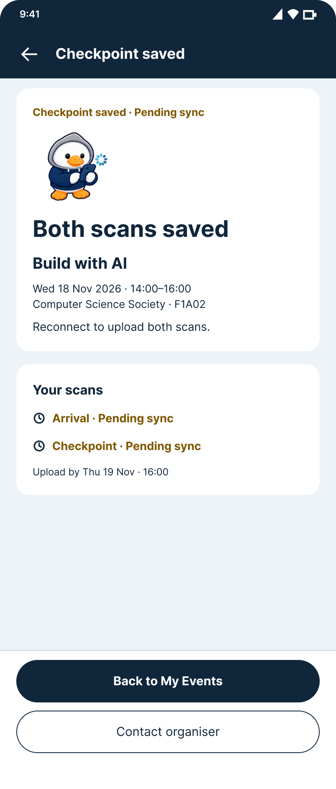](images/checkpoint/student-both-scans-pending-sync.png) [Figma frame](https://www.figma.com/design/Um4ZLQMFP2mEoEEnYOL8oM/Mobile-Device-Programming?node-id=115-250) |
| **Sync in progress** [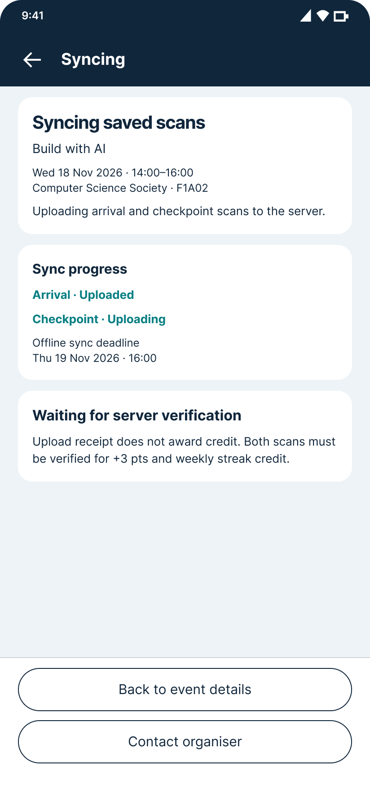](images/wireframes/student-sync-in-progress.png) [Figma frame](https://www.figma.com/design/Um4ZLQMFP2mEoEEnYOL8oM/Mobile-Device-Programming?node-id=147-263) | **Uploaded — under review** [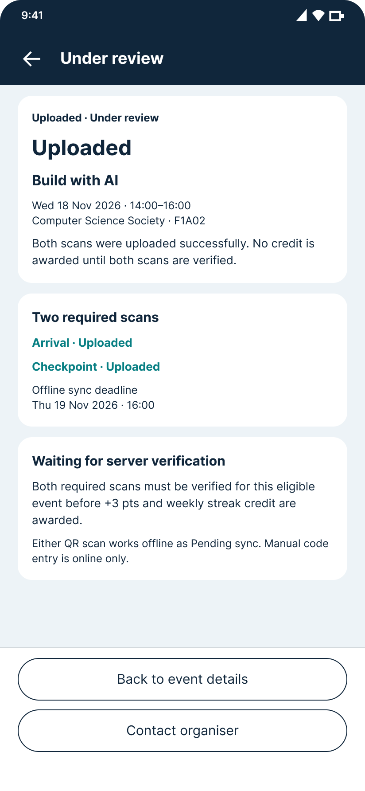](images/wireframes/student-under-review.png) [Figma frame](https://www.figma.com/design/Um4ZLQMFP2mEoEEnYOL8oM/Mobile-Device-Programming?node-id=147-293) |
| **Retry failed sync** [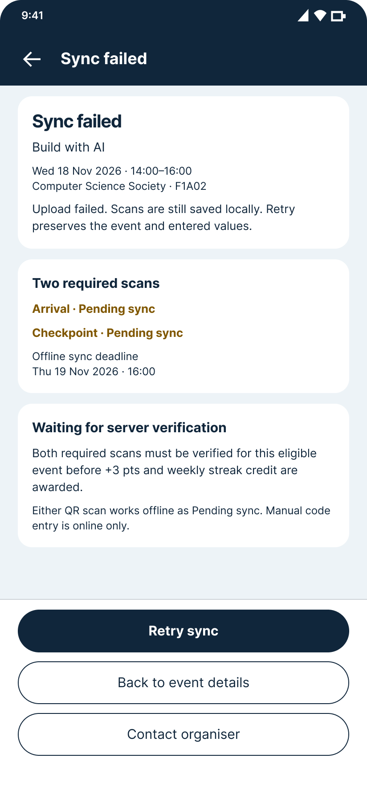](images/wireframes/student-sync-retry.png) [Figma frame](https://www.figma.com/design/Um4ZLQMFP2mEoEEnYOL8oM/Mobile-Device-Programming?node-id=147-325) | **Incomplete attendance** [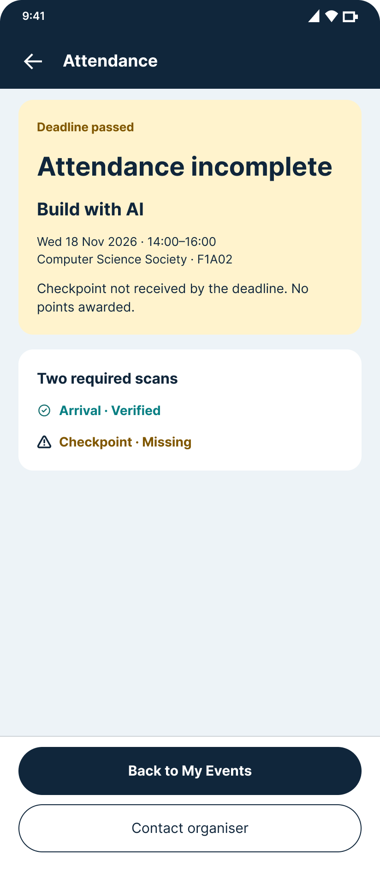](images/checkpoint/student-incomplete-attendance.png) [Figma frame](https://www.figma.com/design/Um4ZLQMFP2mEoEEnYOL8oM/Mobile-Device-Programming?node-id=110-809) |

### 5.6. Points and progress — R5, Feature 2

Verified attendance at an eligible event earns 3 points once. Verification requires all stages to pass or an authorised office decision. Progress shows verified attendance, points, interest stamps and the weekly streak. Pending scans earn zero, and an authorised correction can reverse an earlier award.

[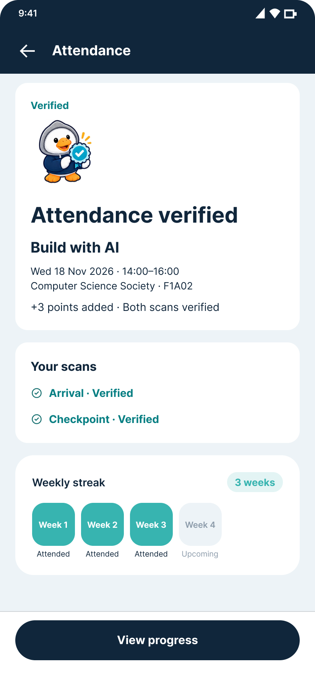](images/checkpoint/student-attendance-verified.png)

**Attendance verified — +3 pts** · [Figma frame](https://www.figma.com/design/Um4ZLQMFP2mEoEEnYOL8oM/Mobile-Device-Programming?node-id=110-757)

Progress and verified attendance

| Screen | Screen |
|---|---|
| **Your progress**  [Figma frame](https://www.figma.com/design/Um4ZLQMFP2mEoEEnYOL8oM/Mobile-Device-Programming?node-id=82-4257) | **Points correction**  [Figma frame](https://www.figma.com/design/Um4ZLQMFP2mEoEEnYOL8oM/Mobile-Device-Programming?node-id=82-3635) |

### 5.7. Profile and settings — R6

Students view their account and update interests, notification preferences and privacy settings. The Profile attendance entry opens the relevant event stage.

**Student profile** · [Figma frame](https://www.figma.com/design/Um4ZLQMFP2mEoEEnYOL8oM/Mobile-Device-Programming?node-id=82-4650)

Account and preferences

| Screen | Screen |
|---|---|
| **Privacy and settings**  [Figma frame](https://www.figma.com/design/Um4ZLQMFP2mEoEEnYOL8oM/Mobile-Device-Programming?node-id=82-5002) |   |

### 5.8. Committee entry and access — R6

Committee members begin at the [shared role picker](#51-student-entry-and-interests--r6). Sign-in checks the account’s assigned role and society. The prototype uses approved test accounts.

| Committee sign-in | Sign-in error | Access not authorised |
|---|---|---|
|  [Figma frame](https://www.figma.com/design/Um4ZLQMFP2mEoEEnYOL8oM/Mobile-Device-Programming?node-id=82-5695) |  [Figma frame](https://www.figma.com/design/Um4ZLQMFP2mEoEEnYOL8oM/Mobile-Device-Programming?node-id=82-5771) |  [Figma frame](https://www.figma.com/design/Um4ZLQMFP2mEoEEnYOL8oM/Mobile-Device-Programming?node-id=82-5852) |

### 5.9. Committee dashboard — R1, R3, R6

The dashboard shows event and submission status, the next public event, and shortcuts to creating an event and managing check-in.

| Dashboard | Loading |
|---|---|
| **Committee dashboard**  [Figma frame](https://www.figma.com/design/Um4ZLQMFP2mEoEEnYOL8oM/Mobile-Device-Programming?node-id=82-5994) | **Dashboard loading**  [Figma frame](https://www.figma.com/design/Um4ZLQMFP2mEoEEnYOL8oM/Mobile-Device-Programming?node-id=82-5936) |

### 5.10. Event submissions — R1

Submissions groups drafts, pending reviews, decisions and approved events. Withdrawing a pending submission returns the same event to an editable draft. A final rejection shows the reason and closes the submission. Committee members can update submissions marked Changes requested and cancel an approved event. The flow shows progress, retry and confirmed outcomes.

**Submissions** · [Figma frame](https://www.figma.com/design/Um4ZLQMFP2mEoEEnYOL8oM/Mobile-Device-Programming?node-id=147-1040)

Create and submit an event

| Screen | Screen |
|---|---|
| **Create event**  [Figma frame](https://www.figma.com/design/Um4ZLQMFP2mEoEEnYOL8oM/Mobile-Device-Programming?node-id=82-6529) | **Submitting**  [Figma frame](https://www.figma.com/design/Um4ZLQMFP2mEoEEnYOL8oM/Mobile-Device-Programming?node-id=147-1117) |
| **Submission retry**  [Figma frame](https://www.figma.com/design/Um4ZLQMFP2mEoEEnYOL8oM/Mobile-Device-Programming?node-id=147-1170) | **Submission success**  [Figma frame](https://www.figma.com/design/Um4ZLQMFP2mEoEEnYOL8oM/Mobile-Device-Programming?node-id=147-1227) |

Review and withdrawal

| Screen | Screen |
|---|---|
| **Changes requested**  [Figma frame](https://www.figma.com/design/Um4ZLQMFP2mEoEEnYOL8oM/Mobile-Device-Programming?node-id=82-6355) | **Pending review**  [Figma frame](https://www.figma.com/design/Um4ZLQMFP2mEoEEnYOL8oM/Mobile-Device-Programming?node-id=82-6434) |
| **Confirm withdrawal**  [Figma frame](https://www.figma.com/design/Um4ZLQMFP2mEoEEnYOL8oM/Mobile-Device-Programming?node-id=147-1276) | **Withdrawing**  [Figma frame](https://www.figma.com/design/Um4ZLQMFP2mEoEEnYOL8oM/Mobile-Device-Programming?node-id=147-1333) |
| **Returned to draft**  [Figma frame](https://www.figma.com/design/Um4ZLQMFP2mEoEEnYOL8oM/Mobile-Device-Programming?node-id=147-1386) | **Withdrawal retry**  [Figma frame](https://www.figma.com/design/Um4ZLQMFP2mEoEEnYOL8oM/Mobile-Device-Programming?node-id=147-1443) |

| **Rejected submission**  [Figma frame](https://www.figma.com/design/Um4ZLQMFP2mEoEEnYOL8oM/Mobile-Device-Programming?node-id=174-96) |  |

Approved event cancellation

| Screen | Screen |
|---|---|
| **Approved event**  [Figma frame](https://www.figma.com/design/Um4ZLQMFP2mEoEEnYOL8oM/Mobile-Device-Programming?node-id=82-6231) | **Confirm event cancellation**  [Figma frame](https://www.figma.com/design/Um4ZLQMFP2mEoEEnYOL8oM/Mobile-Device-Programming?node-id=82-6643) |
| **Cancelling event**  [Figma frame](https://www.figma.com/design/Um4ZLQMFP2mEoEEnYOL8oM/Mobile-Device-Programming?node-id=149-523) | **Cancellation confirmed**  [Figma frame](https://www.figma.com/design/Um4ZLQMFP2mEoEEnYOL8oM/Mobile-Device-Programming?node-id=147-1500) |
| **Cancellation retry**  [Figma frame](https://www.figma.com/design/Um4ZLQMFP2mEoEEnYOL8oM/Mobile-Device-Programming?node-id=147-1557) |   |

### 5.11. Committee Events — R1, R2, R3

Upcoming events link to bookings. Past events link to attendance summaries.

**Upcoming events** · [Figma frame](https://www.figma.com/design/Um4ZLQMFP2mEoEEnYOL8oM/Mobile-Device-Programming?node-id=82-6943)

Upcoming and past events

| Screen | Screen |
|---|---|
| **Past events**  [Figma frame](https://www.figma.com/design/Um4ZLQMFP2mEoEEnYOL8oM/Mobile-Device-Programming?node-id=82-6823) |   |

### 5.12. Check-in — R3, R4, R5

The Committee displays the rotating arrival or checkpoint QR with the short-lived backup code. The checkpoint view shows the countdown and an explicit close confirmation. An offline Committee device pauses code refresh until reconnection. Students can still upload previously saved scans during the sync window.

**Active arrival QR** · [Figma frame](https://www.figma.com/design/Um4ZLQMFP2mEoEEnYOL8oM/Mobile-Device-Programming?node-id=110-925)

QR display and checkpoint closure

| Screen | Screen |
|---|---|
| **Checkpoint open**  [Figma frame](https://www.figma.com/design/Um4ZLQMFP2mEoEEnYOL8oM/Mobile-Device-Programming?node-id=110-1064) | **Offline — checkpoint QR paused**  [Figma frame](https://www.figma.com/design/Um4ZLQMFP2mEoEEnYOL8oM/Mobile-Device-Programming?node-id=110-1203) |
| **Confirm checkpoint closure**  [Figma frame](https://www.figma.com/design/Um4ZLQMFP2mEoEEnYOL8oM/Mobile-Device-Programming?node-id=147-1618) | **Checkpoint closed**  [Figma frame](https://www.figma.com/design/Um4ZLQMFP2mEoEEnYOL8oM/Mobile-Device-Programming?node-id=147-1665) |

### 5.13. Bookings and attendance — R2, R3, R4, R5

Before check-in opens, the bookings list shows reservations as **Booked**. The Committee can then view live attendance, claims awaiting sync and attendance outcomes. Missing uploads remain provisional through the sync window. At the deadline, either verified stage with the other required stage missing becomes **Incomplete attendance**. **No-show** applies when the server receives no claim. If an organiser never opens the required checkpoint, students with verified arrival go to office review. **Under review** remains unresolved until an authorised decision.

**Event bookings** · [Figma frame](https://www.figma.com/design/Um4ZLQMFP2mEoEEnYOL8oM/Mobile-Device-Programming?node-id=174-2)

Attendance lists and summaries

| Screen | Screen |
|---|---|
| **Live attendee list**  [Figma frame](https://www.figma.com/design/Um4ZLQMFP2mEoEEnYOL8oM/Mobile-Device-Programming?node-id=110-1283) | **Awaiting sync**  [Figma frame](https://www.figma.com/design/Um4ZLQMFP2mEoEEnYOL8oM/Mobile-Device-Programming?node-id=115-347) |
| **Attendance summary**  [Figma frame](https://www.figma.com/design/Um4ZLQMFP2mEoEEnYOL8oM/Mobile-Device-Programming?node-id=110-1365) | **Final attendee list**  [Figma frame](https://www.figma.com/design/Um4ZLQMFP2mEoEEnYOL8oM/Mobile-Device-Programming?node-id=110-1440) |

### 5.14. Committee account — R6

Committee members can view their verified club access and confirm sign-out.

**Committee account** · [Figma frame](https://www.figma.com/design/Um4ZLQMFP2mEoEEnYOL8oM/Mobile-Device-Programming?node-id=82-8212)

Committee account and sign-out

| Screen | Screen |
|---|---|
| **Sign-out confirmation**  [Figma frame](https://www.figma.com/design/Um4ZLQMFP2mEoEEnYOL8oM/Mobile-Device-Programming?node-id=82-8267) |   |

[Back to project overview](../README.md)
